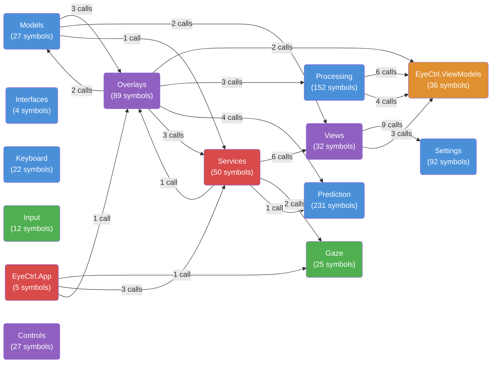
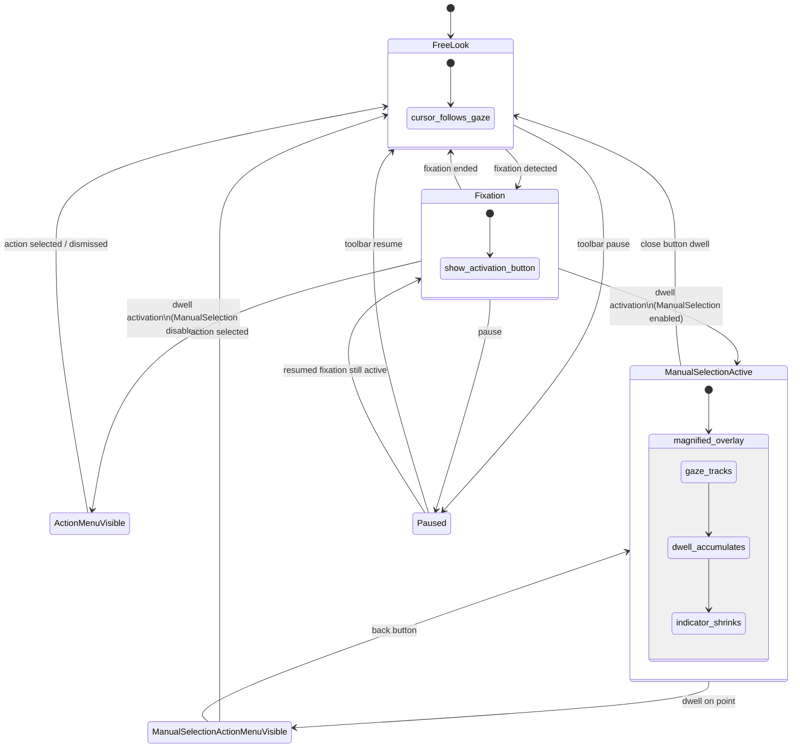
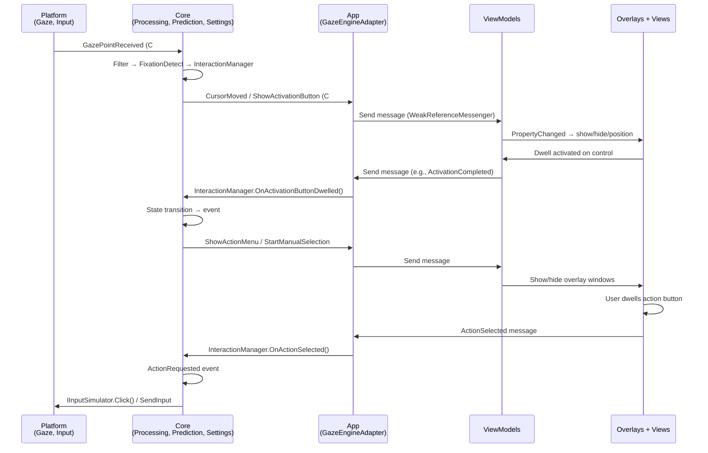

# EyeCtrl Architecture

> Generated from the GitNexus knowledge graph: **4,875 symbols**, **10,838 relationships**, **251 execution flows** across **168 functional clusters**.

EyeCtrl is a gaze-controlled desktop interaction system built on .NET 10 / WPF. It replaces the physical mouse with eye tracking, using dwell-based selection to perform clicks, scrolls, drags, and keyboard input.

## Functional Areas

The knowledge graph auto-detected 14 functional areas (communities) via Leiden clustering. Tests and fixtures excluded.

| Area | Symbols | Cohesion | Description |
|------|---------|----------|-------------|
| **Prediction** | 231 | 0.87 | Word prediction engine: n-gram + bigram models, fuzzy edit distance, language detection, capitalization |
| **Processing** | 152 | 0.72 | Core gaze pipeline: filters (OneEuro, EMA), fixation/dwell detection, centroid tracking, state machine, gap interpolation |
| **Settings** | 92 | 0.67 | JSON-persisted settings hierarchy: 9 sub-settings objects with range validation and camelCase serialization |
| **Overlays** | 89 | 0.81 | WPF overlay windows: cursor circle, activation button, action menu, manual selection (magnified preview), toolbar, keyboard |
| **Services** | 50 | 0.76 | App-layer services: EventCoordinator (message → overlay routing), GazeEngineAdapter (Core ↔ ViewModel bridge), AppBootstrapper (DI), ManualSelectionDwellService |
| **EyeCtrl.ViewModels** | 36 | 0.81 | MVVM ViewModels (CommunityToolkit.Mvvm): CursorCircleVM, ActivationButtonVM, ManualSelectionOverlayVM, ActionMenuVM, ToolbarVM, KeyboardVM, SettingsVM |
| **Views** | 32 | 0.87 | Settings window UI (dwell-friendly controls), toolbar window, tray icon, splash screen |
| **Models** | 27 | 0.87 | Core value types: PhysicalPoint, LogicalPoint, GazePoint, NormalizedPoint, InteractionAction, ViewPosition, InteractionState |
| **Controls** | 27 | 0.96 | Custom dwell-friendly WPF controls: DwellButton, DwellToggle, DwellSlider, DwellComboBox, DwellColorPicker, ColorBlend |
| **Gaze** | 25 | 0.91 | Eye tracker providers: IGazeProvider interface, TobiiStreamEngineProvider (conditional), MouseGazeProvider (fallback) |
| **Keyboard** | 22 | 0.83 | JSON keyboard layouts (QWERTY, AZERTY, etc.), key definitions, layout loader |
| **Input** | 12 | 0.53 | Win32 P/Invoke: SendInput (mouse clicks, keystrokes, scroll), coordinate normalization |
| **EyeCtrl.App** | 5 | 0.47 | Application entry point: App.xaml startup, splash screen lifecycle |
| **Interfaces** | 4 | 1.00 | Core abstractions: IGazeProvider, IInputSimulator, IEventCoordinator, IOverlayManager |

## Inter-Area Call Graph



Arrows show the top inter-community `CALLS` edges from the graph. Edge labels are call counts.

## Project ↔ Area Mapping

| .NET Project | Primary Areas |
|-------------|---------------|
| `EyeCtrl.Core` | Processing, Prediction, Settings, Models, Interfaces, Keyboard |
| `EyeCtrl.Platform` | Gaze, Input |
| `EyeCtrl.ViewModels` | EyeCtrl.ViewModels |
| `EyeCtrl.App` | Services, Overlays, Views, Controls, EyeCtrl.App |

## Key Execution Flows

The graph contains 251 processes (execution flows). Top 5 by relevance, with step-by-step traces:

### 1. Gaze Engine Startup (`Start → GazePoint`)

4-step intra-community process:

| Step | Symbol | File |
|------|--------|------|
| 1 | `GazeEngine.Start()` | `src/EyeCtrl.Core/GazeEngine.cs` |
| 2 | `TobiiStreamEngineProvider.Start()` | `src/EyeCtrl.Platform/Gaze/TobiiStreamEngineProvider.cs` |
| 3 | `SubscribeGaze()` | `src/EyeCtrl.Platform/Gaze/TobiiStreamEngineProvider.cs` |
| 4 | `GazePoint` (data model) | `src/EyeCtrl.Core/Models/GazePoint.cs` |

### 2. Gaze Update → Dwell Position (`UpdateGaze → UpdatePosition`)

4-step intra-community process:

| Step | Symbol | File |
|------|--------|------|
| 1 | `SettingsWindow.UpdateGaze()` | `src/EyeCtrl.App/Views/SettingsWindow.xaml.cs` |
| 2 | `UpdateAllTargetPositions()` | `src/EyeCtrl.App/Views/SettingsWindow.xaml.cs` |
| 3 | `DwellControl.UpdatePosition()` | `src/EyeCtrl.App/Controls/DwellControl.cs` |
| 4 | `IDwellRegistrar.UpdatePosition()` | `src/EyeCtrl.Core/Processing/IDwellRegistrar.cs` |

### 3. Manual Selection Activation (`OnStartManualSelection → PhysicalPoint`)

3-step intra-community process:

| Step | Symbol | File |
|------|--------|------|
| 1 | `GazeEngineAdapter.OnStartManualSelection()` | `src/EyeCtrl.App/Services/GazeEngineAdapter.cs` |
| 2 | `ManualSelectionLayoutHelper.CalculateDisplayPoint()` | `src/EyeCtrl.ViewModels/Helpers/ManualSelectionLayoutHelper.cs` |
| 3 | `PhysicalPoint` construction | `src/EyeCtrl.Core/Models/PhysicalPoint.cs` |

### 4. Action Menu Display (`OnShowActionMenu → PhysicalPoint`)

3-step intra-community process:

| Step | Symbol | File |
|------|--------|------|
| 1 | `GazeEngineAdapter.OnShowActionMenu()` | `src/EyeCtrl.App/Services/GazeEngineAdapter.cs` |
| 2 | `ActionMenuLayoutHelper.CalculateDisplayPoint()` | `src/EyeCtrl.ViewModels/Helpers/ActionMenuLayoutHelper.cs` |
| 3 | `PhysicalPoint` construction | `src/EyeCtrl.Core/Models/PhysicalPoint.cs` |

### 5. Manual Selection Recapture (`Recapture → LogicalToPhysicalY`)

4-step intra-community process:

| Step | Symbol | File |
|------|--------|------|
| 1 | `ManualSelectionOverlayWindow.Recapture()` | `src/EyeCtrl.App/Overlays/ManualSelectionOverlayWindow.xaml.cs` |
| 2 | `CaptureAndDisplay()` | `src/EyeCtrl.App/Overlays/ManualSelectionOverlayWindow.xaml.cs` |
| 3 | `ScreenCaptureService.CaptureRegion()` | `src/EyeCtrl.App/Services/ScreenCaptureService.cs` |
| 4 | `DpiHelper.LogicalToPhysicalY()` | `src/EyeCtrl.Core/Services/DpiHelper.cs` |

## Interaction State Machine



**6 states:** FreeLook → Fixation → ActionMenuVisible / ManualSelectionActive → ManualSelectionActionMenuVisible / Paused

## Layers

```
┌──────────────────────────────────────────────────────────────────┐
│                     EyeCtrl.App (WPF Entry)                       │
│  ┌──────────┐   ┌──────────────┐   ┌──────────┐   ┌──────────┐  │
│  │ Overlays │◄──│ EventCoordin-│   │ TrayIcon │   │ GazeEng-  │  │
│  │(10 wind.)│   │ ator         │   │ Manager  │   │ ineAdapter│  │
│  └──────────┘   └──────┬───────┘   └──────────┘   └────┬─────┘  │
│                        │                                │        │
├────────────────────────┼────────────────────────────────┼────────┤
│       EyeCtrl.ViewModels (MVVM)                         │        │
│  ┌──────────┐ ┌───────┐ ┌─────────────┐ ┌───────────┐  │        │
│  │Cursor    │ │Activ- │ │ManualSel    │ │Action     │  │        │
│  │CircleVM  │ │BtnVM  │ │OverlayVM    │ │MenuVM     │  │        │
│  └──────────┘ └───────┘ └─────────────┘ └───────────┘  │        │
│  ┌──────────┐ ┌───────┐ ┌───────────┐                  │        │
│  │ToolbarVM │ │Keybrd │ │SettingsVM │                  │        │
│  │          │ │VM     │ │           │                  │        │
│  └──────────┘ └───────┘ └───────────┘                  │        │
├─────────────────────────────────────────────────────────┼────────┤
│                 EyeCtrl.Core (Domain)                   │        │
│  ┌────────────┐   ┌────────────────────────────┐       │        │
│  │ GazeEngine │   │ InteractionManager         │       │        │
│  │ (pipeline) │   │ (6-state FSM)              │       │        │
│  └─────┬──────┘   └─────────────┬──────────────┘       │        │
│        │                        │                       │        │
│  ┌─────┴────────────────────────┴───────────────────┐  │        │
│  │ FixationDetector   DwellDetector   DwellTarget   │  │        │
│  │ OneEuroFilter      GapInterpolator               │  │        │
│  │ FixationCentroidTracker                          │  │        │
│  └──────────────────────────────────────────────────┘  │        │
│  ┌──────────────────────────────────────────────────┐  │        │
│  │ WordPredictor (n-gram + bigram, 231 symbols)      │  │        │
│  │ KeyboardLayout (multi-lang JSON, 22 symbols)      │  │        │
│  │ SettingsService (JSON persistence, 92 symbols)    │  │        │
│  │ Models (PhysicalPoint, GazePoint, etc., 27 sym.)  │  │        │
│  └──────────────────────────────────────────────────┘  │        │
├──────────────────────────────────────────────────────────────────┤
│                 EyeCtrl.Platform (OS Bridge)                     │
│  ┌──────────────────────┐   ┌──────────────────────────────┐    │
│  │ IGazeProvider         │   │ IInputSimulator              │    │
│  │ ├─ TobiiStreamEngine  │   │ └─ Win32InputSimulator       │    │
│  │ └─ MouseGazeProvider  │   │    (SendInput P/Invoke)      │    │
│  └──────────────────────┘   └──────────────────────────────┘    │
└──────────────────────────────────────────────────────────────────┘
```

## Communication Flow



## Dependencies

| Dependency | Usage |
|------------|-------|
| CommunityToolkit.Mvvm 8.4.0 | `[ObservableProperty]` source generators, `WeakReferenceMessenger` |
| Microsoft.Extensions.DependencyInjection | DI container (`ServiceCollection`, `ServiceProvider`) |
| Serilog | Structured logging, daily rolling files, 7-day retention |
| System.Text.Json | Settings serialization with `JsonNamingPolicy.CamelCase` |
| Tobii Stream Engine SDK | Conditional (`#if TOBII_AVAILABLE`), only when SDK DLLs present |
| BenchmarkDotNet | Standalone benchmarks (not in solution, not in graph count) |

## Statistics (from Knowledge Graph)

| Metric | Count |
|--------|-------|
| Total symbols | 4,875 |
| Relationships | 10,838 |
| Communities | 168 |
| Processes (execution flows) | 251 |
| Source files indexed | 298 |
