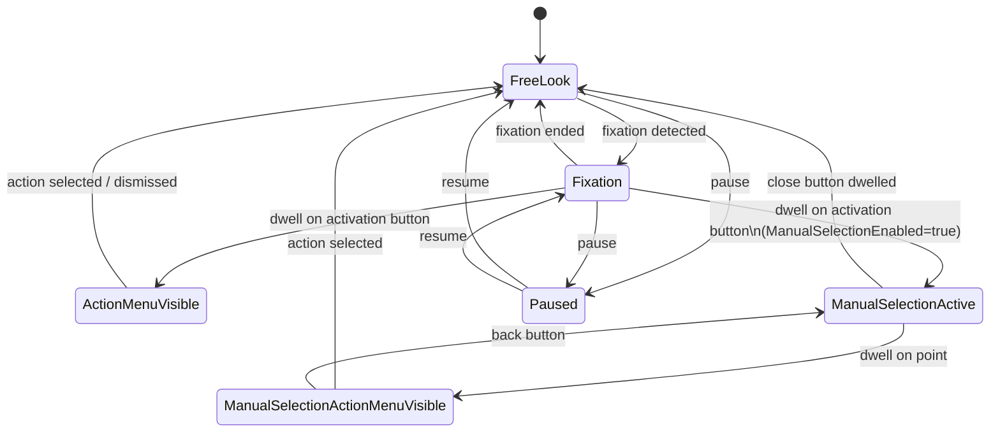

# EyeCtrl Architecture

EyeCtrl is a gaze-controlled desktop interaction system built on .NET 10 / WPF. It replaces the physical mouse with eye tracking, using dwell-based selection to perform clicks, scrolls, drags, and keyboard input — all without touching a mouse or keyboard.

## Overview

```
┌──────────────────────────────────────────────────────────────────┐
│                     EyeCtrl.app (WPF Entry)                       │
│  ┌──────────┐  ┌──────────────┐  ┌──────────┐  ┌─────────────┐  │
│  │ Overlays │  │ EventCoordin-│  │ TrayIcon │  │ GazeEngine  │  │
│  │(8 windows)│◄─│ ator         │  │ Manager  │  │ Adapter     │  │
│  └──────────┘  └──────┬───────┘  └──────────┘  └──────┬──────┘  │
│                       │                                │         │
├───────────────────────┼────────────────────────────────┼─────────┤
│       EyeCtrl.ViewModels (MVVM)                        │         │
│  ┌────────────┐ ┌──────────┐ ┌───────────┐ ┌────────┐ │         │
│  │CursorCircle│ │Activation│ │ManualSel  │ │Action  │ │         │
│  │VM          │ │ButtonVM  │ │VM         │ │MenuVM  │ │         │
│  └────────────┘ └──────────┘ └───────────┘ └────────┘ │         │
│  ┌────────────┐ ┌──────────┐ ┌───────────┐            │         │
│  │ToolbarVM   │ │KeyboardVM│ │SettingsVM │            │         │
│  └────────────┘ └──────────┘ └───────────┘            │         │
├────────────────────────────────────────────────────────┼─────────┤
│                 EyeCtrl.Core (Domain)                  │         │
│  ┌──────────────┐  ┌────────────────────────────────┐ │         │
│  │  GazeEngine  │  │  InteractionManager            │ │         │
│  │  (pipeline)  │  │  (state machine, 6 states)     │ │         │
│  └──────┬───────┘  └───────────────┬────────────────┘ │         │
│         │                          │                   │         │
│  ┌──────┴──────────────────────────┴──────────────┐   │         │
│  │ FixationDetector  DwellDetector  DwellTarget   │   │         │
│  │ OneEuroFilter     GapInterpolator              │   │         │
│  │ FixationCentroidTracker                        │   │         │
│  └────────────────────────────────────────────────┘   │         │
│  ┌─────────────────────────────────────────────────┐ │         │
│  │ Settings (9 sub-objects, JSON persistence)       │ │         │
│  │ Word Prediction (n-gram + bigram + fuzzy match)  │ │         │
│  │ Keyboard Layouts (JSON-based, multi-lang)        │ │         │
│  │ Data Models (PhysicalPoint, InteractionAction)   │ │         │
│  └─────────────────────────────────────────────────┘ │         │
├──────────────────────────────────────────────────────────────────┤
│                 EyeCtrl.Platform (OS Bridge)                     │
│  ┌──────────────────────┐    ┌──────────────────────────────┐   │
│  │ IGazeProvider         │    │ IInputSimulator              │   │
│  │ ├─ TobiiStreamEngine  │    │ └─ Win32InputSimulator       │   │
│  │ └─ MouseGazeProvider  │    │    (SendInput P/Invoke)      │   │
│  └──────────────────────┘    └──────────────────────────────┘   │
└──────────────────────────────────────────────────────────────────┘
```

## Layers

### EyeCtrl.Core — Domain Logic

Framework-agnostic pure logic. No WPF, no Win32 dependencies.

| Component | Purpose |
|-----------|---------|
| **GazeEngine** | Core gaze pipeline: receives raw samples, runs filter + gap interpolation, feeds fixation/dwell detectors, fires `CursorMoved`, delegates interaction to `InteractionManager` |
| **InteractionManager** | State machine managing the interaction lifecycle (6 states: FreeLook, Fixation, ActionMenuVisible, ManualSelectionActive, ManualSelectionActionMenuVisible, Paused). Fires events consumed by `GazeEngineAdapter` |
| **FixationDetector** | Detects stable gaze within a radius for a configurable duration (default 300ms) |
| **FixationCentroidTracker** | Online Welford mean of gaze positions during fixation. Velocity-gated stable centroid |
| **DwellDetector** | Hit-test dwell engine. Maintains concurrent dictionary of `DwellTarget`s. Fires `TargetActivated` / `TargetProgress`. Supports cooldown |
| **DwellTarget** | Circular target with center, radius, dwell threshold |
| **OneEuroFilter** | Adaptive low-pass filter — strong smoothing at low velocity, responsive at high velocity (default) |
| **GapInterpolator** | Handles missing gaze samples: short gaps repeat last filtered position; long gaps feed raw data |
| **SettingsService** | JSON persistence to `%APPDATA%/EyeCtrl/settings.json` with 500ms debounced saves |
| **WordPredictor** | N-gram + bigram prediction with user dictionary learning, fuzzy edit distance, capitalization |
| **KeyboardLayout** | JSON-based multi-language keyboard layout definitions |
| **DpiHelper** | Singleton for LogicalPoint ↔ PhysicalPoint conversion |

### EyeCtrl.Platform — OS/SDK Bridge

Contains `unsafe` blocks and P/Invoke for Win32 interaction.

| Component | Purpose |
|-----------|---------|
| **IGazeProvider** | Interface for eye tracker input (`Start()`, `Stop()`, `GazePointReceived` event) |
| **TobiiStreamEngineProvider** | Conditionally compiled (`#if TOBII_AVAILABLE`). Wraps Tobii Stream Engine SDK |
| **MouseGazeProvider** | Fallback: uses mouse cursor position as gaze data |
| **IInputSimulator** | Interface for mouse/keyboard simulation |
| **Win32InputSimulator** | P/Invoke `SendInput` with `MOUSEINPUT`/`KEYBDINPUT` structures |

### EyeCtrl.ViewModels — MVVM Layer

Uses CommunityToolkit.Mvvm 8.4.0 with `[ObservableProperty]` source generators. Communication via `WeakReferenceMessenger`.

| ViewModel | Purpose |
|-----------|---------|
| **CursorCircleViewModel** | Gaze cursor ring position, visibility, styling |
| **ActivationButtonViewModel** | Dwell activation ring around fixation point |
| **ManualSelectionOverlayViewModel** | Magnified zoom overlay (center, radius, magnification, side buttons) |
| **ManualSelectionGazeIndicatorViewModel** | Gaze dot within the manual selection overlay |
| **ActionMenuViewModel** | Radial action menu (left click, right click, scroll, drag, etc.) |
| **ToolbarViewModel** | Floating/docked toolbar (pause, keyboard, settings, manual selection toggle) |
| **KeyboardViewModel** | Virtual keyboard with word predictions and emoji grid |
| **SettingsViewModel** | Settings pages with dwell-friendly controls |

### EyeCtrl.App — WPF Entry Point

| Component | Purpose |
|-----------|---------|
| **App.xaml.cs** | Application lifecycle: splash, DPI init, settings load, logging, DI, overlays, tray icon |
| **AppBootstrapper** | DI container setup (`BuildServiceProvider()`) — registers all singletons |
| **GazeEngineAdapter** | Bridge between Core events and MVVM messages. Marshals to UI thread via `Dispatcher.BeginInvoke()` |
| **EventCoordinator** | Central coordinator of property-change and message routing between ViewModels, overlays, and core |
| **ManualSelectionDwellService** | Dwell detection within the manual selection magnified overlay |
| **OverlayManager** | Creates and owns all 8 overlay window instances |
| **TrayIconManager** | System tray icon with context menu |
| **ScreenCaptureService** | Captures screen regions for manual selection magnified preview |

## Communication Mechanisms

| Mechanism | Direction | Purpose |
|-----------|-----------|---------|
| C# events | Core → Core, Core → Adapter | `GazeEngine.CursorMoved`, `InteractionManager.ShowActivationButton`, etc. |
| `WeakReferenceMessenger` | Adapter → ViewModels, ViewModels → Adapter | `GazeCursorMovedMessage`, `StartManualSelectionMessage`, `ActionSelectedMessage`, etc. |
| `INotifyPropertyChanged` | ViewModels → EventCoordinator | Drives overlay window show/hide/position |
| `IDwellRegistrar` | Controls → ViewModel DwellDetector | Controls self-register their dwell targets |

## Gaze Pipeline

```
IGazeProvider.GazePointReceived (raw sample)
  │
  ▼
GapInterpolator
  ├─ Valid → IGazeFilter.Filter() → filtered position
  └─ Gap within threshold → repeat last filtered
  │
  ▼
CursorMoved event (always fired)
  ├─► FixationCentroidTracker.Update()  →  online mean, velocity-gated
  ├─► If FreeLook: IInputSimulator.MoveCursor(filtered)
  └─► If not suppressed:
         FixationDetector.Update(gazePoint, timestamp)
           └─ stable within radius for fixationDetectionMs → FixationStarted
           └─ gaze leaves radius → FixationEnded
```

**Filters** (selectable via `CursorSettings.FilterMode`):
- `Direct` — no filtering
- `Smoothed` — exponential moving average
- `SmoothedWithSnapping` — EMA (snap not yet implemented)
- `OneEuro` — adaptive low-pass (default)

## Interaction State Machine



**6 states:**
1. **FreeLook** — cursor follows gaze, no fixation
2. **Fixation** — gaze stable, activation button shown
3. **ActionMenuVisible** — action menu shown (left click, right click, double click, drag, scroll)
4. **ManualSelectionActive** — magnified overlay active for precise positioning
5. **ManualSelectionActionMenuVisible** — action menu with "back" option after manual selection dwell
6. **Paused** — cursor frozen, toolbar remains responsive

## Key Execution Flows

### 1. Direct Click Flow

```
User fixates → FixationDetector.FixationStarted
  → InteractionManager.OnFixationStarted() → state=Fixation
  → ShowActivationButton → ActivationButtonWindow shown
User dwells activation button → ActivationCompletedMessage
  → InteractionManager.OnActivationButtonDwelled()
  → ShowActionMenu(event) → ActionMenuWindow shown
User dwells action (e.g. LeftClick) → ActionSelectedMessage
  → InteractionManager.OnActionSelected(LeftClick)
  → ActionRequested(LeftClick, point) → Win32InputSimulator.Click()
  → EndManualSelection → clean up → state=FreeLook
```

### 2. Manual Selection Flow

```
User fixates → FixationStarted → ActivationButton shown
User dwells activation button → since ManualSelectionEnabled=true
  → StartManualSelection(fixationPoint)
  → ManualSelectionOverlay shown (magnified screen capture)
  → ManualSelectionGazeIndicator shown
  → ManualSelectionDwellService starts dwell detector + grace period (500ms)
Gaze moves within magnified circle ~30Hz
  → GazeCursorMovedMessage → dwell accumulates → indicator shrinks
  → if gaze leaves circle → dwell resets → indicator back to full size
Dwell completes → ManualSelectionDwellCompletedMessage
  → EventCoordinator de-magnifies coordinates to real screen space
  → InteractionManager.OnManualSelectionDwell()
  → ActionMenu shown at precise point
User selects action → ActionRequested → actual input → state=FreeLook
```

### 3. Toolbar Interaction Flow

```
Gaze moves over toolbar region ~30Hz
  → GazeCursorMovedMessage → ToolbarViewModel.DwellDetector.Update(gaze)
Toolbar stays responsive in ALL states (including Paused)
Each button is a DwellTarget with its own dwell threshold
User dwells toolbar button → TargetActivated
  → Pause: TogglePause() → state=Paused/FreeLook
  → Keyboard: ShowKeyboardMessage → KeyboardWindow shown
  → Settings: ShowSettingsMessage → SettingsWindow shown
  → ManualSelection: ManualSelectionToggledMessage → toggle enabled flag
```

### 4. Keyboard Input Flow

```
Keyboard shown → KeyboardWindow with multiple layout tabs
User gazes at keys → KeyboardViewModel.DwellDetector tracks all keys
User dwells key → KeyActivated → Win32InputSimulator sends keystroke
Word predictions update in real-time (n-gram + bigram)
User dwells prediction → replaces typed text with prediction
Emoji tab → emoji grid with dwell-to-insert
```

### 5. Settings Persistence Flow

```
SettingsWindow shown → SettingsWindowViewModel loads tabs
Each setting is a DwellToggle, DwellSlider, DwellComboBox, or DwellButton
User dwells control → setting value changed in EyeCtrlSettings model
  → SettingsService.ApplyAndSave() → debounced (500ms)
  → Serializes to JSON with CamelCasePolicy → writes to %APPDATA%/EyeCtrl/settings.json
  → Corresponding subsystem reads updated value (e.g., GazeEngine recreates filter)
Reset buttons → re-instantiate default settings object → copy properties → ApplyAndSave
Reset ALL → new EyeCtrlSettings() → manually copy all fields → ApplyAndSave
```

## Overlay Windows

All overlays extend `OverlayWindow` (WPF `Window` with `WS_EX_TOOLWINDOW | WS_EX_NOACTIVATE`).

| Window | File | Purpose |
|--------|------|---------|
| `CursorCircleWindow` | `Overlays/CursorCircleWindow.xaml.cs` | Green ring following gaze cursor |
| `ActivationButtonWindow` | `Overlays/ActivationButtonWindow.xaml.cs` | Dwell ring around fixation point |
| `ActionMenuWindow` | `Overlays/ActionMenuWindow.xaml.cs` | Radial menu with action buttons |
| `ManualSelectionOverlayWindow` | `Overlays/ManualSelectionOverlayWindow.xaml.cs` | Magnified circular screen capture |
| `ManualSelectionSideButtonWindow` | `Overlays/ManualSelectionSideButtonWindow.xaml.cs` | Close/Recapture buttons |
| `ManualSelectionGazeIndicatorWindow` | `Overlays/ManualSelectionGazeIndicatorWindow.xaml.cs` | Gaze dot inside magnification |
| `ToolbarWindow` | `Overlays/ToolbarWindow.xaml.cs` | Floating/docked toolbar |
| `KeyboardWindow` | `Overlays/KeyboardWindow.xaml.cs` | Virtual keyboard |
| `SettingsWindow` | `Views/SettingsWindow.xaml.cs` | Settings pages |
| `SplashWindow` | `Overlays/SplashWindow.xaml.cs` | Startup splash (skipped in test mode) |

## Custom Dwell Controls

All inherit from `DwellControl`, self-register with `IDwellRegistrar` (owned by overlay ViewModel's `DwellDetector`).

| Control | File | Purpose |
|---------|------|---------|
| `DwellButton` | `Controls/DwellButton.cs` | Dwell-activated button with Action callback |
| `DwellToggle` | `Controls/DwellToggle.cs` | Boolean toggle with checkbox indicator |
| `DwellSlider` | `Controls/DwellSlider.cs` | Slider with + and − dwell buttons |
| `DwellComboBox` | `Controls/DwellComboBox.cs` | Row of mutually-exclusive dwell buttons |
| `DwellColorPicker` | `Controls/DwellColorPicker.cs` | Color swatches with dwell selection |
| `DwellLabel` | `Controls/DwellLabel.cs` | Read-only text with optional dwell |

## Coordinate System

All gaze coordinates use **physical screen pixels** (device pixels). Types enforce safe conversion:

| Type | Space | Usage |
|------|-------|-------|
| `PhysicalPoint` (record struct) | Physical pixels | Primary coordinate in Core, Platform, and messages |
| `LogicalPoint` (record struct) | WPF DIPs | Overlay positioning after DPI conversion |
| `NormalizedPoint` (record struct) | Win32 0–65535 | `SendInput` mouse absolute positioning |
| `GazePoint` (record) | Physical + timestamp | Raw gaze data with `IsValid` flag |
| `ViewPosition` (enum) | N/A | `AtGaze` / `AtCenter` — overlay placement mode |

## Settings Structure

```
EyeCtrlSettings (root)
├── CursorSettings         (filter mode, smoothing, snap, circle style)
├── DwellSettings          (fixation/dwell thresholds, radius)
├── ManualSelectionSettings (enabled, radius, magnification, grace period)
├── ActionMenuSettings     (visible actions)
├── KeyboardSettings       (active layout, key size, prediction, screen edge)
├── ToolbarSettings        (docked state, docked edge, size)
├── ThemeSettings          (mode, overlay opacity, high contrast)
├── GeneralSettings        (start on boot, start paused)
└── ViewPosition           (AtGaze / AtCenter — shared for all views)
```

## Dependencies

| Dependency | Usage |
|------------|-------|
| CommunityToolkit.Mvvm 8.4.0 | `[ObservableProperty]` source generators, `WeakReferenceMessenger` |
| Microsoft.Extensions.DependencyInjection | DI container (`ServiceCollection`, `ServiceProvider`) |
| Serilog | Structured logging, daily rolling files, 7-day retention |
| System.Text.Json | Settings serialization/deserialization |
| Tobii Stream Engine SDK | Conditional (`#if TOBII_AVAILABLE`), only when SDK DLLs present |
| BenchmarkDotNet | Standalone benchmarks project (not in solution) |
