# EyeCtrl Architecture

> Generated from the GitNexus knowledge graph (5,722 symbols, 12,863 relationships, 299 execution flows).

## Overview

EyeCtrl is a WPF desktop application for eye-tracking-based computer control. It enables gaze-driven cursor movement, dwell-to-click interaction, an on-screen keyboard with word prediction, and a suite of overlay interfaces. The system follows a four-layer architecture with MVVM pattern and dependency injection via `Microsoft.Extensions.DependencyInjection`.

| Project | Layer | Technology |
|---------|-------|------------|
| `EyeCtrl.Core` | Domain Logic | .NET 10, framework-agnostic |
| `EyeCtrl.Platform` | OS/SDK Bridge | `unsafe` Win32, conditional Tobii SDK |
| `EyeCtrl.ViewModels` | MVVM Layer | CommunityToolkit.Mvvm v8.4.0 |
| `EyeCtrl.App` | WPF Entrypoint | `UseWPF` + `UseWindowsForms` |

## Functional Areas

The knowledge graph identifies 197 communities (functional areas). Below are the major ones, grouped by architectural concern:

### 1. Gaze Processing Pipeline (`EyeCtrl.Core/Processing/`)

The core signal processing chain that converts raw eye tracker data into smooth cursor movement and detected fixations.

| Component | File | Purpose |
|-----------|------|---------|
| `GapInterpolator` | `GapInterpolator.cs` | Fills brief signal dropouts from the eye tracker to prevent cursor jitter |
| `OneEuroFilter` | `OneEuroFilter.cs` | Adaptive low-pass filter — smooth when slow, responsive when fast |
| `SmoothedFilter` | `SmoothedFilter.cs` | Alternative simple smoothing filter |
| `DirectFilter` | `DirectFilter.cs` | Passthrough (no filtering) |
| `GazeFilterFactory` | `GazeFilterFactory.cs` | Creates the appropriate filter based on `CursorSettings.FilterMode` |
| `FixationDetector` | `FixationDetector.cs` | Detects when the user holds gaze within a radius long enough |
| `FixationCentroidTracker` | `FixationCentroidTracker.cs` | Tracks the stable centroid of a fixation using velocity thresholding |
| `DwellDetector` | `DwellDetector.cs` | Manages dwell targets and fires dwell completion events |
| `DwellTarget` | `DwellTarget.cs` | Represents a single registered dwell-activatable UI element |
| `InteractionManager` | `InteractionManager.cs` | State machine governing the full interaction lifecycle |

### 2. Interaction State Machine

The `InteractionManager` drives all gaze-based interactions through these states:

```
FreeLook ──fixation──► Fixation ──activation dwell──► ActionMenuVisible
                                                          │
                       ┌──────────────────────────────────┘
                       ▼
              ManualSelectionActive ──precise dwell──► ManualSelectionActionMenuVisible
                       ▲                                        │
                       └────────── back ────────────────────────┘
                                                          │
                       Paused ◄── toggle pause ───────────┘
```

- **FreeLook**: Cursor follows gaze, fixation detection active
- **Fixation**: Activation button shown at fixation point
- **ActionMenuVisible**: Radial action menu (click, scroll, drag) shown
- **ManualSelectionActive**: Magnified area shown for precise targeting
- **ManualSelectionActionMenuVisible**: Action menu positioned at precise dwell point
- **Paused**: All interaction suspended (cursor still follows gaze for toolbar access)

### 3. Word Prediction (`EyeCtrl.Core/Prediction/`)

Multi-strategy prediction system combining n-gram statistics, trie-based sentence completion, and optional small language model inference.

| Component | File | Purpose |
|-----------|------|---------|
| `PredictionOrchestrator` | `PredictionOrchestrator.cs` | Merges results from all prediction strategies |
| `WordPredictor` | `WordPredictor.cs` | N-gram + fuzzy matching word completion |
| `BigramModel` | `BigramModel.cs` | Bigram word transition probabilities |
| `SentenceCompletionIndex` | `SentenceCompletionIndex.cs` | Trie-based prefix completion |
| `SmallLMPredictor` | `SmallLMPredictor.cs` | ONNX runtime neural language model |
| `LMTokenizer` | `LMTokenizer.cs` | Tokenizer for the LM model |
| `FuzzyEditDistance` | `FuzzyEditDistance.cs` | Edit-distance-based fuzzy matching with keyboard adjacency weighting |
| `FileDictionaryProvider` | `FileDictionaryProvider.cs` | Loads word frequency dictionaries from JSON |
| `LanguageDetector` | `LanguageDetector.cs` | Auto-detects system language for dictionary selection |
| `ModelDownloadService` | `ModelDownloadService.cs` | Downloads LM model files on demand |

### 4. On-Screen Keyboard (`EyeCtrl.Core/Keyboard/` + `EyeCtrl.App/Overlays/KeyboardWindow`)

JSON-driven keyboard layouts with sub-layouts, emoji support, and prediction integration.

| Component | File | Purpose |
|-----------|------|---------|
| `KeyboardLayout` | `KeyboardLayout.cs` | Parsed keyboard layout definition |
| `KeyboardLayoutLoader` | `KeyboardLayoutLoader.cs` | Loads layouts from JSON files |
| `KeyDefinition` | `KeyDefinition.cs` | Single key definition (label, action, size, modifiers) |
| `SubLayout` | `SubLayout.cs` | Shift/symbol layer within a layout |
| `EmojiData` | `EmojiData.cs` | Emoji grid data |
| `EmojiDataLoader` | `EmojiDataLoader.cs` | Loads emoji data from JSON |
| `RecentEmojiStore` | `RecentEmojiStore.cs` | Persists recently used emojis |

### 5. Settings (`EyeCtrl.Core/Settings/`)

Hierarchical JSON settings with validation and debounced persistence.

| Component | File | Purpose |
|-----------|------|---------|
| `SettingsService` | `SettingsService.cs` | JSON load/save with debounce and validation |
| `EyeCtrlSettings` | `EyeCtrlSettings.cs` | Root settings object (contains all sub-settings) |
| `ValidationHelper` | `ValidationHelper.cs` | Clamps and validates setting values |

Sub-settings: `CursorSettings`, `DwellSettings`, `KeyboardSettings`, `ActionMenuSettings`, `ToolbarSettings`, `ManualSelectionSettings`, `ThemeSettings`, `BackdropSettings`, `GeneralSettings`.

### 6. ViewModel Layer (`EyeCtrl.ViewModels/`)

CommunityToolkit.Mvvm ViewModels using `[ObservableProperty]` source generators and `WeakReferenceMessenger` for decoupled communication.

| ViewModel | Purpose |
|-----------|---------|
| `CursorCircleViewModel` | Cursor circle position and appearance |
| `ActivationButtonViewModel` | Fixation activation button state |
| `ActionMenuViewModel` | Radial action menu layout and dwell progress |
| `ToolbarViewModel` | Floating toolbar (pause, keyboard toggle, settings) |
| `KeyboardViewModel` | On-screen keyboard state, prediction display |
| `ManualSelectionOverlayViewModel` | Magnified selection area |
| `ManualSelectionGazeIndicatorViewModel` | Gaze indicator during manual selection |
| `GlassBackdropViewModel` | Screen backdrop overlay |
| `SettingsViewModel` | Settings page tree |
| `SettingsWindowViewModel` | Settings window chrome |

### 7. Overlay Windows (`EyeCtrl.App/Overlays/`)

Transparent WPF windows rendered over the desktop. Each window is paired with a ViewModel.

| Window | Purpose |
|--------|---------|
| `CursorCircleWindow` | Visual cursor indicator |
| `ActivationButtonWindow` | Dwell activation button at fixation point |
| `ActionMenuWindow` | Radial action menu |
| `ToolbarWindow` | Persistent toolbar (dockable) |
| `KeyboardWindow` | Full on-screen keyboard |
| `ManualSelectionOverlayWindow` | Magnified area for precise clicks |
| `ManualSelectionGazeIndicatorWindow` | Gaze dot during manual selection |
| `ManualSelectionSideButtonWindow` | Close/recapture buttons |
| `GlassBackdropWindow` | Dimming backdrop overlay |
| `SplashWindow` | Startup splash screen |
| `SettingsWindow` | Settings UI |

### 8. Platform Bridge (`EyeCtrl.Platform/`)

OS-specific implementations with conditional Tobii SDK support.

| Component | File | Purpose |
|-----------|------|---------|
| `GazeProviderFactory` | `Gaze/GazeProviderFactory.cs` | Creates gaze provider (Tobii SDK or mouse fallback) |
| `MouseGazeProvider` | `Gaze/MouseGazeProvider.cs` | Mouse cursor position as gaze proxy (development/fallback) |
| `TobiiStreamEngineProvider` | `Gaze/TobiiStreamEngineProvider.cs` | Tobii EyeX SDK integration (conditional on `TOBII_AVAILABLE`) |
| `Win32InputSimulator` | `Input/Win32InputSimulator.cs` | `SendInput` P/Invoke for mouse/keyboard simulation |
| `MouseCoordinateMapper` | `Input/MouseCoordinateMapper.cs` | DPI-aware coordinate mapping |
| `NativeMethods` | `Input/NativeMethods.cs` | Win32 API declarations |
| `VirtualKeys` | `Input/VirtualKeys.cs` | Virtual key code constants |

### 9. Application Services (`EyeCtrl.App/Services/`)

| Service | File | Purpose |
|---------|------|---------|
| `AppBootstrapper` | `AppBootstrapper.cs` | DI container configuration |
| `EventCoordinator` | `EventCoordinator.cs` | Wires PropertyChanged events and messages between VMs and overlay windows |
| `OverlayManager` | `OverlayManager.cs` | Creates and manages overlay window instances |
| `GazeEngineAdapter` | `GazeEngineAdapter.cs` | Bridges `GazeEngine` core events into MVVM messages |
| `ManualSelectionDwellService` | `ManualSelectionDwellService.cs` | Handles manual selection dwell detection |
| `TrayIconManager` | `TrayIconManager.cs` | System tray icon and context menu |
| `ScreenCaptureService` | `ScreenCaptureService.cs` | Screen capture for magnification |
| `LoggingInitializer` | `LoggingInitializer.cs` | Serilog configuration (file + rolling) |

## Key Execution Flows

### Application Startup

```
App.OnStartup
  ├── SplashWindow.Show()
  ├── DpiHelper.Initialize()
  ├── SettingsService.Load() → EyeCtrlSettings
  ├── LoggingInitializer.Initialize()
  ├── AppBootstrapper.BuildServiceProvider() → DI container
  ├── Resolve all services and ViewModels from DI
  ├── OverlayManager.Initialize() → create all overlay windows
  ├── EventCoordinator.Initialize() → wire all event handlers
  ├── EventCoordinator.LoadKeyboard() → layout + prediction setup
  ├── TrayIconManager()
  ├── OverlayManager show cursor + toolbar
  └── GazeEngine.Start() → IGazeProvider.Start()
```

### Gaze Processing Loop

```
IGazeProvider.GazePointReceived
  └── GazeEngine.OnGazePoint(GazePoint)
        ├── GapInterpolator.Process() → filtered point
        ├── CursorMoved event → EventCoordinator routes to Toolbar + Keyboard
        ├── FixationCentroidTracker.Update()
        ├── [if FreeLook] IInputSimulator.MoveCursor()
        └── [if !suppress] FixationDetector.Update()
              ├── [if fixation started] → InteractionManager.OnFixationStarted()
              │     └── ShowActivationButton event → ActivationButtonViewModel
              └── [if fixation ended] → InteractionManager.OnFixationEnded()
                    └── HideActivationButton event
```

### Dwell Activation → Action Menu

```
DwellDetector.Update() [activation button dwell]
  └── InteractionManager.OnActivationButtonDwelled()
        ├── [if ManualSelection enabled]
        │     ├── StartManualSelection event → ManualSelectionOverlayViewModel
        │     └── State → ManualSelectionActive
        └── [else]
              ├── ShowActionMenu event → ActionMenuViewModel
              └── State → ActionMenuVisible
```

### Action Selection

```
ActionMenuViewModel action dwell
  └── Messenger.Send(ActionRequestedMessage)
        └── EventCoordinator.HandleActionRequested()
              └── IInputSimulator.LeftClick / RightClick / DoubleClick / Drag / Scroll
                    └── Win32InputSimulator → SendInput P/Invoke
```

### Keyboard Prediction

```
KeyboardViewModel.ProcessKeyGaze(key)
  ├── Append character to typed text
  ├── PredictionOrchestrator.GetSuggestions(context)
  │     ├── WordPredictor.GetSuggestions() → n-gram + fuzzy
  │     ├── SentenceCompletionIndex.Search() → trie prefix
  │     └── SmallLMPredictor.Predict() → neural LM
  └── Display merged suggestions in prediction bar

[Prediction dwell]
  └── Messenger.Send(PredictionSelectedMessage)
        └── EventCoordinator.HandlePredictionSelected()
              ├── SendKeyPress(Backspace) × deleteCount
              └── SendText(word + " ")
```

### Manual Selection Flow

```
InteractionManager.OnActivationButtonDwelled() [ManualSelection enabled]
  ├── State → ManualSelectionActive
  └── StartManualSelection event
        └── ManualSelectionOverlayViewModel → shows magnified area
              ├── ScreenCaptureService captures region
              └── ManualSelectionGazeIndicatorWindow shows gaze dot

[Precise dwell within magnified area]
  └── ManualSelectionDwellService detects dwell
        └── Messenger.Send(ManualSelectionDwellCompletedMessage)
              └── EventCoordinator → coordinate conversion
                    └── InteractionManager.OnManualSelectionDwell()
                          ├── State → ManualSelectionActionMenuVisible
                          └── ShowActionMenu at precise point
```

## Directory Structure

```
eyectrl/
├── src/
│   ├── EyeCtrl.Core/           # Domain logic (framework-agnostic)
│   │   ├── GazeEngine.cs       # Central gaze pipeline
│   │   ├── Processing/         # DwellDetector, filters, fixation tracking
│   │   ├── Prediction/         # Word prediction, LM, dictionaries
│   │   ├── Settings/           # Configuration models & validation
│   │   ├── Services/           # DpiHelper, SettingsService
│   │   ├── Models/             # GazePoint, PhysicalPoint, etc.
│   │   ├── Keyboard/           # Keyboard layout definitions
│   │   ├── Interfaces/         # Core interfaces
│   │   └── Enums/              # Enumerations
│   ├── EyeCtrl.Platform/       # OS/SDK bridge
│   │   ├── Gaze/               # GazeProviderFactory, Tobii, Mouse providers
│   │   └── Input/              # Win32 SendInput wrappers
│   ├── EyeCtrl.ViewModels/     # MVVM layer
│   │   ├── Messages/           # Messenger message types
│   │   └── Helpers/            # ViewModel utilities
│   └── EyeCtrl.App/            # WPF application
│       ├── App.xaml.cs         # Entry point, overlay lifecycle
│       ├── Services/           # EventCoordinator, OverlayManager, DI bootstrapper
│       ├── Overlays/           # Transparent overlay windows
│       ├── Views/              # Settings window & other views
│       ├── Controls/           # WPF custom controls (DwellControl)
│       └── Assets/             # Resources, sounds, dictionaries
├── tests/
│   ├── EyeCtrl.Core.Tests/     # Unit tests for Core
│   ├── EyeCtrl.Platform.Tests/ # Platform unit tests
│   ├── EyeCtrl.ViewModels.Tests/ # ViewModel unit tests
│   └── EyeCtrl.App.Tests/     # App service tests + UI tests
└── benchmarks/
    └── EyeCtrl.Benchmarks/     # BenchmarkDotNet benchmarks
```

## Architecture Diagram

```mermaid
graph TB
    subgraph "EyeCtrl.App (WPF Entrypoint)"
        APP[App.xaml.cs<br/>OnStartup / lifecycle]
        EVT[EventCoordinator<br/>central event wiring]
        OM[OverlayManager<br/>overlay lifecycle]
        GEA[GazeEngineAdapter]
        MSDS[ManualSelectionDwellService]
        MMS[ModelManagementService]
        TIM[TrayIconManager]
        SCS[ScreenCaptureService]
    end

    subgraph "Overlays"
        KB[KeyboardWindow]
        AM[ActionMenuWindow]
        AB[ActivationButtonWindow]
        CC[CursorCircleWindow]
        GB[GlassBackdropWindow]
        MSO[ManualSelectionOverlayWindow]
        MSGI[ManualSelectionGazeIndicatorWindow]
        MSSB[ManualSelectionSideButtonWindow]
        TB[ToolbarWindow]
        EMG[EmojiGridManager]
        SPL[SplashWindow]
        SET[SettingsWindow]
    end

    subgraph "EyeCtrl.ViewModels (MVVM)"
        KVM[KeyboardViewModel]
        SVM[SettingsWindowViewModel]
        AMVM[ActionMenuViewModel]
        AVM[ActivationButtonViewModel]
        CCVM[CursorCircleViewModel]
        GBVM[GlassBackdropViewModel]
        MSOVM[ManualSelectionOverlayViewModel]
        TVM[ToolbarViewModel]
    end

    subgraph "EyeCtrl.Core (Domain Logic)"
        GE[GazeEngine<br/>pipeline hub]
        subgraph "Processing"
            DD[DwellDetector]
            DT[DwellTarget]
            IM[InteractionManager]
            FD[FixationDetector]
            FCT[FixationCentroidTracker]
            OEF[OneEuroFilter]
            DF[DirectFilter]
            GI[GapInterpolator]
        end
        subgraph "Prediction"
            PO[PredictionOrchestrator]
            WP[WordPredictor]
            SLM[SmallLMPredictor]
            BM[BigramModel]
            PM[PhraseModel]
            MRS[ModelRegistryService]
            MR[ModelRegistry]
            MM[ModelManifest]
            FDP[FileDictionaryProvider]
        end
        subgraph "Settings & Services"
            SS[SettingsService]
            DS[DwellSettings]
            KS[KeyboardSettings]
            DPI[DpiHelper]
        end
    end

    subgraph "EyeCtrl.Platform (OS Bridge)"
        GPF[GazeProviderFactory]
        TSEP[TobiiStreamEngineProvider<br/>conditional TOBII_AVAILABLE]
        MGP[MouseGazeProvider<br/>fallback]
        IS[InputSimulator<br/>Win32 SendInput]
    end

    %% Startup flow
    APP -->|BuildServiceProvider| GPF
    GPF -->|CreateAuto| TSEP
    GPF -->|CreateAuto| MGP
    APP --> EVT
    APP --> OM

    %% Event Coordinator bridges
    EVT -->|wires| GE
    EVT -->|wires| OM
    EVT -->|wires| KB
    EVT -->|wires| PO
    EVT -->|wires| SS

    %% Gaze data flow
    TSEP -->|gaze points| GE
    MGP -->|gaze points| GE
    GE --> GI --> DF --> FD
    GE --> GI --> OEF --> FD
    FD --> FCT
    GE --> DD
    GE --> IM

    %% Dwell detection
    DD -->|manages| DT
    DD -->|Activates| IM
    GE -->|Update| DD

    %% InteractionManager events
    IM -->|ShowActivationButton| AVM
    IM -->|ShowActionMenu| AMVM
    IM -->|StartManualSelection| MSOVM
    IM -->|ActionRequested| EVT

    %% Input simulation
    IM --> IS
    IS -->|SendInput| HOST[Windows OS]

    %% Prediction flow
    KB -->|key dwell| WP
    WP --> PO
    PO --> BM
    PO --> PM
    PO --> SLM
    PO --> MR
    SLM -->|inference| PR[PredictionResult]
    MRS --> MR
    MR --> MM
    FDP --> PO

    %% Overlay <-> ViewModel binding
    KB --> KVM
    AM --> AMVM
    AB --> AVM
    CC --> CCVM
    GB --> GBVM
    MSO --> MSOVM
    TB --> TVM

    %% Settings
    SV[SettingsWindow.xaml.cs] --> SVM
    SV --> DD
    SV --> DS
    SS --> DS
    SS --> KS

    %% Adapter
    GEA --> GE
```



## Dependency Graph

```
EyeCtrl.App ──► EyeCtrl.ViewModels ──► EyeCtrl.Core
    │                                       │
    └───────────────► EyeCtrl.Platform ─────┘
```

- `EyeCtrl.App` depends on all three lower layers
- `EyeCtrl.ViewModels` depends on `EyeCtrl.Core`
- `EyeCtrl.Platform` depends on `EyeCtrl.Core` (for models/interfaces)
- `EyeCtrl.Core` has no project dependencies (framework-agnostic)

## Key Design Patterns

| Pattern | Location | Purpose |
|---------|----------|---------|
| **DI / IoC** | `AppBootstrapper.cs` | Wire all services, ViewModels, and providers |
| **MVVM + Messenger** | `EyeCtrl.ViewModels` | `WeakReferenceMessenger` for decoupled VM communication |
| **Factory** | `GazeProviderFactory.cs` | Select gaze provider at runtime |
| **Strategy** | `GazeFilterFactory.cs` | Select filter (OneEuro, Direct, Smoothed) per settings |
| **Observer** | `EventCoordinator.cs` | PropertyChanged handlers on all overlay VMs |
| **Adapter** | `GazeEngineAdapter.cs` | Bridge between Core engine and App layer |

## Statistics

| Metric | Value |
|--------|-------|
| Total symbols | 5,722 |
| Relationships | 12,863 |
| Execution flows | 299 |
| Functional communities | 197 |
| Source files | 337 |
| Largest class | `EventCoordinator` (860 lines) |
| Most tested class | `DwellDetector` (27 tests across 2 test classes) |
| SDK | .NET 10.0.102 |
| Gaze providers | 2 (Tobii Stream Engine, Mouse fallback) |
| Filter modes | 3 (Direct, OneEuro, Smoothed) |
