# EyeCtrl Architecture

> Auto-generated from the GitNexus knowledge graph: **eyectrl** (5746 symbols, 12865 relationships, 300 execution flows, 293 functional areas). Index dated 2026-06-18 (commit `5df4a426`).

EyeCtrl is a gaze control platform for Windows that turns an eye tracker (Tobii Stream Engine, or a mouse fallback) into a cursor, dwell-click, on-screen keyboard, and word-prediction input system. The codebase is split into eight .NET projects with a strict dependency direction (`App → ViewModels → Core`, `App → Platform → Core`), plus a standalone SDK layer (`Contracts → Abstractions → Sdk.Wpf / Sdk.WinUI`) that enables third-party apps to add gaze-dwell via named-pipe IPC.

---

## 1. Overview

```
+------------------------------------------------------------------+
|                        EyeCtrl.App (WPF)                         |
|  App.xaml.cs  AppBootstrapper  EventCoordinator                  |
|  ExternalDwellService  OverlayManager  Overlays/*  Views/*       |
+----------------------------+-------------------------------------+
                             |
        +--------------------+--------------------+
        |                                         |
+-------v--------+                      +----------v--------+
| ViewModels     |  <-- CommunityToolkit.Mvvm  |  Platform     |
|  (MVVM layer)  |      [ObservableProperty]  |  (OS / SDK)   |
|  IMessenger    |      WeakReferenceMessenger |  Win32, Tobii |
+----------------+                      +-----------------+
                             |
                  +----------v----------+
                  |        Core         |
                  | (framework-agnostic)|
                  | GazeEngine          |
                  | DwellDetector       |
                  | Prediction/*        |
                  | Settings/*          |
                  +---------------------+

  ┌──────────── Named-pipe IPC (eyectrl_dwell) ────────────┐
  │                                                         │
  │  ExternalDwellService (server) ◄──── DwellClient (SDK) │
  │                                                         │
  └─────────────────────────────────────────────────────────┘
                    │                         │
         +----------+----------+    +---------+---------+
         | EyeCtrl.Sdk.Wpf     |    | EyeCtrl.Sdk.WinUI |
         | Dwell (attached     |    | Dwell (attached    |
         |   properties)       |    |   properties)      |
         | WpfElementAdapter   |    | WinUiElementAdapter|
         +---------------------+    +--------------------+
                    │                         │
                    └────────┬────────────────┘
                             │
                  +----------v----------+
                  | EyeCtrl.Sdk.Abstractions
                  | IDwellElementAdapter |
                  | DwellClient         |
                  | OutboundRectTracker  |
                  +---------------------+
                             │
                  +----------v----------+
                  | EyeCtrl.Contracts   |
                  | WireMessages        |
                  | SdkRect             |
                  +---------------------+
```

**Dependency direction**: `App` references everything. `ViewModels` and `Platform` depend on `Core`. `Core` has zero internal dependencies. The SDK layer (`Contracts → Abstractions → Sdk.Wpf/WinUI`) is fully independent of Core and App — it communicates with EyeCtrl exclusively via named-pipe IPC using the `Contracts` wire format.

**Cross-project import weights** (from IMPORTS edges in the knowledge graph):

| Dependency | Import count |
|------------|-------------:|
| `Platform → Core` | 120 |
| `App → Core` | 53 |
| `App → ViewModels` | 20 |
| `App → Platform` | 14 |
| `ViewModels → Core` | 7 |
| `ViewModels ↔ Platform` | 0 (independent) |

`Platform` leans heavily on `Core` (120 imports — it wraps Core interfaces for the OS/SDK boundary). `ViewModels` depends only on `Core`, never on `Platform`. `App` is the sole composition root touching all three lower layers.

---

## 2. The Nine Projects

| Project | Target | Role |
|---|---|---|
| `EyeCtrl.Core` | `net10.0` | Domain logic, gaze pipeline, prediction, settings model. Zero UI / OS dependencies. |
| `EyeCtrl.Platform` | `net10.0-windows` | `unsafe` Win32 (`SendInput`), Tobii Stream Engine SDK (conditional, only when DLLs are present). |
| `EyeCtrl.ViewModels` | `net10.0-windows` | MVVM with `CommunityToolkit.Mvvm` v8.4.0. `[ObservableProperty]` source generators, `WeakReferenceMessenger` for pub/sub. |
| `EyeCtrl.App` | `net10.0-windows`, `WinExe`, `UseWPF`+`UseWindowsForms` | WPF entry point, DI wiring, overlay windows, settings UI, tray icon, **ExternalDwellService** (named-pipe server). |
| `EyeCtrl.LM` | `net10.0` | ONNX neural language model predictor (`SmallLMPredictor`) and tokenizer (`LMTokenizer`). Depends on `EyeCtrl.Core`. |
| `EyeCtrl.Contracts` | `net8.0` | Shared wire-format records (`WireMessage`, `SdkRect`). Zero dependencies. Used by both App (server) and SDK (client). |
| `EyeCtrl.Sdk.Abstractions` | `net8.0` | Framework-agnostic SDK surface: `IDwellElementAdapter`, `DwellClient` (named-pipe client), `OutboundRectTracker`. |
| `EyeCtrl.Sdk.Wpf` | `net8.0-windows` | WPF attached properties (`Dwell.Enabled`, `Dwell.Mode`). `WpfElementAdapter` bridges WPF elements to `IDwellElementAdapter`. |
| `EyeCtrl.Sdk.WinUI` | `net8.0-windows10.0.22621` | WinUI 3 attached properties. `WinUiElementAdapter` resolves HWNDs via `XamlRoot.ContentIslandEnvironment`. Per-dispatcher rect-refresh timers via `AdapterGroupTracker`. |

---

## 3. Functional Areas (GitNexus Communities)

Communities are auto-detected functional clusters. Numbers are total symbols across all community instances.

| Area | Symbols | Cohesion | Purpose |
|---|---:|---:|---|
| **Prediction** | 378 | up to 1.0 | Word prediction pipeline: `WordPredictor`, `BigramModel`, `PhraseModel`, `SentenceCompletionIndex`, `FuzzyEditDistance`, `CapitalizationHelper`, `PredictionOrchestrator`, `SmallLMPredictor` (optional ONNX LM). |
| **Processing** | 160 | 0.98 | Gaze signal processing: `FixationDetector`, `FixationCentroidTracker`, `GapInterpolator`, `OneEuroFilter`, `DwellDetector`, `DwellTarget`, `GazeFilterFactory`, `SmoothingFilter`. |
| **Overlays** | 120 | 1.0 | WPF overlay windows: cursor circle, activation button, manual selection grid, action menu, toolbar, on-screen keyboard, glass backdrop, calibration window, target highlight, **DwellFeedbackOverlay** (external dwell progress). |
| **Settings** | 110 | 0.95 | `SettingsService` (JSON persistence + validation), `EyeCtrlSettings` model tree, settings-window tab/page builders. |
| **Services** | 108 | 1.0 | DI composition (`AppBootstrapper`), `EventCoordinator`, `GazeEngineAdapter`, `OverlayManager`, `TrayIconManager`, model download/registry/management, **ExternalDwellService**. |
| **Calibration** | 50 | 0.95 | `CalibrationService`, `CalibrationViewModel`, 2-D transform (affine / polynomial), Gaussian-elimination solver, on-screen calibration flow. |
| **Views** | 45 | 0.93 | WPF XAML windows: `SplashWindow`, `SettingsWindow` (and its tab page builders). |
| **Models / Interfaces** | 33 | 1.0 | `GazePoint`, `PhysicalPoint`, `DwellTarget`, `EyeCtrlSettings` (and sub-settings), `IGazeProvider`, `IInputSimulator`, `IMouseCoordinateMapper`, `IControlFinder`, `IOverlayManager`, `IEventCoordinator`. |
| **Gaze** | 27 | 1.0 | `GazeEngine` orchestrator, `GazeFilterFactory`, `MathConstants`. |
| **Controls** | 26 | 1.0 | `ControlFinder` (Auto-Selection mode: `VisualTreeHelper` hit testing, `ControlInfo` metadata extraction). |
| **Keyboard** | 22 | 0.95 | On-screen keyboard layouts (JSON), `KeyboardViewModel`, key renderers, `KeyBaseColor` theming. |
| **Input** | 12 | 0.53 | `IInputSimulator` ↔ `Win32InputSimulator`, `MouseCoordinateMapper`, `MouseGazeProvider` (test-mode gaze source). |
| **StreamEngineGazeTracker** | 11 | 1.0 | Tobii Stream Engine wrapper (`TOBII_AVAILABLE`-guarded). |
| **SDK** | 45 | 0.90 | Named-pipe IPC layer: `Contracts` (wire messages), `Sdk.Abstractions` (`DwellClient`, `IDwellElementAdapter`), `Sdk.Wpf` (`Dwell` attached properties), `Sdk.WinUI` (`Dwell` attached properties + `AdapterGroupTracker`). |
| **Tests** | 244 | — | xUnit 2.9; private nested fakes (no mocking library). Per-test class instantiation, no `IClassFixture`. |

### Hub Symbols (most-referenced in the graph)

The load-bearing types — these appear in the most execution flows:

| Symbol | File | Incoming calls |
|--------|------|---------------:|
| `PhysicalPoint` | `Core/Models/PhysicalPoint.cs` | 220 |
| `EyeCtrlSettings` | `Core/Settings/EyeCtrlSettings.cs` | 117 |
| `GazeCursorMovedMessage` | `ViewModels/Messages/GazeMessages.cs` | 41 |
| `WordPredictor.GetSuggestions` | `Core/Prediction/WordPredictor.cs` | 39 |
| `DpiHelper.LogicalToPhysicalX` | `Core/Services/DpiHelper.cs` | 37 |
| `DwellTarget` | `Core/Processing/DwellTarget.cs` | 33 |
| `DwellSettings` | `Core/Settings/DwellSettings.cs` | 31 |
| `DwellDetector.AddTarget` | `Core/Processing/DwellDetector.cs` | 27 |
| `StartManualSelectionMessage` | `ViewModels/Messages/InteractionMessages.cs` | 24 |
| `PhraseModel` | `Core/Prediction/PhraseModel.cs` | 24 |
| `InteractionManager.OnFixationStarted` | `Core/Processing/InteractionManager.cs` | 23 |
| `InteractionManager.OnActivationButtonDwelled` | `Core/Processing/InteractionManager.cs` | 22 |

`PhysicalPoint` (220 callers) and `EyeCtrlSettings` (117 callers) are the two universal dependencies — the coordinate type and the configuration aggregate.

---

## 4. Key Execution Flows

GitNexus traced 300 call-chain processes. The most important entry-to-terminal flows are summarised below. Each narrative description is accompanied by a graph-verified step trace (from `STEP_IN_PROCESS` edges).

### 4.1 Application startup — `App.OnStartup`
`src/EyeCtrl.App/App.xaml.cs:50`

1. Show `SplashWindow` (skipped in `--test-mode`).
2. Initialize `DpiHelper` from `CompositionTarget.TransformToDevice`.
3. Load `EyeCtrlSettings` from `%APPDATA%/EyeCtrl/settings.json` via `SettingsService`.
4. Initialize Serilog → `%APPDATA%/EyeCtrl/logs/eyectrl-.log` (rolling, 7-day retention).
5. `AppBootstrapper.BuildServiceProvider(...)` constructs the DI graph.
6. Resolve every ViewModel — their constructors register `IMessenger` handlers (`RegisterAll`).
7. Resolve `GazeEngineAdapter` (subscribes to Core events) and `ManualSelectionDwellService` (subscribes to messages).
8. `IOverlayManager.Initialize(viewModels, settings, providerType)` creates and configures all overlay windows.
9. `CalibrationService.Load(calibrationPath, screenPx, monitorName)` — uses **physical** screen pixels.
10. Construct `EventCoordinator`, hand it an `EventCoordinationContext` of all participants.
11. `_eventCoordinator.LoadKeyboard(...)` populates the on-screen keyboard from the active layout.
12. Start `TrayIconManager`, close splash, show `CursorCircle` + `Toolbar`.
13. If `settings.General.StartPaused` → `InteractionManager.TogglePause()`.
14. `gazeEngine.Start()` → `IGazeProvider.Start()` begins emitting samples.

**Graph-verified trace** (`OnStartup → ConnectApi`, 6 steps):

| Step | Symbol | File |
|------|--------|------|
| 1 | `App.OnStartup` | `src/EyeCtrl.App/App.xaml.cs` |
| 2 | `AppBootstrapper.BuildServiceProvider` | `src/EyeCtrl.App/Services/AppBootstrapper.cs` |
| 3 | `GazeProviderFactory.Create` | `src/EyeCtrl.Platform/Gaze/GazeProviderFactory.cs` |
| 4 | `GazeProviderFactory.CreateAuto` | `src/EyeCtrl.Platform/Gaze/GazeProviderFactory.cs` |
| 5 | `TobiiStreamEngineProvider` (ctor) | `src/EyeCtrl.Platform/Gaze/TobiiStreamEngineProvider.cs` |
| 6 | `TobiiStreamEngineProvider.ConnectApi` | `src/EyeCtrl.Platform/Gaze/TobiiStreamEngineProvider.cs` |

A sibling flow `OnStartup → ConnectDevice` (6 steps) follows the same path but terminates at `ConnectDevice`. The mouse fallback is `OnStartup → MouseGazeProvider` (5 steps) — used when no Tobii SDK is present or `--test-mode` is passed.

### 4.2 Gaze pipeline — `GazeEngine.OnGazePoint`
`src/EyeCtrl.Core/GazeEngine.cs:82`

```
IGazeProvider ──GazePointReceived──▶ GazeEngine.OnGazePoint
                                          │
                       ┌──────────────────┼──────────────────┐
                       ▼                  ▼                  ▼
              CalibrationService     GapInterpolator   CentroidTracker
              .CurrentTransform.Apply (filter + gap fill)  .Update
                       │                  │
                       └──────┬───────────┘
                              ▼
                    CursorMoved event  ──▶  GazeEngineAdapter
                                                  │
                                                  ▼
                                      InputSimulator.MoveCursor
                                      (FreeLook state only)
                                                  │
                                                  ▼
                                      FixationDetector.Update
                                                  │
                                                  ▼
                              FixationStarted / FixationEnded
                                                  │
                                                  ▼
                                       InteractionManager
                              (Paused / FreeLook / Dwell / …)
```

* Coordinates are always in **physical** screen pixels. Calibration applies a pre-computed 2-D transform (`PhysicalPoint` → `PhysicalPoint`).
* `GapInterpolator` wraps `GazeFilterFactory.Create(settings.Cursor)` (One-Euro or other) and fills short tracker gaps up to `MaxGapInterpolationMs`.
* `SuppressFixation` and the `InteractionState.Paused` short-circuit guard the cursor / dwell path so the toolbar can still receive gaze while paused (allows unpause via dwell).

**Graph-verified trace** (`OnGazePoint → PhysicalPoint`, 4 steps):

| Step | Symbol | File |
|------|--------|------|
| 1 | `GazeEngine.OnGazePoint` | `src/EyeCtrl.Core/GazeEngine.cs` |
| 2 | `GapInterpolator.Process` | `src/EyeCtrl.Core/Processing/GapInterpolator.cs` |
| 3 | `SmoothedFilter.Filter` | `src/EyeCtrl.Core/Processing/SmoothedFilter.cs` |
| 4 | `PhysicalPoint` (ctor) | `src/EyeCtrl.Core/Models/PhysicalPoint.cs` |

Related flows terminate at `OneEuroFilter.Alpha` and `LowPassFilter`, showing the adaptive-smoothing branch.

### 4.3 Dwell activation — `DwellDetector.Update`
`src/EyeCtrl.Core/Processing/DwellDetector.cs`

* `DwellTarget`s are registered/removed by overlay windows through the `EventCoordinator` as their visual state changes (`BuildXxxPages` processes in GitNexus show this fan-out).
* `Update(point, timestamp)` is invoked from the UI thread (gaze events are marshaled via `Dispatcher.BeginInvoke` inside `GazeEngineAdapter`).
* Per target: tracks `IsGazeInside`, accumulates dwell time, emits `TargetProgress(id, fraction)` continuously and `TargetActivated(id)` on completion.
* `SetCooldown` (ms) prevents retrigger within a window; tested for thread-safety in `DwellDetectorThreadSafetyTests`.
* `ResetAllState` is called when switching input contexts (modal open/close) to avoid stale `EnteredTimestamp` activations.

### 4.4 Interaction State Machine
`src/EyeCtrl.Core/InteractionManager.cs`

```
FreeLook ──fixation──► Fixation ──activation dwell──► ActionMenuVisible
                                                          │
                       ┌──────────────────────────────────┘
                       ▼
              ManualSelectionActive ──precise dwell──► ManualSelectionActionMenuVisible
                       ▲                                        │
                       └────────── back ────────────────────────┘
                                                          │
                       Paused ◄── toggle pause ───────────┘
```

* **FreeLook** — Cursor follows gaze, fixation detection active.
* **Fixation** — Activation button shown at fixation point.
* **ActionMenuVisible** — Radial action menu (click, scroll, drag) shown.
* **ManualSelectionActive** — Magnified area shown for precise targeting.
* **ManualSelectionActionMenuVisible** — Action menu positioned at precise dwell point.
* **Paused** — All interaction suspended (cursor still follows gaze for toolbar access).

### 4.5 Action Selection
`src/EyeCtrl.App/Services/EventCoordinator.cs`

```
ActionMenuViewModel action dwell
  └── Messenger.Send(ActionRequestedMessage)
        └── EventCoordinator.HandleActionRequested()
              └── IInputSimulator.LeftClick / RightClick / DoubleClick / Drag / Scroll
                    └── Win32InputSimulator → SendInput P/Invoke
```

**Graph-verified trace** (`OnShowActionMenu → PhysicalPoint`, 3 steps) — triggered when the user dwells on the activation button to anchor the radial action menu:

| Step | Symbol | File |
|------|--------|------|
| 1 | `GazeEngineAdapter.OnShowActionMenu` | `src/EyeCtrl.App/Services/GazeEngineAdapter.cs` |
| 2 | `ActionMenuLayoutHelper.CalculateDisplayPoint` | `src/EyeCtrl.ViewModels/Helpers/ActionMenuLayoutHelper.cs` |
| 3 | `PhysicalPoint` (ctor) | `src/EyeCtrl.Core/Models/PhysicalPoint.cs` |

**Graph-verified trace** (`ResolveTargetAsync → ControlInfo`, 5 steps) — when a dwell/fixation occurs, this resolves which on-screen control the user is looking at:

| Step | Symbol | File |
|------|--------|------|
| 1 | `GazeEngineAdapter.ResolveTargetAsync` | `src/EyeCtrl.App/Services/GazeEngineAdapter.cs` |
| 2 | `ControlFinder.FindTarget` | `src/EyeCtrl.Platform/Services/ControlFinder.cs` |
| 3 | `ControlFinder.FindNearestInteractiveControl` | `src/EyeCtrl.Platform/Services/ControlFinder.cs` |
| 4 | `ControlFinder.ResolveInteractiveElement` | `src/EyeCtrl.Platform/Services/ControlFinder.cs` |
| 5 | `ControlInfo` (ctor) | `src/EyeCtrl.Core/Models/ControlInfo.cs` |

### 4.6 Keyboard Prediction
`src/EyeCtrl.ViewModels/KeyboardViewModel.cs`

```
KeyboardViewModel.ProcessKeyGaze(key)
  ├── Append character to typed text
  ├── PredictionOrchestrator.GetSuggestions(context)
  │     ├── WordPredictor.GetSuggestions() → n-gram + fuzzy
  │     ├── SentenceCompletionIndex.Search() → trie prefix
  │     └── SmallLMPredictor.Predict() → neural LM (via ILanguageModelPredictor in EyeCtrl.LM)
  └── Display merged suggestions in prediction bar

[Prediction dwell]
  └── Messenger.Send(PredictionSelectedMessage)
        └── EventCoordinator.HandlePredictionSelected()
              ├── SendKeyPress(Backspace) × deleteCount
              └── SendText(word + " ")
```

### 4.7 Manual Selection Flow
`src/EyeCtrl.App/Overlays/ManualSelectionOverlayWindow.xaml.cs`

```
InteractionManager.OnActivationButtonDwelled() [ManualSelection enabled]
  ├── State → ManualSelectionActive
  └── StartManualSelection event
        └── ManualSelectionOverlayViewModel → shows magnified area
              ├── ScreenCaptureService captures region
              └── ManualSelectionGazeIndicatorWindow shows gaze dot

[Precise dwell within magnified area]
  └── ManualSelectionDwellService detects dwell
        └── Messenger.Send(ManualSelectionDwellCompletedMessage)
              └── EventCoordinator → coordinate conversion
                    └── InteractionManager.OnManualSelectionDwell()
                          ├── State → ManualSelectionActionMenuVisible
                          └── ShowActionMenu at precise point
```

### 4.8 Settings flow — `SettingsWindow`
`src/EyeCtrl.App/Views/SettingsWindow.xaml.cs`

* Tab buttons are built once (`BuildTabButtons`).
* Each tab has a `BuildXxxPages` process (Cursor, Keyboard, Toolbar, Theme, Calibration, General, Dwell, Selection, ActionMenu, Layout) — GitNexus indexed 9–10 such cross-community flows. They all fan out to:
  * `DwellDetector.AddTarget` — every setting row is a dwell-clickable target.
  * `SettingsWindowViewModel.GetActions` / `GetDetector` — bind view-model getters to the row.
* Live edits call into `SettingsService.Save` on exit (`App.OnExit`) and selectively persist via `EyeCtrlSettings.PropertyChanged` subscribers.
* Model registry/download/management services (small-LM) are exposed via `_eventCoordinator.SetModelServices(...)` so the settings UI can list / fetch / delete ONNX models.

**Graph-verified trace** (`Initialize → SettingItemViewModel`, 7 steps) — the longest cross-community flow; wires messaging, opens settings, constructs tab VMs:

| Step | Symbol | File |
|------|--------|------|
| 1 | `EventCoordinator.Initialize` | `src/EyeCtrl.App/Services/EventCoordinator.cs` |
| 2 | `EventCoordinator.SetupMessageHandlers` | `src/EyeCtrl.App/Services/EventCoordinator.cs` |
| 3 | `EventCoordinator.ShowSettingsWindow` | `src/EyeCtrl.App/Services/EventCoordinator.cs` |
| 4 | `SettingsViewModel` (ctor) | `src/EyeCtrl.ViewModels/SettingsViewModel.cs` |
| 5 | `SettingsViewModel.BuildTabs` | `src/EyeCtrl.ViewModels/SettingsViewModel.cs` |
| 6 | `ComboSettingViewModel` (ctor) | `src/EyeCtrl.ViewModels/SettingItemViewModel.cs` |
| 7 | `SettingItemViewModel` (ctor) | `src/EyeCtrl.ViewModels/SettingItemViewModel.cs` |

Sibling `Initialize →` flows terminate at `DwellDetector` (ctor), `DpiHelper.LogicalToPhysicalX`, `SettingsViewModel.Dispose`, and `SettingsWindowViewModel.GetProgressDict` — showing `Initialize` is a fan-out hub wiring many subsystems.

The `BuildXxxPages` family (Cursor, Keyboard, Toolbar, Theme, Calibration, General, Dwell, Layout, ActionMenu) shares a common 6-step shape verified by the graph: `SettingsWindow.BuildXxxPages` → `SettingsWindowViewModel.GetDetector` / `GetActions` → `DwellDetector.AddTarget` / `DwellTarget` ctor / `DwellControl.CreateRoot`.

### 4.9 Calibration flow — `CalibrationViewModel.CompleteSession`
`src/EyeCtrl.ViewModels/CalibrationViewModel.cs`

1. User triggers calibration (toolbar dwell) → `CalibrationRequestedMessage` published.
2. `CalibrationWindow` overlay opens; gaze samples are collected at known screen positions.
3. `CompleteSession()` runs the per-monitor **Gaussian elimination** to solve the 2-D mapping.
4. Result wrapped in a `Transform` and written to `%APPDATA%/EyeCtrl/calibration.json` by `CalibrationService.Save`.
5. On next startup, `CalibrationService.Load` (step 9 of §4.1) restores it; the `CurrentTransform` is consulted on every `OnGazePoint`.

### 4.10 External Dwell IPC — `ExternalDwellService`
`src/EyeCtrl.App/Services/ExternalDwellService.cs`

EyeCtrl exposes a named-pipe server (`eyectrl_dwell`) so third-party apps can register UI elements as dwell targets without referencing Core.

```
[Third-party app]                              [EyeCtrl]
Dwell.Enabled="True"                           ExternalDwellService
  │                                               │
  ├─ DwellClient.Start() ──pipe connect──────────► AcceptLoopAsync()
  │                                               │
  ├─ RegisterAdapter(adapter)                     │
  │  ├─ adapter.TryGetScreenRect → SdkRect        │
  │  └─ RegisterMessage{id, rect, hwnd} ────────► HandleMessage(Register)
  │                                               ├─ arbiter.AddOrUpdate()
  │                                               │
  │                          ◄── gaze loop ──── OnCursorMoved()
  │                                               ├─ arbiter.Process(gaze)
  │                                               │  ├─ tracks dwell time
  │                                               │  └─ emits FeedbackId + progress
  │                                               ├─ DwellFeedbackOverlay.ShowAt()
  │                                               ├─ SuppressFixation = true
  │                                               │
  │                          ◄── Activated{id} ── arbiter fires activation
  │                                               ├─ SuppressFixation = false
  │  adapter.Activate()                           │
  │  ├─ UIA Invoke pattern, or                    │
  │  └─ ButtonBase.Command.Execute()              │
```

**Key design points:**
- `DwellClient` dedupes outbound rects via `OutboundRectTracker` (register once, update on layout change).
- Per-UI-thread refresh timers (WinUI: `DispatcherQueueTimer` per `ThreadGroup`; WPF: `LayoutUpdated` event) keep rects current.
- `ExternalDwellArbiter` handles occlusion gating (checks `WindowFromPoint` + `GetAncestor`) and cooldown.
- `DwellFeedbackOverlay` is a click-through, DPI-correct WPF window showing dwell-progress rings.
- `SuppressFixation` is shared with `EventCoordinator` — the external dwell service acquires/releases its own contribution only, never clobbering other owners (keyboard, calibration).

---

## 5. Cross-Cutting Concerns

| Concern | Where |
|---|---|
| **DI** | `AppBootstrapper.BuildServiceProvider` — `Microsoft.Extensions.DependencyInjection`. All ViewModels and services are singletons. |
| **Pub/sub** | `CommunityToolkit.Mvvm.Messaging.WeakReferenceMessenger.Default` — used by ViewModels to decouple (e.g., `CalibrationRequestedMessage`, selection-mode toggles, model-status updates, `ExternalDwellActiveMessage`). |
| **Logging** | Serilog (file + `ILogger<T>`). Initialised in `App.OnStartup`, flushed on `OnExit`. |
| **Settings persistence** | `SettingsService` (JSON, validated on load). Sub-settings (`Cursor`, `Dwell`, `Toolbar`, `Keyboard`, `Calibration`, `General`, `Selection`, `ActionMenu`, `Model`, `ExternalDwell`) are nested under `EyeCtrlSettings`. |
| **DPI** | `DpiHelper` initialised once from `CompositionTarget.TransformToDevice`; physical-vs-logical conversion is centralised. |
| **Input simulation** | `IInputSimulator` → `Win32InputSimulator` (`SendInput`). Gaze is *never* synthesised by writing the mouse position from the gaze thread; cursor move is dispatched on the UI thread. |
| **Threading** | `DwellDetector` and most stateful services are designed for UI-thread use; `GazeEngineAdapter` marshals events via `Dispatcher.BeginInvoke`. |
| **Hardware abstraction** | `IGazeProvider`; concrete: `TobiiStreamEngineProvider` (conditional) and `MouseGazeProvider` (test-mode fallback). Selected by `GazeProviderFactory` based on `settings.General.GazeProviderType`. |
| **Resource files** | JSON layouts, dictionaries, emojis, `click.wav` use `<ExcludeFromSingleFile>true</ExcludeFromSingleFile>` — they ship alongside the single-file exe. |
| **Named-pipe IPC** | `ExternalDwellService` (server, in App) ↔ `DwellClient` (client, in SDK). Byte-mode, newline-framed JSON via `eyectrl_dwell` pipe. Wire format lives in `EyeCtrl.Contracts` so the SDK never references Core. |

---

## 6. Mermaid Architecture Diagram

```mermaid
flowchart TB
    %% ───────── Hardware / OS ─────────
    subgraph HW["Hardware & OS"]
        TOBII["Tobii Eye Tracker<br/>(Stream Engine DLLs)"]
        MOUSE["System Mouse<br/>(fallback / test-mode)"]
        WIN32["Win32<br/>user32 / SendInput"]
    end

    %% ───────── Platform layer ─────────
    subgraph PLAT["EyeCtrl.Platform  (net10.0-windows)"]
        TOBIIPROV{{"TobiiStreamEngineProvider<br/>(TOBII_AVAILABLE)"}}
        MOUSEGAZE{{"MouseGazeProvider"}}
        INPUTSIM{{"IInputSimulator"}}
        WIN32SIM["Win32InputSimulator<br/>unsafe SendInput"]
        MAPPER["MouseCoordinateMapper<br/>(DPI-aware)"]
        FACTORY["GazeProviderFactory"]
        CF["ControlFinder<br/>(IControlFinder)"]
    end

    %% ───────── Core layer ─────────
    subgraph CORE["EyeCtrl.Core  (framework-agnostic)"]
        ENGINE["GazeEngine<br/>+ InteractionManager"]
        FILTFAC["GazeFilterFactory<br/>(One-Euro, …)"]
        GAP["GapInterpolator"]
        FIX["FixationDetector"]
        CENT["FixationCentroidTracker"]
        DWELL["DwellDetector<br/>+ DwellTarget"]
        CAL["CalibrationService<br/>Transform  /  Gaussian"]
        SETTINGS["SettingsService<br/>EyeCtrlSettings  +  subs"]
        PRED{{"PredictionOrchestrator"}}
        WORDP["WordPredictor"]
        BIGRAM["BigramModel"]
        PHRASE["PhraseModel"]
        SENT["SentenceCompletionIndex"]
        FUZZY["FuzzyEditDistance"]
        CAPS["CapitalizationHelper"]
        LM{{"SmallLMPredictor<br/>(ONNX, optional)"}}
        KBD["Keyboard layouts / model"]
    end

    %% ───────── ViewModels ─────────
    subgraph VM["EyeCtrl.ViewModels"]
        CURSORVM["CursorCircleViewModel"]
        ACTVM["ActivationButtonViewModel"]
        MSOVM["ManualSelectionOverlayViewModel"]
        ACTMVM["ActionMenuViewModel"]
        TOOLVM["ToolbarViewModel"]
        KBDVM["KeyboardViewModel"]
        CALVM["CalibrationViewModel"]
        SETVM["SettingsViewModel"]
    end

    %% ───────── App layer ─────────
    subgraph APP["EyeCtrl.App  (WPF entry)"]
        APPCL["App.OnStartup / OnExit"]
        BOOT["AppBootstrapper<br/>(DI graph)"]
        EVT["EventCoordinator<br/>(+ EventCoordinationContext)"]
        ADAPT["GazeEngineAdapter<br/>Core events → IMessenger"]
        OVM["OverlayManager<br/>(IOverlayManager)"]
        MSGI["ManualSelectionDwellService"]
        EXTDWELL["ExternalDwellService<br/>(named-pipe server)"]
        ARBITER["ExternalDwellArbiter<br/>(occlusion + cooldown)"]
        FEEDBACK["DwellFeedbackOverlay<br/>(click-through)"]
        OV_CUR["CursorCircle window"]
        OV_ACT["ActivationButton window"]
        OV_MSO["ManualSelectionOverlay window"]
        OV_AM["ActionMenu window"]
        OV_TB["Toolbar window"]
        OV_KB["Keyboard window"]
        OV_CAL["Calibration window"]
        OV_BG["GlassBackdrop window"]
        OV_HL["TargetHighlight window"]
        SETW["SettingsWindow<br/>(tab page builders)"]
        TRAY["TrayIconManager"]
        SPLASH["SplashWindow"]
    end

    %% ───────── SDK layer ─────────
    subgraph SDK["SDK  (third-party integration)"]
        direction TB
        CONTRACTS["EyeCtrl.Contracts<br/>WireMessages / SdkRect"]
        ABSTRACTIONS["EyeCtrl.Sdk.Abstractions<br/>DwellClient / IDwellElementAdapter"]
        SDKWPF["EyeCtrl.Sdk.Wpf<br/>Dwell attached properties"]
        SDKWINUI["EyeCtrl.Sdk.WinUI<br/>Dwell attached properties"]
    end

    %% ───────── External infra ─────────
    subgraph EXT["External"]
        FILES[("%APPDATA%/EyeCtrl/<br/>settings.json<br/>calibration.json<br/>user-dict.json<br/>models/")]
        LOGS[("%APPDATA%/EyeCtrl/logs/<br/>eyectrl-.log")]
        DICT[("bundled dictionaries<br/>+ emoji + click.wav")]
        ONNX[("ONNX LM model<br/>(user-supplied)")]
        HTTP(["GitHub Releases<br/>(model download)"])
        PIPE[("Named Pipe<br/>eyectrl_dwell")]
    end

    %% ── edges ──
    TOBII --> TOBIIPROV
    MOUSE --> MOUSEGAZE
    FACTORY --> TOBIIPROV
    FACTORY --> MOUSEGAZE

    BOOT -. registers .-> ENGINE
    BOOT -. registers .-> ADAPT
    BOOT -. registers .-> OVM
    BOOT -. registers .-> VM

    TOBIIPROV -- GazePointReceived --> ENGINE
    MOUSEGAZE  -- GazePointReceived --> ENGINE

    ENGINE --> FILTFAC
    ENGINE --> GAP
    ENGINE --> FIX
    ENGINE --> CENT
    ENGINE --> CAL
    ENGINE --> DWELL
    ENGINE --> INPUTSIM
    INPUTSIM --> WIN32SIM
    WIN32SIM --> WIN32
    MAPPER --> WIN32SIM

    ADAPT -- subscribes --> ENGINE
    ADAPT -- publishes IMessenger --> CURSORVM
    ADAPT -- publishes IMessenger --> MSOVM
    ADAPT -- publishes IMessenger --> CALVM
    ADAPT -- publishes IMessenger --> SETVM
    ADAPT --> CF

    EVT -- subscribes --> CURSORVM
    EVT -- subscribes --> ACTVM
    EVT -- subscribes --> MSOVM
    EVT -- subscribes --> ACTMVM
    EVT -- subscribes --> TOOLVM
    EVT -- subscribes --> KBDVM
    EVT -- subscribes --> CALVM
    EVT -- subscribes --> SETVM
    EVT -- AddTarget / RemoveTarget --> DWELL
    EVT -- Save / Load --> SETTINGS
    EVT -- WordPredictor --> PRED
    MSGI -- subscribes IMessenger --> MSOVM
    MSGI --> DWELL

    EXTDWELL -- CursorMoved --> ENGINE
    EXTDWELL --> ARBITER
    EXTDWELL --> FEEDBACK
    EXTDWELL -- SuppressFixation --> ENGINE
    EXTDWELL -- ExternalDwellActiveMessage --> CURSORVM

    PRED --> WORDP
    PRED --> BIGRAM
    PRED --> PHRASE
    PRED --> SENT
    PRED --> FUZZY
    PRED --> CAPS
    PRED -. optional .-> LM
    LM -. reads .-> ONNX
    KBDVM --> KBD

    OVM --> OV_CUR
    OVM --> OV_ACT
    OVM --> OV_MSO
    OVM --> OV_AM
    OVM --> OV_TB
    OVM --> OV_KB
    OVM --> OV_CAL
    OVM --> OV_BG
    OVM --> OV_HL

    OV_TB  -- bound to --> TOOLVM
    OV_CUR -- bound to --> CURSORVM
    OV_ACT -- bound to --> ACTVM
    OV_MSO -- bound to --> MSOVM
    OV_AM  -- bound to --> ACTMVM
    OV_KB  -- bound to --> KBDVM
    OV_CAL -- bound to --> CALVM
    SETW   -- bound to --> SETVM
    SETW   -- dwell targets --> DWELL
    SETW   -- GetActions --> SETVM
    SPLASH --> APPCL
    TRAY   --> APPCL

    CONTRACTS --> ABSTRACTIONS
    ABSTRACTIONS --> SDKWPF
    ABSTRACTIONS --> SDKWINUI
    SDKWPF -- RegisterAdapter --> PIPE
    SDKWINUI -- RegisterAdapter --> PIPE
    PIPE -- WireMessages --> EXTDWELL

    SETTINGS -. read / write .-> FILES
    CAL     -. read / write .-> FILES
    PRED    -. user dict .-> FILES
    SETTINGS -. loads .-> DICT
    KBD     -. loads .-> DICT
    APPCL   -. logs .-> LOGS
    APPCL   -. HTTP GET .-> HTTP

    classDef optional stroke-dasharray: 4 3,opacity:0.85;
    class TOBIIPROV,LM,ONNX optional;
```



---

## 7. Architectural Invariants

1. **Physical pixels everywhere in Core.** All gaze data inside `EyeCtrl.Core` is in physical screen pixels. `DpiHelper` (in `EyeCtrl.Core.Services`) is initialised once at startup from `CompositionTarget.TransformToDevice` in `App.xaml.cs`; all Core code uses it for physical ↔ logical conversion. Calibration operates in the same physical space.
2. **UI-thread serialisation.** Dwell/focus/progress state lives on the UI thread. `GazeEngineAdapter` is the single point that marshals Core events onto the dispatcher.
3. **Conditional hardware dependency.** `TOBII_AVAILABLE` is defined only when the Tobii SDK DLLs are on disk. The build degrades gracefully (mouse fallback) and the symbol is excluded from the assembly.
4. **Singleton DI lifetime.** ViewModels and services are singletons; their constructors register `IMessenger` handlers. Resolving a ViewModel *is* the act of subscribing.
5. **No mocking library in tests.** Tests use private nested fakes (`FakeGazeProvider`, `FakeInputSimulator`). Thread-safety is verified with explicit `DwellDetectorThreadSafetyTests` rather than a concurrency testing framework.
6. **Settings drive behaviour.** Almost every tunable (filter mode, dwell radius, calibration, provider type, model selection) lives in `EyeCtrlSettings` and is re-read on `PropertyChanged`; the engine rebuilds its filter chain live (see `GazeEngineFilterRecreationTests`).
7. **CommunityToolkit.Mvvm in Core is a source-generator utility, not a UI dependency.** `ObservableObject` + `[ObservableProperty]` provide `INotifyPropertyChanged` for settings objects (13 classes, ~80 properties). `GazeEngine` subscribes to `CursorSettings.PropertyChanged` to rebuild the filter chain live. The library emits C# source only — no runtime UI dependency. This is distinct from the `WeakReferenceMessenger` used in ViewModels (which Core does *not* use).

---

## 8. Key Design Patterns

| Pattern | Location | Purpose |
|---------|----------|---------|
| **DI / IoC** | `AppBootstrapper.cs` | Wire all services, ViewModels, and providers |
| **MVVM + Messenger** | `EyeCtrl.ViewModels` | `WeakReferenceMessenger` for decoupled VM communication |
| **Factory** | `GazeProviderFactory.cs` | Select gaze provider at runtime |
| **Strategy** | `GazeFilterFactory.cs` | Select filter (OneEuro, Direct, Smoothed) per settings |
| **Observer** | `EventCoordinator.cs` | PropertyChanged handlers on all overlay VMs |
| **Adapter** | `GazeEngineAdapter.cs` | Bridge between Core engine and App layer |
| **IPC / Bridge** | `ExternalDwellService` + `DwellClient` | Named-pipe IPC between EyeCtrl and third-party SDK consumers |
| **Attached Properties** | `Sdk.Wpf.Dwell` / `Sdk.WinUI.Dwell` | Declarative `Dwell.Enabled="True"` on any `FrameworkElement` |

---

## 9. Where to Start Reading

| Goal | Start here |
|---|---|
| Understand the runtime pipeline | `src/EyeCtrl.App/App.xaml.cs` → `src/EyeCtrl.App/Services/AppBootstrapper.cs` → `src/EyeCtrl.Core/GazeEngine.cs` |
| See how events flow to overlays | `src/EyeCtrl.App/Services/GazeEngineAdapter.cs` → `src/EyeCtrl.App/Services/EventCoordinator.cs` |
| Tweak dwell / fixation | `src/EyeCtrl.Core/Processing/DwellDetector.cs` and `src/EyeCtrl.Core/Processing/FixationDetector.cs` |
| Add a new gaze provider | Implement `IGazeProvider` in `EyeCtrl.Platform/Gaze` and register it in `GazeProviderFactory` |
| Add a new keyboard layout | Drop a JSON layout into `Resources/KeyboardLayouts/`, extend the layout enum, no code change required to load |
| Add a new settings tab | `SettingsWindow.xaml.cs` (`BuildXxxPages`) + a new sub-model in `EyeCtrlSettings` |
| Improve word prediction | `src/EyeCtrl.Core/Prediction/PredictionOrchestrator.cs` orchestrates the existing models; new strategies plug in alongside `BigramModel`, `PhraseModel`, `SmallLMPredictor` |
| Add dwell to a WPF app | `src/EyeCtrl.Sdk.Wpf/Dwell.cs` — set `Dwell.Enabled="True"` on any `FrameworkElement` |
| Add dwell to a WinUI 3 app | `src/EyeCtrl.Sdk.WinUI/Dwell.cs` — same attached-property API; see `samples/EyeCtrl.Sdk.WinUI.Sample/` |
| Understand the IPC protocol | `src/EyeCtrl.Contracts/WireMessages.cs` (wire format) → `src/EyeCtrl.Sdk.Abstractions/DwellClient.cs` (client) → `src/EyeCtrl.App/Services/ExternalDwellService.cs` (server) |

---

## 10. Directory Structure

```
eyectrl/
├── src/
│   ├── EyeCtrl.Core/           # Domain logic (framework-agnostic)
│   │   ├── GazeEngine.cs       # Central gaze pipeline
│   │   ├── Processing/         # DwellDetector, filters, fixation tracking
│   │   ├── Prediction/         # Word prediction, LM, dictionaries
│   │   ├── Settings/           # Configuration models & validation
│   │   ├── Services/           # DpiHelper, SettingsService
│   │   ├── Models/             # GazePoint, PhysicalPoint, etc.
│   │   ├── Keyboard/           # Keyboard layout definitions
│   │   ├── Interfaces/         # Core interfaces
│   │   └── Enums/              # Enumerations
│   ├── EyeCtrl.Platform/       # OS/SDK bridge
│   │   ├── Gaze/               # GazeProviderFactory, Tobii, Mouse providers
│   │   └── Input/              # Win32 SendInput wrappers
│   ├── EyeCtrl.ViewModels/     # MVVM layer
│   │   ├── Messages/           # Messenger message types
│   │   └── Helpers/            # ViewModel utilities
│   ├── EyeCtrl.App/            # WPF application
│   │   ├── App.xaml.cs         # Entry point, overlay lifecycle
│   │   ├── Services/           # EventCoordinator, OverlayManager, DI bootstrapper,
│   │   │                       #   ExternalDwellService (named-pipe server)
│   │   ├── Overlays/           # Transparent overlay windows + DwellFeedbackOverlay
│   │   ├── Views/              # Settings window & other views
│   │   ├── Controls/           # WPF custom controls (DwellControl)
│   │   └── Assets/             # Resources, sounds, dictionaries
│   ├── EyeCtrl.LM/              # ONNX neural LM (SmallLMPredictor, LMTokenizer)
│   │   ├── SmallLMPredictor.cs  # ONNX inference via Microsoft.ML.OnnxRuntime
│   │   └── LMTokenizer.cs       # Tokenizer wrapper via Tokenizers.DotNet
│   ├── EyeCtrl.Contracts/      # Shared wire format (SDK ↔ App IPC)
│   │   ├── WireMessages.cs     # Register/Update/Unregister/Activated records
│   │   └── SdkRect.cs          # Physical-px rect for wire transport
│   ├── EyeCtrl.Sdk.Abstractions/  # Framework-agnostic SDK client
│   │   ├── DwellClient.cs      # Named-pipe client (connect, reconnect, send rects)
│   │   ├── IDwellElementAdapter.cs  # Per-element seam (rect, hwnd, activate)
│   │   └── OutboundRectTracker.cs   # Dedup register/update messages
│   ├── EyeCtrl.Sdk.Wpf/       # WPF dwell SDK
│   │   ├── Dwell.cs            # Attached properties (Enabled, Mode)
│   │   └── WpfElementAdapter.cs  # WPF → IDwellElementAdapter bridge
│   └── EyeCtrl.Sdk.WinUI/     # WinUI 3 dwell SDK
│       ├── Dwell.cs            # Attached properties + per-dispatcher ThreadGroup
│       ├── WinUiElementAdapter.cs  # WinUI → IDwellElementAdapter bridge
│       ├── WinUiCoords.cs      # DIP → physical-px conversion
│       ├── AdapterGroupTracker.cs  # Lifecycle tracking for per-UI-thread timers
│       └── EyeCtrlDwell.cs     # Explicit HWND fallback
├── tests/
│   ├── EyeCtrl.Core.Tests/     # Unit tests for Core
│   ├── EyeCtrl.LM.Tests/       # Tests for EyeCtrl.LM
│   ├── EyeCtrl.Platform.Tests/ # Platform unit tests
│   ├── EyeCtrl.ViewModels.Tests/ # ViewModel unit tests
│   ├── EyeCtrl.App.Tests/     # App service tests + UI tests
│   ├── EyeCtrl.Sdk.Abstractions.Tests/ # DwellClient + OutboundRectTracker tests
│   └── EyeCtrl.Sdk.WinUI.Tests/ # AdapterGroupTracker tests
├── samples/
│   ├── EyeCtrl.Sdk.Wpf.Sample/    # WPF sample app with dwell-enabled controls
│   ├── EyeCtrl.Sdk.WinUI.Sample/  # WinUI 3 sample app with dwell-enabled controls
│   └── StreamEngineGazeTracker/    # Tobii SDK sample
└── benchmarks/
    └── EyeCtrl.Benchmarks/     # BenchmarkDotNet benchmarks
```

---

## 11. Index Provenance

| Field | Value |
|-------|-------|
| Repository | `eyectrl` (`C:\Users\andre\source\repos\eyectrl`) |
| Remote | https://github.com/xasx/eyectrl |
| Indexed at | 2026-06-18T20:34:39Z |
| Last indexed commit | `5df4a426` |
| Symbols / relationships / flows | 5746 / 12865 / 300 |
| Functional areas (communities) | 293 |
| Embeddings | disabled (BM25 + structural only) |

To refresh this document after code changes, re-index (`node .gitnexus/run.cjs analyze`) and regenerate. Check staleness with `gitnexus status`. The graph-verified step traces in §4 are derived from `STEP_IN_PROCESS` edges; the hub symbol table in §3 from `CALLS` edge aggregation; the cross-project import weights in §1 from `IMPORTS` edges.
