# EyeCtrl Architecture

> Generated from the GitNexus knowledge graph: 4794 symbols, 10732 relationships, 244 execution flows across 169 functional clusters.

## Overview

EyeCtrl is a .NET 10.0 WPF application that replaces mouse and keyboard with gaze-driven overlays. It uses a three-layer architecture + MVVM:

| Project | Layer | Responsibility |
|---------|-------|----------------|
| `EyeCtrl.Core` | Domain logic | GazeEngine, DwellDetector, OneEuroFilter, settings models, keyboard layouts, word prediction. Zero framework dependencies. |
| `EyeCtrl.Platform` | OS/SDK bridge | Eye tracker providers (Tobii Stream Engine / mouse fallback), Win32 SendInput for clicks and keystrokes. Contains `unsafe` blocks and conditional compilation. |
| `EyeCtrl.ViewModels` | MVVM layer | CommunityToolkit.Mvvm v8.4.0. Observable properties via source generators. `WeakReferenceMessenger` for cross-component communication. |
| `EyeCtrl.App` | WPF entrypoint | `WinExe`, `net10.0-windows`. Overlay windows, DI wiring, tray icon, event coordination. Uses `UseWPF` + `UseWindowsForms`. |

Supporting: `benchmarks/EyeCtrl.Benchmarks/` (BenchmarkDotNet, standalone — not in `.slnx`).

## Functional Areas

The knowledge graph (Leiden community detection) reveals 15 major functional areas, grouped by project ownership:

### Core domain (231 symbols across 20 prediction clusters + 152 processing symbols)

| Area | Symbols | Cohesion | Description |
|------|---------|----------|-------------|
| **Prediction** | 231 | 0.87 | Word prediction engine: BigramModel, PhraseModel, n-gram frequency dictionaries. Decay mechanism for timestamp-based model aging. |
| **Processing** | 152 | 0.72 | Gaze pipeline: GapInterpolator, OneEuroFilter, LowPassFilter, FixationCentroidTracker, DwellDetector. InteractionManager state machine. |
| **Settings** | 100 | 0.69 | 8 settings classes (Cursor, Dwell, Keyboard, Toolbar, Theme, Zoom, ActionMenu, General) with IValidatable validation. JSON persistence via SettingsService. |
| **Models** | 27 | 0.87 | Data types: GazePoint, KeyboardLayout, KeyDefinition, DwellTarget, ActionItem. |
| **Keyboard** | 22 | 0.83 | QWERTY/QWERTZ/AZERTY layout definitions, key action dispatch, special key handling. |
| **Interfaces** | 4 | 1.00 | Core abstractions: IGazeProvider, IInputSimulator, IDwellRegistrar, IValidatable. |

### Platform (25 gaze + 12 input symbols)

| Area | Symbols | Cohesion | Description |
|------|---------|----------|-------------|
| **Gaze** | 25 | 0.91 | Eye tracker providers: `TobiiStreamEngineProvider` (conditional on `TOBII_AVAILABLE`), `MouseGazeProvider` (fallback), `GazeProviderFactory`. |
| **Input** | 12 | 0.53 | `Win32InputSimulator` — P/Invoke SendInput for mouse clicks, keystrokes, scroll. Virtual key constants. |

### App layer (89 overlays + 50 services + 34 views + 27 controls)

| Area | Symbols | Cohesion | Description |
|------|---------|----------|-------------|
| **Overlays** | 89 | 0.81 | 13 clusters covering cursor circle, activation button, action menu, toolbar, keyboard, zoom, settings windows. WPF overlay windows positioned on screen. |
| **Services** | 50 | 0.76 | `EventCoordinator` (700-line central hub), `AppBootstrapper` (DI), `OverlayManager`, `ZoomDwellService`, `TrayIconManager`, `KeyboardSoundService`. |
| **Views** | 34 | 0.87 | WPF Window/UserControl classes: SettingsWindow, KeyboardWindow, ActionMenuOverlay, ZoomOverlay, CursorCircle. |
| **Controls** | 27 | 0.96 | Reusable WPF controls: `DwellControl` (dwell progress visualization with arc rendering), custom button controls. |

### MVVM layer (36 symbols)

| Area | Symbols | Cohesion | Description |
|------|---------|----------|-------------|
| **EyeCtrl.ViewModels** | 36 | 0.81 | 17+ ViewModels: CursorCircleVM, ActivationButtonVM, ActionMenuVM, ToolbarVM, KeyboardVM, SettingsVM, ZoomOverlayVM, plus SettingItem subtypes (Slider, Toggle, Combo, Color). |

## Key Execution Flows

### 1. Application Startup

```
App.OnStartup
  → LoggingInitializer.Initialize()
  → DpiHelper.Initialize()
  → [optional: SplashWindow]
  → AppBootstrapper.BuildServiceProvider()
      → SettingsService.Load() → Validate()
      → IInputSimulator (Win32)
      → GazeProviderFactory.CreateAuto() → TobiiStreamEngineProvider | MouseGazeProvider
      → DwellDetector
      → EventCoordinator.Initialize()
        → SetupPropertyChangedHandlers()
        → SetupMessageHandlers()
        → SetupGazeRouting()
      → OverlayManager.ShowOverlays()
  → TrayIconManager.Show()
```

### 2. Gaze Processing Pipeline

The core real-time loop runs every frame (~60 Hz via CompositionTarget.Rendering):

```
GazeProvider (eye tracker / mouse)
  → GazePoint (raw + timestamp + validity)
  → OnGazePoint()
    → GapInterpolator.Process()        // Fill gaps in data stream
    → OneEuroFilter.Filter()           // Adaptive low-pass filtering
      → OneEuroFilter.LowPassFilter()  // 1€ algorithm with adaptive cutoff
    → EventCoordinator dispatches via message bus
      → CursorCircleVM.Position = filtered point
      → ZoomOverlayVM updates
    → FixationCentroidTracker.Update() // Rolling window centroid for stability
    → DwellDetector.Update(centroid)   // Accumulate dwell on targets
      → GetProgress() per target       // Dwell fraction 0.0–1.0
      → DwellDetector.TargetActivated event
    → InteractionManager.Update()      // State machine for action modes
```

### 3. Dwell Activation & Action Dispatch

```
DwellDetector.TargetActivated
  → EventCoordinator routes by overlay:
    ├── ActionMenu → ActionMenuVM → OnButtonDwelled(buttonId)
    │   └── HandleActionRequested(action)
    │       └── InteractionManager.RequestAction()
    │           └── Win32InputSimulator (click/double-click/drag/scroll)
    ├── Keyboard → KeyboardVM → OnKeyDwellCompleted(keyId)
    │   ├── Normal key → Win32InputSimulator.SendKey()
    │   ├── Special key (Backspace/Enter/Shift/Space) → SendKey()
    │   ├── Switch sub-keyboard → KeyboardVM.SwitchKeyboard()
    │   └── Category key → Emoji selection pane
    ├── Toolbar → ToolbarVM.OnButtonDwelled()
    │   └── Toggle Zoom / Toggle Keyboard / Pause / Settings
    └── Settings → SettingsVM → ApplyAndSave()
        → SettingsService.SaveDebounced()
        → EyeCtrlSettings.Validate()
        → OnSettingsChanged broadcast
```

### 4. Word Prediction Flow

```
KeyboardVM.OnKeyDwellCompleted(key)  // User types a letter
  → PredictionEngine.LearnWord(context)  // Update language model
  → WordPredictor.GetSuggestions(prefix, context)
    → BigramModel.GetNextWords()        // Bigram frequency lookup
    → PhraseModel.GetNextWords()        // Multi-word phrase matching
    → Dictionary lookup (JSON frequency files)
    → Rank & return top N suggestions
  → KeyboardVM.Predictions = suggestions
  → KeyboardWindow.RebuildPredictionBar()
  → DwellDetector.AddTarget(prediction buttons)

OnPredictionDwelled
  → HandlePredictionSelected(word)
  → InputSimulator.SendText(word)
  → KeyboardVM.ClearPredictions()
  → WordPredictor.LearnWord(word)  // Reinforcement
```

### 5. Settings Change Propagation

```
SettingsWindow.ApplyAndSave()
  → SettingsService.SaveDebounced()     // 500ms debounce
  → EyeCtrlSettings.Validate()          // Range/string-enum validation
  → Serialize to JSON
  → OnSettingsChanged:
    ├── Theme changes → Refresh WPF resources
    ├── Cursor settings → GazeEngine.UpdateFilterParams()
    ├── Dwell times → DwellDetector.SetDwellTimes()
    ├── Keyboard layout → KeyboardWindow.RebuildKeys()
    ├── Toolbar position → ToolbarWindow.Reposition()
    └── All views refresh dwell target registrations
```

## Architecture Diagram

```mermaid
graph TB
    subgraph Platform["EyeCtrl.Platform"]
        GazeProvider["Gaze Providers<br/>TobiiStreamEngineProvider<br/>MouseGazeProvider"]
        InputSim["Win32InputSimulator<br/>SendInput / P/Invoke"]
    end

    subgraph Core["EyeCtrl.Core"]
        subgraph Pipeline["Processing Pipeline"]
            Interp["GapInterpolator"]
            Filter["OneEuroFilter<br/>LowPassFilter"]
            Centroid["FixationCentroidTracker"]
        end
        DwellDetector["DwellDetector<br/>dwell accumulation<br/>cooldown / retrigger"]
        Interaction["InteractionManager<br/>state machine<br/>action modes"]
        subgraph Prediction["Prediction"]
            Predictor["WordPredictor"]
            Bigram["BigramModel"]
            Phrase["PhraseModel"]
            Decay["Decay mechanism"]
        end
        Settings["SettingsService<br/>IValidatable models<br/>JSON persistence"]
        Keyboard["KeyboardLayout<br/>QWERTY/QWERTZ/AZERTY"]
    end

    subgraph ViewModels["EyeCtrl.ViewModels"]
        CursorVM["CursorCircleVM"]
        ActivationVM["ActivationButtonVM"]
        ActionMenuVM["ActionMenuVM"]
        ToolbarVM["ToolbarVM"]
        KeyboardVM["KeyboardVM"]
        SettingsVM["SettingsVM<br/>Slider/Toggle/Combo/Color"]
        ZoomVM["ZoomOverlayVM"]
    end

    subgraph App["EyeCtrl.App"]
        AppEntry["App.xaml.cs<br/>Startup / DI"]
        Bootstrapper["AppBootstrapper"]
        EventCoord["EventCoordinator<br/>message routing<br/>gaze dispatch"]
        subgraph Overlays["Overlay Windows"]
            CursorCircle["CursorCircle"]
            ActivationBtn["ActivationButton"]
            ActionMenu["ActionMenuOverlay"]
            Toolbar["ToolbarWindow"]
            KeyboardW["KeyboardWindow"]
            ZoomOverlay["ZoomOverlay"]
            SettingsW["SettingsWindow"]
        end
        DwellCtrl["DwellControl<br/>arc progress"]
        Tray["TrayIconManager"]
    end

    %% Data flow: gaze
    GazeProvider -->|"GazePoint (60Hz)"| Interp
    Interp --> Filter
    Filter -->|"smoothed point"| EventCoord
    Filter --> Centroid
    Centroid -->|"StableCentroid"| DwellDetector

    %% Dwell → actions
    DwellDetector -->|"TargetActivated event"| EventCoord
    EventCoord -->|"dispatch by overlay"| CursorVM
    EventCoord --> ActivationVM
    EventCoord --> ActionMenuVM
    EventCoord --> ToolbarVM
    EventCoord --> KeyboardVM
    EventCoord --> SettingsVM
    EventCoord --> ZoomVM

    %% Actions → output
    ActionMenuVM -->|"RequestAction"| Interaction
    KeyboardVM -->|"SendKey"| InputSim
    Interaction --> InputSim

    %% Prediction
    KeyboardVM -->|"text context"| Predictor
    Predictor --> Bigram
    Predictor --> Phrase
    Bigram -->|"frequency lookup"| KeyboardVM

    %% Settings flow
    SettingsVM -->|"ApplyAndSave"| Settings
    Settings -->|"OnSettingsChanged"| EventCoord
    EventCoord -->|"update params"| Filter
    EventCoord -->|"set dwell times"| DwellDetector
    EventCoord -->|"rebuild keys"| KeyboardW

    %% DI wiring
    AppEntry --> Bootstrapper
    Bootstrapper -->|"CreateServiceProvider"| GazeProvider
    Bootstrapper --> InputSim
    Bootstrapper --> DwellDetector
    Bootstrapper --> EventCoord
    Bootstrapper --> Predictor
    Bootstrapper --> Settings

    %% WPF views
    CursorVM --- CursorCircle
    ActivationVM --- ActivationBtn
    ActionMenuVM --- ActionMenu
    ToolbarVM --- Toolbar
    KeyboardVM --- KeyboardW
    SettingsVM --- SettingsW
    ZoomVM --- ZoomOverlay
    DwellCtrl --- Overlays
    Tray --- AppEntry

    %% Legend
    style Platform fill:#1a3a5c,color:#eee
    style Core fill:#1a3a5c,color:#eee
    style ViewModels fill:#3a1a5c,color:#eee
    style App fill:#1a5c3a,color:#eee
    style Pipeline fill:#2a4a6c,color:#eee
    style Prediction fill:#2a4a6c,color:#eee
    style Overlays fill:#2a6a4a,color:#eee
```



## Project Dependencies

```
App ──────────────► Core
App ──────────────► Platform
App ──────────────► ViewModels
ViewModels ───────► Core
Platform ─────────► Core
Platform ──(cond)─► Tobii.StreamEngine.Net  [only when TOBII_AVAILABLE]
```

## Key Files Reference

| File | Lines | Role |
|------|-------|------|
| `src/EyeCtrl.App/App.xaml.cs` | 200 | Application entry point, startup orchestration |
| `src/EyeCtrl.App/Services/AppBootstrapper.cs` | ~120 | DI container setup |
| `src/EyeCtrl.App/Services/EventCoordinator.cs` | 700 | Central event hub — message routing, gaze dispatch, action handling |
| `src/EyeCtrl.Core/GazeEngine.cs` | 105 | Core gaze pipeline entry point |
| `src/EyeCtrl.Core/Processing/DwellDetector.cs` | 164 | Dwell accumulation, target registration, cooldown |
| `src/EyeCtrl.Core/Processing/OneEuroFilter.cs` | ~80 | 1€ adaptive low-pass filter |
| `src/EyeCtrl.Core/Processing/FixationCentroidTracker.cs` | ~60 | Rolling window centroid computation |
| `src/EyeCtrl.Core/Processing/InteractionManager.cs` | ~200 | State machine for click/drag/scroll/zoom modes |
| `src/EyeCtrl.Core/Services/SettingsService.cs` | ~150 | JSON settings load/save with validation |
| `src/EyeCtrl.Core/Prediction/WordPredictor.cs` | ~120 | Word prediction facade |
| `src/EyeCtrl.Core/Prediction/BigramModel.cs` | ~100 | Bigram-based word frequency |
| `src/EyeCtrl.Platform/Gaze/TobiiStreamEngineProvider.cs` | ~150 | Tobii Stream Engine wrapper |
| `src/EyeCtrl.Platform/Input/Win32InputSimulator.cs` | ~200 | Win32 SendInput for mouse/keyboard |
| `src/EyeCtrl.ViewModels/SettingsViewModel.cs` | ~400 | Settings tab viewmodel with dwell integration |
| `src/EyeCtrl.App/Views/SettingsWindow.xaml.cs` | 992 | Settings UI — imperative control building with dwell registration |
