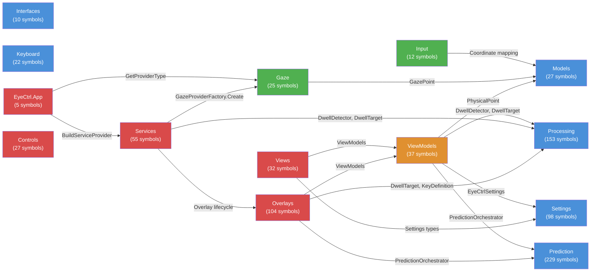
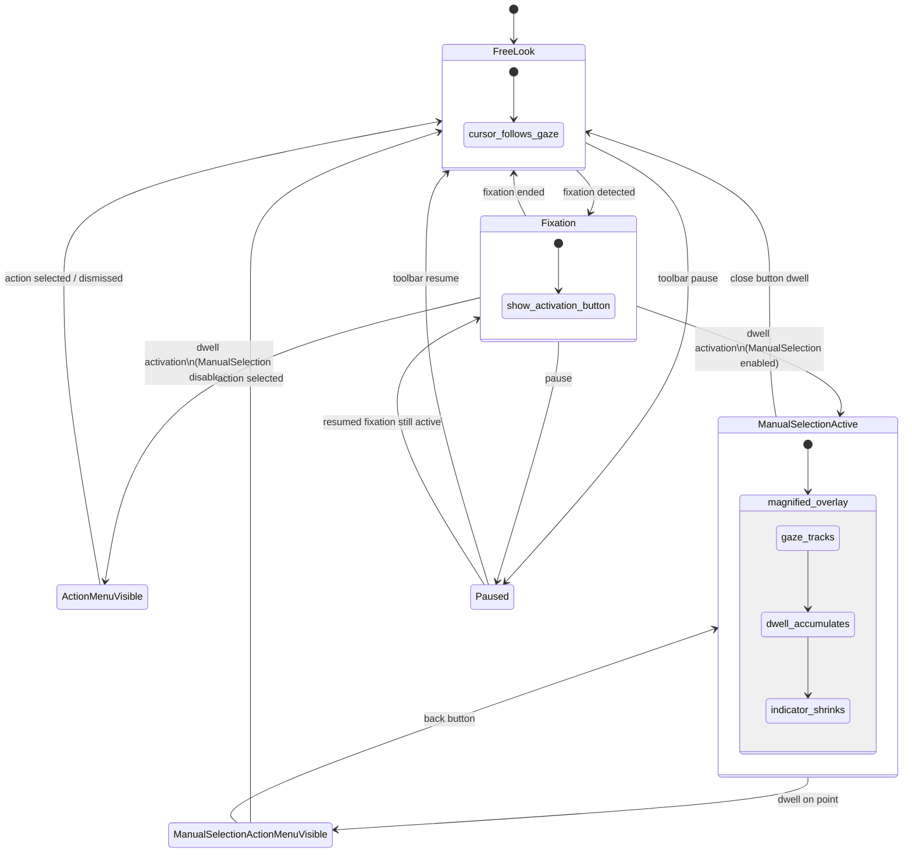
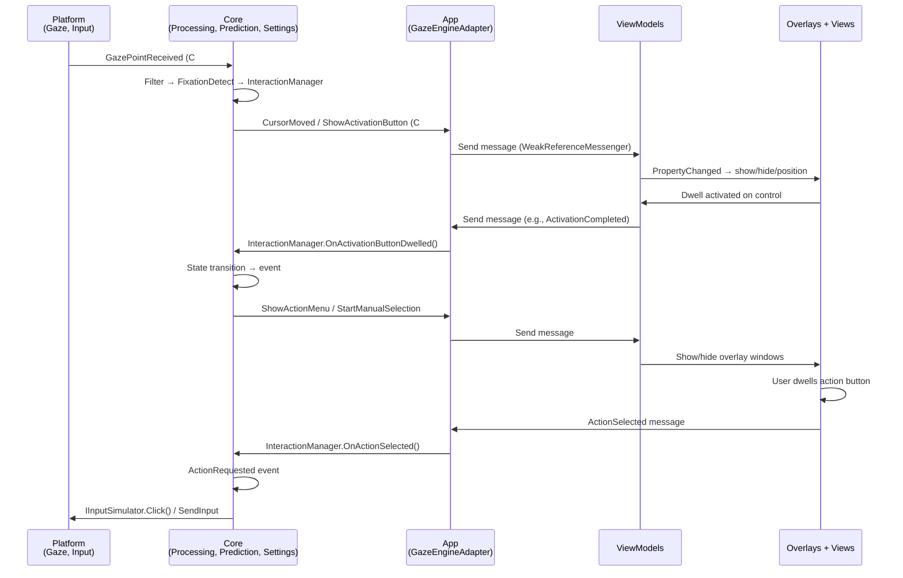

# EyeCtrl Architecture

> Generated from the GitNexus knowledge graph: **5,351 symbols**, **11,926 relationships**, **286 execution flows** across **187 functional clusters**.

EyeCtrl is a gaze-controlled desktop interaction system built on .NET 10 / WPF. It replaces the physical mouse with eye tracking, using dwell-based selection to perform clicks, scrolls, drags, and keyboard input.

## Project Structure

```
EyeCtrl.slnx
├── src/
│   ├── EyeCtrl.Core/          # Domain logic (framework-agnostic)
│   ├── EyeCtrl.Platform/      # OS/SDK bridge (Win32, Tobii)
│   ├── EyeCtrl.ViewModels/    # MVVM layer (CommunityToolkit.Mvvm)
│   └── EyeCtrl.App/           # WPF entrypoint, overlays, DI wiring
├── tests/
│   ├── EyeCtrl.Core.Tests/
│   ├── EyeCtrl.Platform.Tests/
│   ├── EyeCtrl.ViewModels.Tests/
│   └── EyeCtrl.App.Tests/
├── benchmarks/
│   └── EyeCtrl.Benchmarks/
└── tools/
```

## Layer Architecture

```mermaid
graph TB
    subgraph "EyeCtrl.App (WPF Entry)"
        AppEntry["App.xaml.cs<br/>Entry point, splash, tray"]
        Bootstrapper["AppBootstrapper<br/>DI container setup"]
        Coordinator["EventCoordinator<br/>Message → overlay routing"]
        GazeAdapter["GazeEngineAdapter<br/>Core ↔ ViewModel bridge"]
        OverlayMgr["OverlayManager<br/>Window lifecycle"]
        Overlays["Overlays (10 windows)<br/>Keyboard, Toolbar, ActionMenu,<br/>CursorCircle, ManualSelection, etc."]
        Views["Views<br/>SettingsWindow, DwellControls"]
    end

    subgraph "EyeCtrl.ViewModels (MVVM)"
        direction TB
        CursorVM["CursorCircleVM"]
        ActBtnVM["ActivationButtonVM"]
        ActionMenuVM["ActionMenuVM"]
        ManualSelVM["ManualSelectionOverlayVM"]
        ToolbarVM["ToolbarVM"]
        KeyboardVM["KeyboardVM"]
        SettingsVM["SettingsVM / SettingsWindowVM"]
        GlassVM["GlassBackdropVM"]
        LayoutHelpers["LayoutHelpers<br/>ActionMenu, ManualSelection"]
    end

    subgraph "EyeCtrl.Core (Domain)"
        direction TB
        GazeEngine["GazeEngine<br/>Core gaze pipeline"]
        InteractionMgr["InteractionManager<br/>6-state FSM"]
        Processing["Processing<br/>DwellDetector, FixationDetector,<br/>OneEuroFilter, GapInterpolator,<br/>FixationCentroidTracker, SmoothedFilter"]
        Prediction["Prediction<br/>WordPredictor, BigramModel,<br/>SmallLMPredictor, PhraseModel,<br/>SentenceCompletionIndex"]
        Keyboard["Keyboard<br/>Layouts, KeyDefinition,<br/>RecentEmojiStore"]
        Settings["Settings<br/>SettingsService, 9 sub-settings<br/>with validation"]
        Models["Models<br/>PhysicalPoint, LogicalPoint,<br/>NormalizedPoint, GazePoint,<br/>InteractionAction, ViewPosition"]
        Services_Core["Services<br/>DpiHelper"]
    end

    subgraph "EyeCtrl.Platform (OS Bridge)"
        direction TB
        GazeProviders["Gaze Providers"]
        TobiiProvider["TobiiStreamEngineProvider<br/>(conditional: TOBII_AVAILABLE)"]
        MouseProvider["MouseGazeProvider<br/>(fallback)"]
        InputSim["Win32InputSimulator<br/>SendInput P/Invoke"]
        CoordMapper["IMouseCoordinateMapper"]
    end

    %% Layer dependencies
    AppEntry --> Bootstrapper
    Bootstrapper --> Coordinator
    Bootstrapper --> GazeAdapter
    Bootstrapper --> OverlayMgr
    Coordinator --> Overlays
    Coordinator --> Views

    Overlays --> ViewModels
    Views --> ViewModels
    Views --> Settings

    ViewModels --> Processing
    ViewModels --> Prediction
    ViewModels --> Models
    ViewModels --> Settings
    ViewModels --> Keyboard

    GazeAdapter --> GazeEngine
    GazeAdapter --> InteractionMgr
    GazeAdapter --> ViewModels

    GazeEngine --> Processing
    GazeEngine --> Models
    InteractionMgr --> Processing
    InteractionMgr --> Models

    GazeProviders --> GazeEngine
    TobiiProvider --> Models
    MouseProvider --> Models

    InputSim --> Models

    classDef app fill:#d94a4a,color:white
    classDef vm fill:#e09030,color:white
    classDef core fill:#4a90d9,color:white
    classDef platform fill:#50b050,color:white

    class AppEntry,Bootstrapper,Coordinator,GazeAdapter,OverlayMgr,Overlays,Views app
    class CursorVM,ActBtnVM,ActionMenuVM,ManualSelVM,ToolbarVM,KeyboardVM,SettingsVM,GlassVM,LayoutHelpers vm
    class GazeEngine,InteractionMgr,Processing,Prediction,Keyboard,Settings,Models,Services_Core core
    class GazeProviders,TobiiProvider,MouseProvider,InputSim,CoordMapper platform
```



## Functional Areas

The knowledge graph auto-detected 14 functional areas (communities) via Leiden clustering. Tests and fixtures excluded.

| Area | Project | Symbols | Description |
|------|---------|---------|-------------|
| **Prediction** | Core | 229 | Word prediction engine: n-gram + bigram models, fuzzy edit distance, language detection, capitalization |
| **Processing** | Core | 153 | Core gaze pipeline: filters (OneEuro, EMA), fixation/dwell detection, centroid tracking, state machine, gap interpolation |
| **Settings** | Core | 98 | JSON-persisted settings hierarchy: 9 sub-settings objects with range validation and camelCase serialization |
| **Overlays** | App | 104 | WPF overlay windows: cursor circle, activation button, action menu, manual selection (magnified preview), toolbar, keyboard, glass backdrop |
| **Services** | App | 55 | App-layer services: EventCoordinator (message → overlay routing), GazeEngineAdapter (Core ↔ ViewModel bridge), AppBootstrapper (DI), ManualSelectionDwellService |
| **ViewModels** | ViewModels | 37 | MVVM ViewModels (CommunityToolkit.Mvvm): CursorCircleVM, ActivationButtonVM, ManualSelectionOverlayVM, ActionMenuVM, ToolbarVM, KeyboardVM, SettingsVM |
| **Views** | App | 32 | Settings window UI (dwell-friendly controls), toolbar window, tray icon, splash screen |
| **Models** | Core | 27 | Core value types: PhysicalPoint, LogicalPoint, GazePoint, NormalizedPoint, InteractionAction, ViewPosition, InteractionState |
| **Controls** | App | 27 | Custom dwell-friendly WPF controls: DwellButton, DwellToggle, DwellSlider, DwellComboBox, DwellColorPicker, ColorBlend |
| **Gaze** | Platform | 25 | Eye tracker providers: IGazeProvider interface, TobiiStreamEngineProvider (conditional), MouseGazeProvider (fallback) |
| **Keyboard** | Core | 22 | JSON keyboard layouts (QWERTY, AZERTY, etc.), key definitions, layout loader, emoji data |
| **Input** | Platform | 12 | Win32 P/Invoke: SendInput (mouse clicks, keystrokes, scroll), coordinate normalization, IMouseCoordinateMapper |
| **Interfaces** | Core | 10 | Core abstractions: IGazeProvider, IInputSimulator, IGazeFilter, IDictionaryProvider, IDwellRegistrar, IValidatable |
| **EyeCtrl.App** | App | 5 | Application entry point: App.xaml startup, splash screen lifecycle |

## Interface Inventory

All interfaces discovered by the knowledge graph:

| Interface | Project | File | Purpose |
|-----------|---------|------|---------|
| `IGazeProvider` | Core | `src/EyeCtrl.Core/Interfaces/IGazeProvider.cs` | Abstraction for eye tracker data sources |
| `IGazeFilter` | Core | `src/EyeCtrl.Core/Interfaces/IGazeFilter.cs` | Pluggable gaze data filtering |
| `IInputSimulator` | Core | `src/EyeCtrl.Core/Interfaces/IInputSimulator.cs` | Abstraction for mouse/keyboard simulation |
| `IDictionaryProvider` | Core | `src/EyeCtrl.Core/Prediction/IDictionaryProvider.cs` | Word frequency dictionary loading |
| `IDwellRegistrar` | Core | `src/EyeCtrl.Core/Processing/IDwellRegistrar.cs` | Dwell target registration interface |
| `IValidatable` | Core | `src/EyeCtrl.Core/Settings/IValidatable.cs` | Settings validation contract |
| `IMouseCoordinateMapper` | Platform | `src/EyeCtrl.Platform/Input/IMouseCoordinateMapper.cs` | Logical ↔ physical coordinate mapping |
| `IEventCoordinator` | App | `src/EyeCtrl.App/Services/IEventCoordinator.cs` | Message routing and event coordination |
| `IOverlayManager` | App | `src/EyeCtrl.App/Services/IOverlayManager.cs` | Overlay window lifecycle management |
| `IDwellComposite` | App | `src/EyeCtrl.App/Controls/IDwellComposite.cs` | Composite dwell control contract |

## Inter-Project Call Graph



## Key Execution Flows

The graph contains 286 processes (execution flows). Top 5 by relevance, with step-by-step traces:

### 1. Gaze Engine Startup (`Start → GazePoint`)

4-step process spanning Core → Platform:

| Step | Symbol | File |
|------|--------|------|
| 1 | `GazeEngine.Start()` | `src/EyeCtrl.Core/GazeEngine.cs` |
| 2 | `TobiiStreamEngineProvider.Start()` | `src/EyeCtrl.Platform/Gaze/TobiiStreamEngineProvider.cs` |
| 3 | `SubscribeGaze()` | `src/EyeCtrl.Platform/Gaze/TobiiStreamEngineProvider.cs` |
| 4 | `GazePoint` (data model) | `src/EyeCtrl.Core/Models/GazePoint.cs` |

### 2. Word Prediction (`Predict → PredictionResult`)

4-step process within Core/Prediction:

| Step | Symbol | File |
|------|--------|------|
| 1 | `SmallLMPredictor.Predict()` | `src/EyeCtrl.Core/Prediction/SmallLMPredictor.cs` |
| 2 | `RunInference()` | `src/EyeCtrl.Core/Prediction/SmallLMPredictor.cs` |
| 3 | `PostProcess()` | `src/EyeCtrl.Core/Prediction/SmallLMPredictor.cs` |
| 4 | `PredictionResult` (data model) | `src/EyeCtrl.Core/Prediction/PredictionResult.cs` |

### 3. Gaze Update → Dwell Position (`UpdateGaze → UpdatePosition`)

4-step process from Views → Core:

| Step | Symbol | File |
|------|--------|------|
| 1 | `SettingsWindow.UpdateGaze()` | `src/EyeCtrl.App/Views/SettingsWindow.xaml.cs` |
| 2 | `UpdateAllTargetPositions()` | `src/EyeCtrl.App/Views/SettingsWindow.xaml.cs` |
| 3 | `DwellControl.UpdatePosition()` | `src/EyeCtrl.App/Controls/DwellControl.cs` |
| 4 | `IDwellRegistrar.UpdatePosition()` | `src/EyeCtrl.Core/Processing/IDwellRegistrar.cs` |

### 4. Emoji Action Handling (`HandleAction → GetCategoryEmojis`)

4-step process within Overlays:

| Step | Symbol | File |
|------|--------|------|
| 1 | `EmojiGridManager.HandleAction()` | `src/EyeCtrl.App/Overlays/EmojiGridManager.cs` |
| 2 | `BuildGrid()` | `src/EyeCtrl.App/Overlays/EmojiGridManager.cs` |
| 3 | `GetCurrentPageEmojis()` | `src/EyeCtrl.App/Overlays/EmojiGridManager.cs` |
| 4 | `GetCategoryEmojis()` | `src/EyeCtrl.App/Overlays/EmojiGridManager.cs` |

### 5. Settings Page Building (`BuildCursorPages → AddTarget`)

6-step cross-community process from Views → Core:

| Step | Symbol | File |
|------|--------|------|
| 1 | `SettingsWindow.BuildCursorPages()` | `src/EyeCtrl.App/Views/SettingsWindow.xaml.cs` |
| 2 | `Add()` | `src/EyeCtrl.App/Views/SettingsWindow.xaml.cs` |
| 3 | `DwellControl.Attach()` | `src/EyeCtrl.App/Controls/DwellControl.cs` |
| 4 | `RegisterDwell()` | `src/EyeCtrl.App/Controls/DwellControl.cs` |
| 5 | `SettingsWindowViewModel.Register()` | `src/EyeCtrl.ViewModels/SettingsWindowViewModel.cs` |
| 6 | `DwellDetector.AddTarget()` | `src/EyeCtrl.Core/Processing/DwellDetector.cs` |

## Interaction State Machine



**6 states:** FreeLook → Fixation → ActionMenuVisible / ManualSelectionActive → ManualSelectionActionMenuVisible / Paused

## Communication Flow



## Messaging (WeakReferenceMessenger)

The ViewModels layer communicates with the App layer via three message groups defined in `src/EyeCtrl.ViewModels/Messages/`:

| Message Group | File | Purpose |
|---------------|------|---------|
| **GazeMessages** | `GazeMessages.cs` | Cursor position updates, gaze provider state changes |
| **InteractionMessages** | `InteractionMessages.cs` | Dwell activation, action selection, key presses |
| **OverlayMessages** | `OverlayMessages.cs` | Show/hide overlays, toolbar/keyboard visibility |

This replaces direct ViewModel→App references with decoupled publish/subscribe via `WeakReferenceMessenger`.

## Dependencies

| Dependency | Usage |
|------------|-------|
| CommunityToolkit.Mvvm 8.4.0 | `[ObservableProperty]` source generators, `WeakReferenceMessenger` |
| Microsoft.Extensions.DependencyInjection | DI container (`ServiceCollection`, `ServiceProvider`) |
| Serilog | Structured logging, daily rolling files, 7-day retention |
| System.Text.Json | Settings serialization with `JsonNamingPolicy.CamelCase` |
| Tobii Stream Engine SDK | Conditional (`#if TOBII_AVAILABLE`), only when SDK DLLs present |
| BenchmarkDotNet | Standalone benchmarks (not in solution) |

## Build & Run

```bash
dotnet build EyeCtrl.slnx                # build everything
dotnet run --project src/EyeCtrl.App     # run (falls back to mouse-as-gaze if no eye tracker)
dotnet run --project src/EyeCtrl.App -- --test-mode   # skip splash, force mouse gaze provider
dotnet publish src/EyeCtrl.App -c Release -r win-x64 --self-contained true -p:PublishSingleFile=true -o publish
```

## Statistics (from Knowledge Graph)

| Metric | Count |
|--------|-------|
| Total symbols | 5,351 |
| Relationships | 11,926 |
| Communities | 187 |
| Processes (execution flows) | 286 |
| Interfaces | 10 |
| Source files indexed | 324 |
