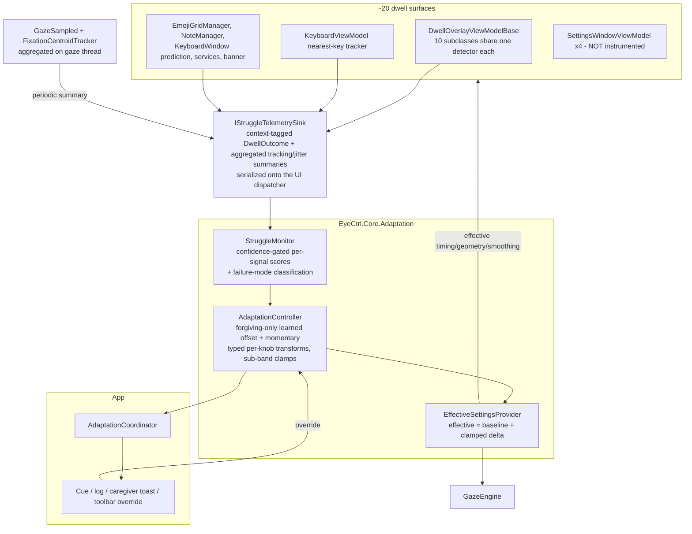

# Struggle Detection & Self-Adaptation — Design

- **Date:** 2026-07-19
- **Status:** **Approved (2026-07-19)** after three review rounds — all findings (R1–R5, C1–C5, N1–N3, M1–M4) verified against source and incorporated. Ready as input to the Phase 1a implementation plan. **Phase-1b brainstorming (2026-07-21)** resolved the §14 open items needed for Phase 1b (see **§13.1**) and the 1b-③ `StruggleMonitor` scoring design (see **§13.2**).
- **Topic:** Detect when the user is struggling to interact and automatically adapt EyeCtrl's own settings — conservatively, visibly, and reversibly — to help.

## 1. Summary & Motivation

EyeCtrl is the user's **sole input channel** (eye tracking). Real-world conditions drift over
a day: eyes tire, lighting changes, head position shifts, calibration slips. When that happens
the user *struggles* — selections misfire or get abandoned, gaze gets shaky, tracking degrades —
and the only remedy today is to manually open settings and re-tune, which is exactly the
operation that is hard to perform *while* struggling.

This feature makes the app notice struggle and **adapt itself** to relieve it, then relax back
once the user recovers. Because the app controls the user's only input path, every adaptation
must be **conservative, visible, reversible, and incapable of locking the user out**.

## 2. Goals / Non-Goals

**Goals**
- Detect struggle from signals the gaze pipeline produces (plus a new, richer dwell-outcome signal).
- Automatically adapt four knob families — dwell duration, targeting tolerance, smoothing,
  target size/geometry — in a way that keeps the user able to act.
- Learn a slow, bounded, **forgiving-only** per-context baseline layered *under* the momentary response.
- Keep the user informed (subtle cue), keep a reviewable log, alert a caregiver on sustained
  trouble, and always offer an instant escape back to baseline.

**Non-Goals**
- **Never auto-modify the calibration transform.** Drift is *detected and reported* only.
- **No blanket "struggle ⇒ longer dwell."** Longer dwell applies *only* to the accidental-activation
  failure mode, bounded and instantly escapable (R1-round Finding 1).
- **No visual-only size changes.** The visible cursor is never resized without atomically changing
  the actual hit geometry.
- **No learned auto-tightening past the user's baseline.**
- **Do not instrument the Settings window dwell.** Settings is the *remedy* surface, not a struggle
  surface; struggling there should never feed adaptation (2nd-round R2.3).
- **Suppress visible feedback (cue/toast) and verbose logging in sensitive contexts** (password /
  secure fields), so adaptation never leaks that the user is struggling on a credential entry
  (2nd-round C5).
- No ML/exploration-based tuning.

## 3. Key Decisions

| Decision | Choice |
|---|---|
| Behavior on detection | Auto-adjust with guardrails |
| Adaptation lifetime | Layered: slow forgiving-only learned baseline + momentary forgiving/tightening response |
| Adaptation targets | Dwell duration, targeting tolerance, smoothing, target size/geometry |
| Struggle signals | Missed/abandoned (reason-tagged), shaky/drift, poor tracking, slow/effortful, accidental-activation |
| Feedback & control | On-screen cue, session log, caregiver alert, manual override |
| Architecture | Rule-based controller (deterministic, explainable, bounded, testable) |
| Value model | Effective-value layer; **delta clamped in per-direction sub-bands**, not the sum |
| Default posture | Conservative (tunable) |
| Caregiver channel (v1) | **Net-new** tray balloon/toast (no toast API exists today); Supervisor relay deferred |
| Build structure | Phased: **1a substrate → 1b momentary → 2 learning → 3 caregiver** |

## 4. Architecture Overview

The central structural fact (1st-round Finding 3, expanded in 2nd-round R2): dwell is **not**
centralized. There are ~20 dwell surfaces — 10 `DwellOverlayViewModelBase` subclasses (which
share the base's detector), `SettingsWindowViewModel`'s 4 detectors, `EmojiGridManager`,
`NoteManager`, `KeyboardWindow`'s prediction detector, `ExternalDwellService`,
`ManualSelectionDwellService`, `EyeCareBannerWindow`, and `KeyboardViewModel`'s *separate*
nearest-key tracker (not a `DwellDetector`). So adaptation cannot observe "the" detector; it needs
a **shared telemetry sink** that surfaces report into with a context tag.



**Context strategy** (2nd-round R2.1): `DwellContext` is a policy-relevant set —
`Keyboard`, `KeyboardPrediction`, `ActionMenu`, `ManualSelection`, `Toolbar`, `EdgeButtonBar`,
`QuickActions`, `TaskSwitcher`, `Emoji`, `Notes`, `Scroll`, `DragTrail`, `ActivationButton`,
`Backdrop`, `ExternalDwell`, `EyeCare`, `Other`. Surfaces without enough evidence, or tagged
`Other`, contribute to the **aggregate** struggle level and the global momentary response but do
**not** get a per-context learned offset until they cross a confidence threshold. Instrumenting
`DwellOverlayViewModelBase` covers 10 surfaces at once; the non-base owners are wired individually.
The **exhaustive surface inventory + context assignment is a Phase 1a deliverable**, guarded by a
test analogous to `EyeCtrlSettingsEnumerationTests` (every `DwellDetector`-owning surface must
declare a context; Settings is explicitly excluded). `Scroll` is **reserved but not emitted** in
Phase 1a: `ScrollOverlayViewModel` is inert (it overrides `Receive` without ever calling
`DwellDetector.Update`), and the scroll-stop dwell lives on the shared `EdgeButtonBar` — so scroll-stop
struggle is reported under `EdgeButtonBar`, and 1b per-context scoring must not expect `Scroll` evidence.
The enum value is kept for a future dedicated scroll detector.

**New components** (`EyeCtrl.Core.Adaptation`): `IStruggleTelemetrySink`, `DwellContext`,
`DwellOutcome` (§6.1), `StruggleMonitor`, `AdaptationController`, `EffectiveSettingsProvider`,
`StruggleAssessment`, `AdaptationKnob`.

**New settings:** `AdaptationSettings` — added both as an `[ObservableProperty]` on `EyeCtrlSettings`
**and** yielded from `EyeCtrlSettings.EnumerateSubSettings()`, the single registration point that
`Validate()`, `SettingsViewModel.ResetAllSettings()`, and the drift-guard test all consume (adding
the property without the `yield return` fails the build).

## 5. The Value Model (corrected)

The pipeline reads the composed **effective** value; the user's baseline is never overwritten. The
clamp applies to the **adaptive delta**, decomposed into independent per-direction sub-bands so the
quarantined tightening cannot be silently swallowed (2nd-round C1):

```
forgiving(knob,ctx)  = clamp(learnedOffset + momentaryForgiving, forgivingBand(knob))   // e.g. [-B, 0]
tightening(knob,ctx) = clamp(momentaryTightening,                tighteningBand(knob))   // dwell only, e.g. [0, +T]
effective(knob,ctx)  = clamp(baseline + forgiving + tightening, validatedRange(knob))
```

- **baseline** — existing `*Settings`; UI edits these; adaptation never writes them.
- **learnedOffset** — forgiving-only (§8), slow EWMA per context/knob, persisted, decays toward 0.
- **momentaryForgiving / momentaryTightening** — ephemeral. Tightening is nonzero *only* for dwell
  under the accidental-activation mode; every other knob has an empty tightening band.
- **Sub-band separation matters:** if a forgiving learned offset (shorter dwell) coexists with an
  accidental-activation tightening (longer dwell), summing-then-clamping to a one-sided forgiving
  band would clamp the result at baseline and **defeat the tightening**. Clamping the two components
  independently and adding them lets the bounded tightening push above baseline as intended.
- **Zero delta ⇒ exact baseline:** with the feature off/idle both components are 0; the final
  validated-range clamp only engages when `delta ≠ 0`, so it never disturbs the baseline.
- **Typed per-knob transforms** (1st-round Finding 6): each knob defines its own safe direction and
  units — dwell ms, fixation radius px, One-Euro `OneEuroMinCutoff` (down = more smoothing) / EMA
  `SmoothingFactor` (**down** = more smoothing — verified against `SmoothedFilter.cs`), target geometry px.
  There is no single scalar "relaxation."

**Knobs routed through the provider:** dwell durations; tolerance (`FixationRadiusPixels`,
`FixationDetectionMs`); smoothing (the active filter's parameter only — mode is never auto-switched);
target geometry (button ring radius + hit radius, key hit slop, and the coupled visible size).

**Live-update integration** (state-preserving, gaze-thread-owned):
- **Smoothing rebuild must not cold-start the filter (2nd-round R1).** Today `GazeEngine` builds a
  **fresh** filter via `GazeFilterFactory` on rebuild, and `GapInterpolator.CopyStateFrom` carries only
  `_lastValidPosition`/`_lastValidTimestamp` — the filter's own state (One-Euro's low-pass + derivative
  history, EMA's last output) is lost, so a naive rebuild causes a cursor jump on the next sample,
  exactly what must not be inflicted on a struggling user (and can itself read as more struggle).
  **Preferred Phase-1a fix — warm-start (no interface changes):** seed the fresh filter through the
  existing public `Filter()` with a synthetic sample at the current cursor position/timestamp; both
  filters return the seed unchanged on first call. The *seeded* output equals the current position; the
  first *real* sample is then a weighted average toward the seed (EMA: `factor·raw + (1−factor)·seed`)
  or briefly over-smoothed (One-Euro — its derivative filters seed at 0 → low speed → low cutoff), i.e.
  a bounded **one-sample lag toward the seed**, **not a discontinuity**, recovering within one sample.
  **Optional Phase-2 hardening — full state transfer** (eliminates even the lag) is interface surgery:
  a new copy/seed method on `IGazeFilter` (which today exposes only `Filter`/`Reset`) plus state
  accessors on `OneEuroFilter` (incl. its nested `LowPassFilter.Last`, currently `private set`) and
  `SmoothedFilter`. Either way, extend `GazeEngine`'s rebuild trigger — which today fires only on
  `FilterMode`/`MaxGapInterpolationMs` — to `OneEuroMinCutoff`/`OneEuroBeta`/`SmoothingFactor`.
- **Tolerance:** `FixationDetector` radius/time are readonly → rebuild on change (it currently
  subscribes to `CursorSettings` only, never `DwellSettings`, so even manual tolerance changes don't
  propagate today — real gap to fix).
- **Dwell time & geometry:** baked into `DwellTarget` at creation and `DwellTarget.Radius` is
  immutable. Add **state-preserving** update methods on `DwellDetector` (mirroring the existing
  `DwellDetector.UpdateTargetCenter`, which is on the *detector*, not the target): `UpdateTargetDwellTime`
  and `UpdateTargetGeometry` that adjust timing/radius while preserving `EnteredTimestamp`/`IsGazeInside`.
  Surfaces read effective values at (re)creation; the action menu already clears+recreates targets each show.

When `AdaptationSettings.Enabled == false`, both components are 0, `effective == baseline`, and no
rebuild logic runs.

## 6. Detection

### 6.1 `DwellOutcome` (1st-round Finding 4)

Fired from `DwellDetector.Update` on genuine activation and abandonment — covering all
`DwellDetector`-based surfaces including `KeyboardWindow`'s prediction detector — plus **net-new**
emission added to `KeyboardViewModel.ProcessKeyGaze` (which today raises activation only, via
`KeyDwellCompleted`, and silently mutates state on abandonment, so its abandonment path is new wiring).
No outcome is raised from `ResetAllState`, cooldown resets, or target removal:

```
DwellOutcome {
    long   TimestampMicroseconds;
    DwellContext Context;
    string TargetId;
    OutcomeKind Kind;          // Activated | Abandoned
    AbandonReason Reason;      // GazeLeft | NearestChanged | (none if Activated)
    double ProgressAtEnd;      // 0..1
    PhysicalPoint GazePoint;   // at outcome
    PhysicalPoint TargetCenter;
    double TargetRadius;       // circular hit radius; 0 for rect targets
    PhysicalRect? TargetBounds; // rect target bounds; null for circular targets
    // NearMiss is exposed as two computed doubles NearMissX / NearMissY (= GazePoint − TargetCenter);
    // there is NO separate Vector field — Core has no Vector type and the geometry already lives in
    // GazePoint/TargetCenter. (Realized this way in the committed 1a-① plan, which is authoritative;
    // this sketch reconciled 2026-07-22 during 1b-③b review round 2.)
}
```

Abandonment is reported only when `ProgressAtEnd >= AbandonProgressThreshold` (default `0.3`).

### 6.2 Signals

- **Missed / abandoned** — from `DwellOutcome` (Abandoned, reason-tagged).
- **Shaky / drift** — **jitter is new work (2nd-round R3):** `FixationCentroidTracker` computes a
  per-sample `speed` but discards it. Add a velocity-variance (Welford) accumulator to the tracker,
  exposed as a jitter statistic emitted at fixation end. Drift = coherent bias of `NearMiss` vectors
  across abandons, **evaluated across contexts** (2nd-round C2): a persistent bias within a *single*
  surface (e.g. a too-narrow radial wedge) is a UI-geometry artifact and is *not* reported as
  calibration drift; only bias coherent across multiple contexts is treated as genuine drift. Each
  context keeps its own `NearMiss` baseline for this comparison.
- **Poor tracking** — invalid/off-screen fraction from `GazeSampled`, **aggregated on the gaze thread**
  (§9) rather than marshaled per sample.
- **Slow / effortful** — time-to-activate vs. the user's own rolling baseline pace, plus retries.
- **Accidental activation** — an activation followed within a short window by a reversal signal
  (Back/undo, or immediate re-approach of the just-left region). Drives the *only* dwell-tightening response.
- **Fatigue (reuse existing).** `EyeCtrl.EyeCare.FatigueMonitor` exposes a 0–1 fatigue `Score` via
  `OnSample(GazePoint)`; it is driven by `EyeCareService.OnGazeSample`, which subscribes to
  `GazeSampled` (wired in `App.xaml.cs`), so it already runs on the gaze thread. Consume that `Score`
  as an *optional* struggle input (opt-in via `EyeCareSettings.FatigueMonitorEnabled`), pushed into the
  sink by the App layer so `EyeCtrl.Core.Adaptation` keeps no dependency on `EyeCtrl.EyeCare`. Do
  **not** reimplement its window statistics (see §9.1 — avoids a second O(window) per-sample scan).

### 6.3 Scoring & readiness (1st-round Finding 9)

- Each signal produces a score `[0..1]` **and a confidence**; the controller acts on a knob only when
  that signal's confidence gate is met — no single mixed "60s or 12 interactions" gate.
- Evidence has a **fixed maximum age** and resets on **session boundaries** (app start; resume after a
  pause longer than a threshold — precise threshold in §14).
- **Poor tracking uses a direct, time-based threshold independent of interaction count**, so tracking
  loss (which produces *no* interactions) is still detected promptly.
- Failure-mode classification (sustain-failure vs. accidental-activation vs. aiming vs. tracking)
  selects the response (§7).

## 7. Adaptation Policy

### 7.1 Failure mode → typed knob transform

| Failure mode (evidence) | Safe response |
|---|---|
| **Sustain-failure** — high-progress abandonment, jitter | **shorter** dwell (bounded); **loosen** tolerance; **more** smoothing |
| **Accidental activation** — activation then reversal | **longer** dwell (bounded, gated on this signal only) |
| **Aiming** — large `NearMiss` | **enlarge target geometry** (ring + hit radius / key slop) *and* coupled visible size, atomically |
| **Drift** — cross-context coherent `NearMiss` bias | **loosen** tolerance + **report** (never touch calibration) |
| **Poor tracking** — invalid-sample rate | **more** smoothing; **enlarge geometry**; **caregiver alert if sustained**; never tighten |

"Shorter" and "longer" dwell are opposite responses to *different, separately-detected* modes; they
never both apply from a generic "struggle" score. Cooldown is not adapted.

### 7.2 Momentary layer (Phase 1b)

Per tick, each knob moves toward the transform target for the currently classified mode:
- Relax **promptly** above `RelaxThreshold` (default `0.5`) held `SustainSeconds` (default `3`): step
  `RelaxStepFraction` (default `0.10` of the band) up to the band edge.
- Recover **gently** below `RecoverThreshold` (default `0.25`): step `RecoverStepFraction` (default `0.05`) toward 0.
- **Deadband** between thresholds ⇒ no change.
- The only tightening move (longer dwell for accidental activation) lives in its own sub-band (§5),
  bounded well inside the validated range, and is instantly escapable.

### 7.3 In-progress dwell during a geometry/timing change (2nd-round C4)

Size/timing changes preserve in-progress dwell state (via the state-preserving update methods, §5):
- **Enlarging** a target while gaze is inside **keeps** accumulated progress — enlargement is
  forgiving, so progress must not reset.
- **Shrinking** during recovery that leaves the gaze outside ends the dwell as a normal gaze-left.
- A dwell-time change re-evaluates completion against the *new* time using the existing
  `EnteredTimestamp` (no reset). Covered by tests (§12).

### 7.4 Learned layer (Phase 2)

- `learnedOffset` accumulates **only forgiving** offsets on sustained patterns and **decays toward 0
  (baseline)**; it never produces a tightening offset (1st-round Finding 8). Accidental-activation
  handling stays entirely in the bounded, escapable momentary tightening sub-band.
- Rate-limited, bounded to the forgiving band, logged, resettable.
- Persisted in `%APPDATA%\EyeCtrl\adaptation-state.json` with an **atomic temp-file + rename** write
  (as `SettingsService` does) and **validated on load** using the `CalibrationService.Load` pattern as
  the explicit template (range/plausibility checks, catch-all); corrupt or out-of-band state is ignored
  and reset.

## 8. Safety Invariants

1. **Default direction keeps you able to act** — dominant responses make interaction easier to complete.
2. **The single tightening move is quarantined** — longer dwell applies only to the separately detected
   accidental-activation mode, lives in its own bounded sub-band, and is instantly escapable.
3. **Zero delta ⇒ exact baseline.**
4. **Sub-bands strictly inside validated ranges.**
5. **Calibration off-limits** — detect + report + temporary tolerance compensation only.
6. **Always-reachable escape** — a large toolbar reset/pause button; mirrored in the tray.
7. **Learned layer is forgiving-only and decays toward baseline.**
8. **Hysteresis + deadband** everywhere.
9. **Size changes are atomic** — visible size never changes without hit geometry changing with it.
10. **No feedback leakage** — cue/toast/verbose logging suppressed in sensitive (password) contexts;
    adaptation itself still functions silently.
11. **Smoothing rebuilds are continuous** — no cold-filter cursor jump (§5, R1).

## 9. Threading & Performance (1st-round Finding 7, refined by 2nd-round C3)

- `GazeSampled` fires synchronously on the gaze-provider poll thread; `CursorMoved`→dwell is marshaled
  to the UI dispatcher; the keyboard tracker runs on the UI thread. Different threads.
- **Aggregate high-frequency signals on the gaze thread and marshal only compact summaries** — the
  poor-tracking fraction and the fixation jitter statistic are computed on the gaze thread and pushed
  to the sink periodically (e.g. per ~500 ms / per N samples), *not* per 30–60 Hz sample, keeping
  dispatcher load small while still supporting time-based poor-tracking detection (§6.3).
- `DwellOutcome` events (low frequency) marshal individually. The sink re-dispatches everything onto
  one serialized channel (the UI dispatcher), so `StruggleMonitor` stays single-threaded, matching
  `DwellDetector`'s documented contract (its internal `ConcurrentDictionary`/copy-on-write hardening is
  orthogonal — the monitor relies on the contract, not internal concurrency).
- The telemetry sink enforces monotonic ordering — it **drops any outcome older than the last accepted**,
  since marshaling can reorder near-simultaneous events; **equal timestamps are retained** as legitimate
  distinct outcomes (coarse clock resolution / concurrent surfaces). The `StruggleMonitor` (Phase 1b)
  consumes this already-ordered, non-decreasing stream.
- Per-sample hot-path work stays allocation-free.

### 9.1 Performance & resource budgets

The gaze path runs at 30–60 Hz and is guarded by an existing BenchmarkDotNet suite
(`GazePipelineBenchmarks`, `GazePipelineWithFatigueBenchmarks`, `GazeDwellBenchmarks`,
`GazeFilterBenchmarks`, `GazeFatigueMonitorBenchmarks`, `GazeStreamGenerator`). This feature must
not regress it.

- **O(1) per sample, never O(window).** The existing `FatigueMonitor` re-scans its whole window
  every sample — validated at ~395 ns (10 s / ~300-sample window), ~1350 ns (30 s), and ~2590 ns
  (60 s / ~1800 samples) per the benchmark design spec's O(window) sweep. The new signals must use
  incremental aggregates — running counts (invalid-sample fraction), Welford variance (jitter),
  EWMA (pace) — so per-sample cost is O(1). A second O(window) scan would stack on the fatigue cost.
- **Reuse the fatigue signal, don't recompute it** (§6.2).
- **Gaze-thread aggregation, ~2 Hz summaries** (C3): per-sample work is a few O(1) updates on the
  provider thread (where `FatigueMonitor` already runs); only compact summaries cross the dispatcher,
  so added dispatcher load is negligible against the existing 30–60 Hz `CursorMoved` marshaling.
- **Allocation-free hot path.** `DwellOutcome` is a struct passed through generic sink methods (no
  boxing); the per-sample abandonment check adds no LINQ/closures. `[MemoryDiagnoser]` asserts zero
  per-sample allocation.
- **Bound reconfiguration churn.** Smoothing changes trigger a filter rebuild (small alloc);
  quantize + hysteresis so rebuilds occur at most ~1/s during active adaptation, never per tick.
- **Prefer in-place target updates.** `UpdateTargetGeometry`/`UpdateTargetDwellTime` (state-preserving,
  no snapshot rebuild) over `Add/Clear`, avoiding the copy-on-write `_targetsSnapshot` array
  reallocation on the UI thread.
- **Controller tick is O(1)** at a few Hz on the dispatcher; must not compete with dwell/cursor
  rendering. The cue overlay is a cheap fading badge.
- **I/O off the hot path.** `adaptation-log.jsonl` writes are async/batched; learned-state
  persistence is debounced to session boundaries with an atomic write.
- **Disabled = current cost.** Gated at the source (like `FatigueMonitor`'s `if (!Enabled) return;`):
  when off (default) surfaces skip reporting, the monitor isn't fed, effective = baseline, no
  rebuilds — the pipeline's measured cost is unchanged.
- **Regression budget & coverage:** extend the suite (reuse `GazeStreamGenerator`, mirror
  `GazePipelineWithFatigueBenchmarks`) with a StruggleMonitor per-sample benchmark, an
  `AdaptationController` tick benchmark, and pipeline-with-adaptation enabled-vs-disabled; gate on a
  per-sample-cost budget and zero per-sample allocations.

## 10. Feedback, Control & Settings

- **On-screen cue** — subtle corner badge, on-canvas, excluded from magnifier capture, non-interactive,
  auto-fading (~2 s), intensity scales with the assessment. **Suppressed in sensitive contexts** (§8.10).
- **Session log** — append-only `%APPDATA%\EyeCtrl\adaptation-log.jsonl`
  (`{ts, context, signal, failureMode, knob, oldEffective, newEffective, reason}`), size-capped. In
  sensitive contexts, log only a coarse "adaptation suppressed (sensitive)" marker.
- **Caregiver alert (v1)** — **net-new** (no toast API exists today): `NotifyIcon.ShowBalloonTip`
  (WinForms) or a WinRT `AppNotification` on the existing tray icon, on sustained high struggle / poor
  tracking, rate-limited. **Not** via `HeartbeatPublisher`, which is a liveness-only heartbeat to the
  supervisor watchdog (named pipe, `HeartbeatPayload`); a supervisor *alert* relay would need a new
  payload/channel and is deferred to Phase 3 (format open, §14).
- **Manual override** — toolbar button: reset momentary + learned to baseline, and/or pause adaptation;
  mirrored in the tray.
- **`AdaptationSettings`** (`ObservableObject` + `IValidatable`; UI from existing `SettingItemViewModel`
  subclasses): `Enabled` (default `false`, opt-in); per-knob enables; `Posture` (Conservative default);
  per-knob sub-band bounds (validated inside base ranges); `ShowCue`, `CaregiverAlerts`,
  `SuppressInSensitiveContexts` (default true); `ResetLearnedBaseline` action; live status label.
  Registered via `EyeCtrlSettings.EnumerateSubSettings()` (§4).

## 11. Robustness / Error Handling

- Corrupt/out-of-band `adaptation-state.json` → validated (CalibrationService.Load-style), ignored, reset.
- Out-of-order telemetry timestamps → dropped by the sink's monotonic guard; equal timestamps retained (§9).
- No exceptions on the gaze hot path; adaptation failures degrade to "no adaptation." Log/toast failures
  are swallowed.

## 12. Testing Strategy

Headless, xUnit v3 + NFluent, synthetic timestamped signal sequences (reuses the headless gaze-flow harness):
- `DwellOutcome`: fires on genuine abandonment (≥ threshold) + activation with correct
  reason/geometry/vector; **not** from `ResetAllState`/cooldown/removal.
- `StruggleMonitor`: per-signal scores + confidence gates; failure-mode classification; fixed evidence
  age / session reset; poor-tracking time-based threshold with **zero interactions**; cross-context drift
  vs. single-context UI-offset discrimination (C2).
- `AdaptationController`: typed transforms/directions; **sub-band value model** — zero delta returns
  exact baseline even for out-of-band baseline; **learned-forgiving + accidental-tightening coexistence**
  — tightening still applied, not swallowed (C1); learned forgiving-only + decay; hysteresis/no-oscillation.
- `EffectiveSettingsProvider`: composition/clamp; disabled = pass-through; changes reach
  `FixationDetector` rebuild, `DwellTarget` recreate/update, and **smoothing filter reconfiguration**.
- **Smoothing continuity (R1):** a smoothing-param change produces **no discontinuity** — the seeded
  output equals the current position and the first real sample stays within a bounded **one-sample lag
  toward the seed** (assert that bound, not zero). Warm-start path in Phase 1a; if Phase-2 state
  transfer is adopted, tighten the bound to ~zero lag.
- **In-progress dwell (C4):** enlarge mid-dwell ⇒ progress preserved; shrink-out ⇒ normal gaze-left;
  dwell-time change re-evaluates without reset.
- Size adaptation atomicity: visible size + hit geometry change together (action-menu ring + hit radius).
- Telemetry: cross-thread inputs serialized; gaze-thread aggregation emits summaries; monotonic guard.
- **Phase 1a exit criterion:** effective == baseline for every knob when `Enabled=false`, asserted and
  **locked across phases** so a later regression is caught.
- Persistence: round-trip; corrupt/out-of-band ignored.
- Test categorization (1st-round Finding 10, corrected): display-dependent tests **must carry
  `[Trait("Category","UI")]`**; STA/WPF tests *additionally* use `[StaFact]`; app-launching UI tests use
  class-level `[Trait("Category","UI")]` + `[Fact]` + the `EYECTRL_UI_TESTS=1` env gate. CI's
  `Category!=UI` filter excludes all of these regardless of `[StaFact]`.

## 13. Phasing

**Phase 1a — Instrumentation substrate (no behaviour change; delta always 0).**
`IStruggleTelemetrySink` + `DwellContext` + `DwellOutcome`; `DwellDetector` reason-tagged outcomes +
`UpdateTargetDwellTime`/`UpdateTargetGeometry`; **exhaustive surface inventory** and context wiring
(base class covers 10; individual wiring for keyboard keys, keyboard prediction, emoji, notes, services,
banner; Settings excluded), guarded by an enumeration test; `FixationCentroidTracker` jitter statistic;
gaze-thread aggregation of tracking/jitter + serialized channel; the **stateless `EffectiveValue`
calculator** (sub-band arithmetic; zero-delta ⇒ exact-baseline exit invariant) + **warm-started filter
reconfiguration (the cold-filter fix, R1)**. (The **stateful `EffectiveSettingsProvider`** + routing
consumers to read effective values, and the **`FixationDetector` tolerance-rebuild**, are deferred to
Phase 1b — every delta is 0 in 1a, so both would be no-ops until a controller exists; see the 1a-⑤
scope boundary.) Exit criterion:
effective == baseline everywhere (tested). This is the safe, testable foundation the reviews showed is required.

**Phase 1b — Momentary adaptation.** `StruggleMonitor` (scoring + failure-mode classification) +
`AdaptationController` (momentary only, typed transforms, sub-band clamps, quarantined tightening) + cue +
toolbar override + `AdaptationSettings` + sensitive-context suppression. Learned offset pinned to 0.

**Phase 2 — Learning.** Forgiving-only learned offset + validated atomic persistence + reset + log review.

**Phase 3 — Caregiver.** Net-new tray toast + rate-limiting; optional Supervisor relay (new payload/channel).

Each phase gets its own implementation plan, reviewed before the next.

## 13.1 Phase 1b — Resolved Parameters (brainstorming 2026-07-21)

The §14 open items needed for Phase 1b are resolved here. Numbers are **starting values, tunable in
review**. Each sub-band sits **strictly inside the knob's bound** (Safety Invariant §8.4): for dwell,
tolerance, and smoothing that bound is the knob's existing `*Settings` validated range; the
**target-geometry knob has no pre-existing validated range** — its ring radius is derived at runtime from
`CircleSize` + `UIConstants` constants (`ActionMenuViewModel.cs:52`) and keyboard keys have no hit-slop
setting today — so its safety bound is a **feature-introduced bound defined in `AdaptationSettings`** that
Phase 1b adds and validates before §8.4 is testable for geometry.

**Sensitive-context detection (resolves §14 C5; Safety Invariant §8.10).** A new Core interface
`ISensitiveContextDetector` (`bool IsSensitiveActive { get; }` + start/stop), implemented in
`EyeCtrl.Platform` via **UI Automation** — reusing the existing `System.Windows.Automation` dependency
and the defensive patterns already in `ControlFinder` (own-process exclusion, COM `try`/`catch`). It
subscribes to UIA focus-changed events; on each focus change to a non-EyeCtrl element it reads the focused
element's `IsPassword` (and `ControlType`) and caches a single boolean. The feedback gate reads that cached
bool in O(1) — nothing runs on the gaze hot path. The focus-changed callback fires on a UIA (RPC) thread —
not the UI thread — so the cached bool is published thread-safely (`Volatile.Write`/`Interlocked`) and the
subscription is explicitly disposed on shutdown (UIA event hooks otherwise leak). It gates **only the
visible/loggable feedback** — the
on-screen cue, the caregiver toast (Phase 3), and verbose log entries (a coarse
`adaptation suppressed (sensitive)` marker is logged instead); **the adaptation itself still runs silently.**
Best-effort: on UIA failure/unavailability it reports *not sensitive* (a false negative shows only a subtle
cue; the credential is never exposed), with `AdaptationSettings.SuppressInSensitiveContexts` (default true)
and `ShowCue` as backstops. These specific UIA calls are **net-new** — today's `ControlFinder` uses only
`AutomationElement.FromPoint` + `TreeWalker.ControlViewWalker`, so the reuse is of the defensive-COM
*pattern*, not copy-paste. Exact UIA API surface (`AutomationElement.FocusedElement`, `IsPassword`
property, `Automation.AddAutomationFocusChangedEventHandler`) verified at plan time.

**Accidental-activation reversal (resolves §14; drives the only tightening move; Safety Invariant §8.2).**
Primary signal — a **re-approach heuristic** on the `DwellOutcome` stream: an `Activated` outcome at center
P₀ in context C, followed within window **W (default 1.5 s)** by another dwell outcome (activation or
≥-threshold abandonment) in the **same context** whose center lies within radius **R (default 2× the
activated target's radius, with an absolute floor)** of P₀. Corroborating signal — in `Keyboard` context, a
key activation immediately followed by a **Backspace** activation within W. Both feed one
accidental-activation score; the bounded longer-dwell response engages only when that score sustains past
its confidence gate. Semantic Back/undo on action-menu / edge-bar / manual-selection is **deferred**
(heterogeneous target identities; and it assumes the user can reach Back *while* struggling). Both signals
**depend on the Phase-1a `DwellOutcome` enrichment** (per-outcome timestamp/center/radius plus the net-new
abandonment emission) and cannot be built until 1a lands — today `DwellDetector.TargetActivated` raises only
a string id and there is no abandonment event.

**Posture presets — eagerness only, fixed safety envelope (resolves §14; Safety Invariants §8.4/§8.8).**
`AdaptationPosture` scales *how eagerly/fast* adaptation moves, never *how far*:

| Param | Conservative | Balanced | Responsive |
|---|---|---|---|
| RelaxThreshold | 0.50 | 0.40 | 0.30 |
| SustainSeconds | 3 | 2 | 1 |
| RelaxStepFraction | 0.10 | 0.15 | 0.20 |
| RecoverThreshold | 0.25 | 0.20 | 0.15 |
| RecoverStepFraction | 0.05 | 0.05 | 0.05 |

(`RecoverStepFraction` is intentionally posture-independent — recovery is uniformly gentle regardless of how
eagerly adaptation engaged.)

The **per-knob sub-band widths are fixed** (identical across postures), so the maximum deviation from
baseline is invariant and posture changes only the approach speed. Starting widths (each clamped to the
knob's bound): dwell **shorter** −40 % of baseline, then clamped to the knob's validated minimum (a stricter
feature floor may apply — e.g. keeping keyboard keys usably slow even though `KeyboardKeyDwellMs` validates
down to 100 ms); dwell **longer** *(accidental-activation only)* +50 %; fixation radius **looser** +50 %;
smoothing **more** = a bounded shift of the *active filter parameter only*, **decreasing** it for both
filters (One-Euro `OneEuroMinCutoff` down, EMA `SmoothingFactor` down — verified against
`SmoothedFilter.cs:36`/`OneEuroFilter.cs`; mode never switched. NB: `CursorSettings.cs`'s `SmoothingFactor`
summary comment **was** inverted vs. its implementation when this spec was written — **fixed in `49a12e9`
(2026-07-21)**, so it now reads "down = more smoothing" and there is no code-doc bug left to reconcile;
adaptation keys off actual filter behaviour regardless); target geometry **bigger** +50 % of the (runtime-derived) ring/hit radius, coupled
atomically with the visible size (§8.9), bounded by the feature-introduced geometry bound above.

**Session boundary & evidence (resolves §14; §6.3).** Momentary struggle evidence has a **60 s rolling
max-age** and resets to a fresh session on: app start, resume from an explicit toolbar/tray **Pause**, or a
**gaze-idle gap > 120 s**. (The Phase-2 learned layer persists across these — only momentary evidence
resets.) **Drift** is classified only when a `NearMiss` bias is directionally coherent (within ≈ ±30°)
across **≥ 2 distinct contexts** with **≥ 5 qualifying abandons each**; a bias confined to a single context
is treated as UI geometry, not calibration slip, and never triggers a calibration report (§6.2/C2).

## 13.2 Phase 1b-③ — StruggleMonitor Scoring Design (approved 2026-07-21; retry definition clarified 2026-07-22, 1b-③a review round 2)

Detection design consumed by the Phase-1b controller. All numeric thresholds are **starting values,
tuned in review / Phase 1b** (§14); the *structure* is fixed here.

**Architecture.** `StruggleMonitor` (Core, `EyeCtrl.Core.Adaptation`) **reads** the existing 1a
`BufferingTelemetrySink` (reusing its bounded ring + monotonic guard — no DI rewiring, no wasted 1a
work) rather than reimplementing a sink. `Assess(nowMicroseconds) → StruggleAssessment`, called per
controller tick on the dispatcher thread (single-threaded, §9). Evidence = the sink snapshot filtered
to `[max(sessionStart, now − 60 s), now]`. `ResetSession(now)` (invoked by the coordinator on app-start
/ resume-from-Pause) + auto-reset on a gaze-idle gap > 120 s inferred from timestamp gaps (§13.1) — no
buffer mutation, the monitor just ignores evidence before the boundary. Monotonic timestamp guard (§9).

**Signals** — each yields a `score ∈ [0,1]` + a `confidence ∈ [0,1]`; the controller acts on a
signal's failure-mode only when that signal's confidence gate is met (§6.3 — no single mixed gate):

| Signal | Input (in-window) | Proposed score | Confidence gate |
|---|---|---|---|
| Abandonment | `Abandoned` outcomes + `ProgressAtEnd` (+ retries) | Σ(progress of high-progress abandons) ÷ total attempts | ≥ ~4 attempts |
| Jitter | `GazeQualitySummary.JitterStdDev` (px/s) | linear ramp between low/high px/s thresholds | ≥ ~3 summaries |
| Poor tracking | `GazeQualitySummary.InvalidFraction` | linear ramp ~0.1 → ~0.5 | **time-based** (≥ ~2 s of summaries) — fires with 0 interactions (§6.3) |
| Accidental activation | activation→reversal: re-approach (another outcome ≤ 1.5 s within 2× radius, same context) OR keyboard key→Backspace | reversals ÷ activations | ≥ ~3 activations |
| Aiming | mean(\|NearMiss\| ÷ `TargetRadius`) on abandons | linear ramp above ~1.0 | ≥ ~4 abandons |
| Drift | per-context mean `NearMiss` vectors; coherent (±30°) across ≥ 2 contexts, ≥ 5 abandons each (§13.1) | coherence × magnitude | the §13.1 gate itself |
| Fatigue | `GazeQualitySummary.FatigueScore` | pass-through amplifier | opt-in (`EyeCareSettings.FatigueMonitorEnabled`) |

**Design calls (approved 2026-07-21):**
- **"Slow/effortful" (§6.2) is folded into the Abandonment/sustain-failure signal as a retry term**,
  not a standalone signal — §7.1 has no distinct "slow" response mode, and `DwellOutcome` carries no
  dwell-enter timestamp (true time-to-activate isn't derivable), but *retries* (abandon-then-re-engage
  in the same context — a strictly-later same-context outcome, whether an activation **or** a
  re-abandonment; a re-attempt that also fails is still effort evidence) are, and carry the same
  "make it easier" meaning.
- **Jitter/tracking px-thresholds are uncalibrated starting guesses** — jitter is measured on the
  *filtered* gaze stream (1a-④), so absolute px/s needs real-data tuning; flagged, not authoritative.

**Failure-mode classification → response (§7.1):**
- **sustain-failure** ← Abandonment (high-progress) + Jitter (+ retries) → shorter dwell + looser tolerance + more smoothing.
- **accidental-activation** ← Accidental → longer dwell (the one quarantined tightening; bounded, escapable).
- **aiming** ← Aiming → enlarge target geometry (+ coupled visible size, §8.9).
- **drift** ← Drift → looser tolerance + **report only** (calibration NEVER auto-touched, §8.5).
- **poor-tracking** ← PoorTracking → more smoothing + enlarge geometry + caregiver alert if sustained; never tighten.

Multiple modes may be active; the controller (1b-④) applies the union of *forgiving* responses, while
the single tightening move stays quarantined to accidental-activation (§8.2).

**Output.** `StruggleAssessment` = per-failure-mode `{ score, confidence, gatePassed, context? }` + an
aggregate struggle level, consumed by the 1b-④ `AdaptationController`. New Core types: `StruggleMonitor`,
`StruggleAssessment`, a failure-mode enum, and per-signal scorer helpers.

**Decomposition (approved: core subset first):**
- **1b-③a** — `StruggleAssessment` + failure-mode/signal types + the **four core signal scorers**
  (Abandonment, Jitter, Poor-tracking, Accidental) as pure, testable functions over the evidence window.
- **1b-③b** — the remaining scorers (Aiming, Drift [the complex cross-context one], Fatigue amplifier)
  + the `StruggleMonitor` itself (evidence-window/session management, classification, `Assess`). May
  split further if large.

**Testability.** Pure Core, headless: feed synthetic `DwellOutcome` / `GazeQualitySummary` sequences
(or a pre-loaded `BufferingTelemetrySink`) and assert scores/confidences/classification, session-reset,
and monotonic-guard behaviour. No display dependency.

## 14. Open Questions / Future Work

- Default weights/thresholds/sub-band widths per posture — **Resolved for Phase 1b (§13.1):** eagerness-only
  posture presets over a **fixed** per-knob safety envelope. Numbers remain tunable in review.
- Reversal-signal definition for accidental activation — **Resolved for Phase 1b (§13.1):** re-approach
  heuristic (W ≈ 1.5 s, R ≈ 2× radius, same context) + keyboard-Backspace corroboration; semantic Back/undo deferred.
- Session-boundary definition — **Resolved for Phase 1b (§13.1):** app start + resume-from-Pause +
  gaze-idle > 120 s; 60 s rolling evidence max-age.
- Cross-context drift thresholds — **Resolved for Phase 1b (§13.1):** coherent `NearMiss` bias (≈ ±30°)
  across ≥ 2 contexts with ≥ 5 abandons each.
- Sensitive-context detection mechanism (C5) — **Resolved for Phase 1b (§13.1):** UIA focus-driven
  `ISensitiveContextDetector`, gating feedback (cue/toast/verbose-log) only, adaptation still runs.
- Phase 3 supervisor relay: `SettingsService` has a single-writer mutex with only `SupervisionSettings`
  marked cross-writer; if the supervisor must *write* adaptation state, the `SupervisionSectionName`
  constant + merge logic need extending. Alert payload/channel format also open.
- Time-of-day-aware learned baseline — deferred past Phase 2.

## 15. Affected / New Files (indicative — the exhaustive surface list is a Phase 1a deliverable)

*New (Core):* `Adaptation/IStruggleTelemetrySink.cs`, `Adaptation/DwellContext.cs`,
`Adaptation/DwellOutcome.cs`, `Adaptation/StruggleMonitor.cs`, `Adaptation/AdaptationController.cs`,
`Adaptation/EffectiveSettingsProvider.cs`, `Adaptation/StruggleAssessment.cs`, `Adaptation/AdaptationKnob.cs`,
`Settings/AdaptationSettings.cs`.

*Modified (Core):* `Processing/DwellDetector.cs` (outcomes, `UpdateTargetDwellTime`/`UpdateTargetGeometry`),
`Processing/DwellTarget.cs` (state-preserving geometry/timing updates), `Processing/FixationDetector.cs`
(rebuild-on-change; also fix that it ignores `DwellSettings` today), `Processing/FixationCentroidTracker.cs`
(expose jitter statistic — R3), `Processing/GapInterpolator.cs` + `IGazeFilter` (transfer filter state on
rebuild — R1), `GazeEngine.cs` (extend reconfiguration to smoothing params; route adapted knobs),
`Settings/EyeCtrlSettings.cs` (property + `EnumerateSubSettings()` entry).

*Modified (ViewModels):* `DwellOverlayViewModelBase.cs` (sink + context injection — covers 10 subclasses),
`ActionMenuViewModel.cs` (effective ring/hit geometry), `KeyboardViewModel.cs` (report + effective key
dwell/slop), `SettingsViewModel` (reset wiring), settings UI section. (`SettingsWindowViewModel` explicitly
**not** instrumented.)

*Modified (App):* `Services/GazeEngineAdapter.cs` (feed aggregated tracking/jitter summaries into the sink),
`Services/EventCoordinator.cs` (`LoadKeyboard` builds the keyboard stack from raw settings today and must
consume effective values), `Services/ManualSelectionDwellService.cs`, `Services/ExternalDwellService.cs`,
`Overlays/EmojiGridManager.cs`, `Overlays/KeyboardWindow.xaml.cs` (prediction detector),
`Services/NoteManager.cs`, `Overlays/EyeCareBannerWindow.xaml.cs` (report with contexts); new
`Services/AdaptationCoordinator.cs`, cue overlay, log writer, tray toast, toolbar override, `AppBootstrapper` wiring.

*Modified (EyeCare):* `EyeCareService` — relay `FatigueMonitor.Score` for the sink.

*Modified (App, fatigue wiring):* `Services/EyeCareHooks.cs` (an App-project type, not EyeCare) —
push the fatigue `Score` into the sink. App layer owns the wiring; Core stays decoupled.

*New (benchmarks):* `EyeCtrl.Benchmarks` — StruggleMonitor per-sample, `AdaptationController` tick,
and pipeline-with-adaptation enabled/disabled benchmarks (reuse `GazeStreamGenerator`, mirror
`GazePipelineWithFatigueBenchmarks`).

*Tests:* new `EyeCtrl.Core.Tests/Adaptation/*`, extended `DwellDetectorTests`, surface-context enumeration
guard test, settings validation/serialization, smoothing-continuity + in-progress-dwell + Phase-1a-exit
tests, minimal App.Tests with correct `Category` traits.
