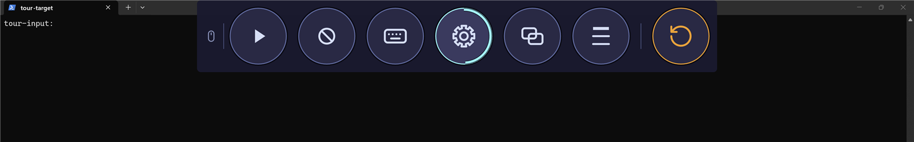
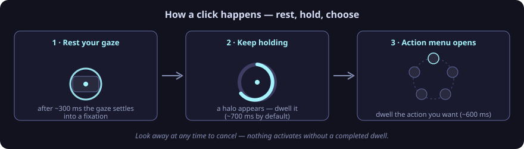
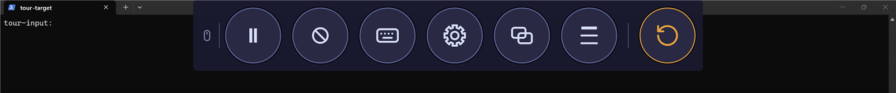
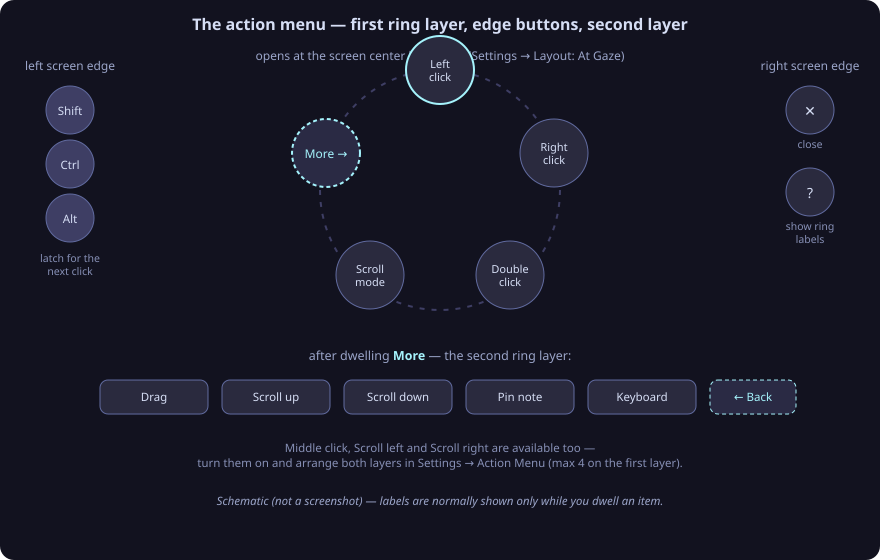
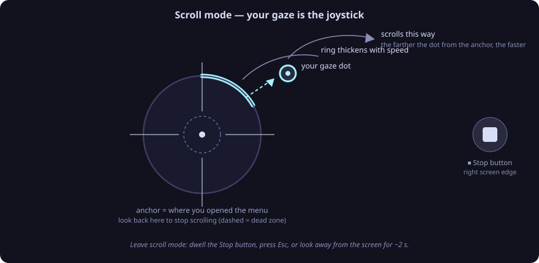
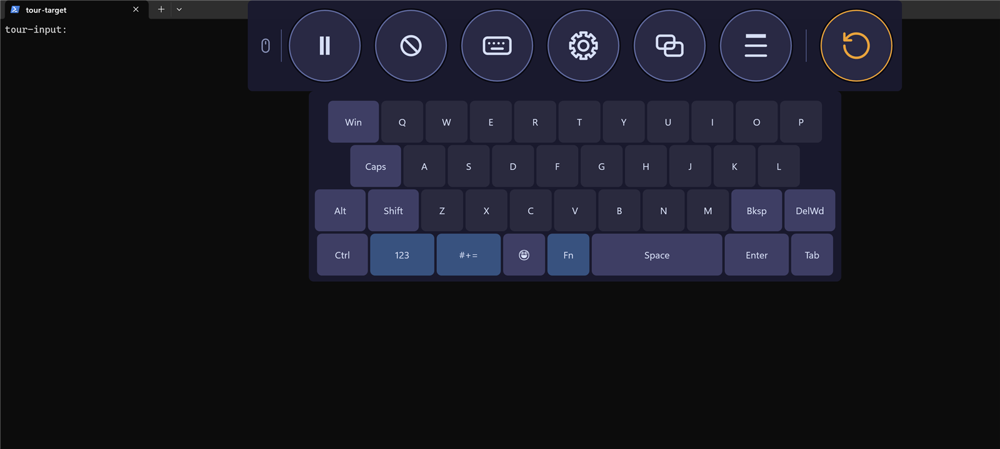
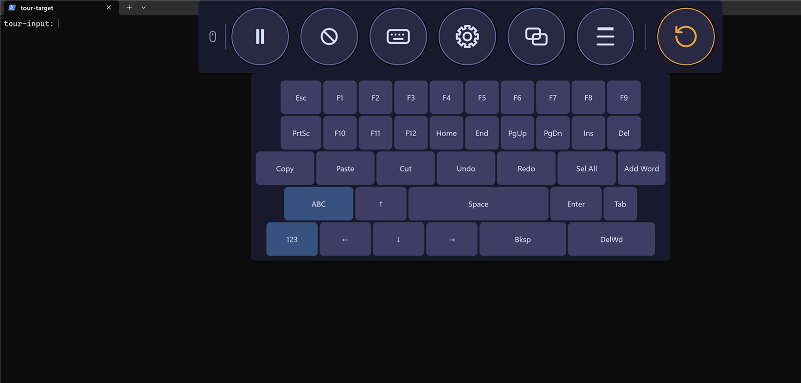
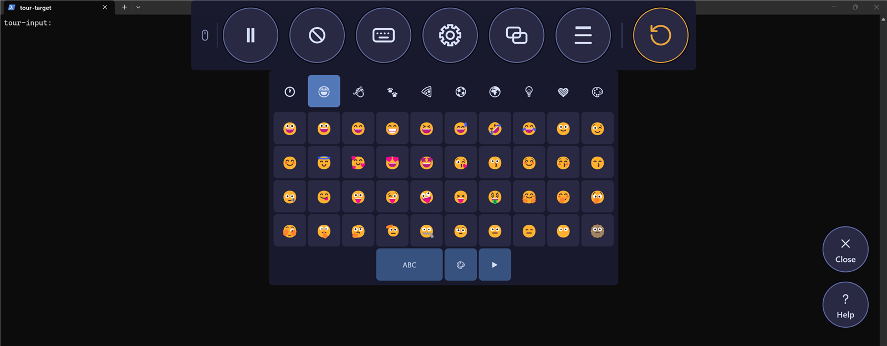
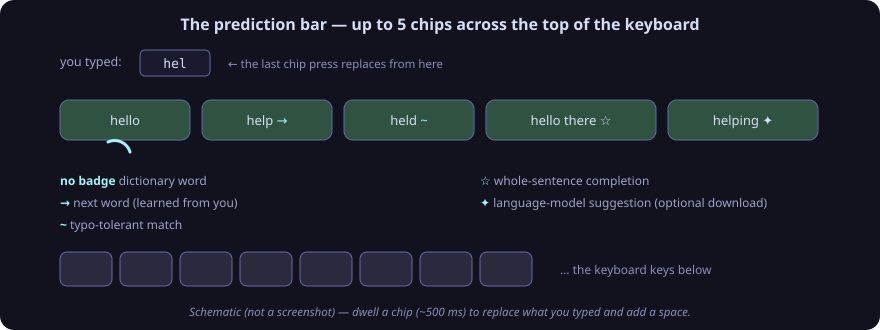

# EyeCtrl — User Guide

EyeCtrl lets you control a Windows PC entirely with your eyes. A colored ring follows your
gaze, and *dwelling* — resting your gaze on one spot — activates buttons, clicks, drags,
scrolls, and types on an on-screen keyboard. It is built for the Tobii Dynavox PCEye 5 and
compatible Tobii eye trackers, and it can also run in a mouse mode for testing or for users
who still have some hand control.

This guide describes how to use EyeCtrl as an end user — for yourself or as a caregiver
setting it up for someone. Values marked **default** are what you get after a fresh install
or after pressing a reset button; almost everything can be changed in Settings.

> **About the images:** photographs are real screenshots of the app (default Midnight
> theme); graphics labeled *schematic* are drawn diagrams of the same interfaces.

---

## Contents

1. [What you need](#1-what-you-need)
2. [Starting and quitting](#2-starting-and-quitting)
3. [Gaze control basics](#3-gaze-control-basics)
4. [The toolbar](#4-the-toolbar)
5. [Clicking with the action menu](#5-clicking-with-the-action-menu)
6. [Dragging and dropping](#6-dragging-and-dropping)
7. [Scrolling](#7-scrolling)
8. [Repeat clicks (Modes menu)](#8-repeat-clicks-modes-menu)
9. [Precise aiming: Manual Selection](#9-precise-aiming-manual-selection)
10. [Precise aiming: Auto Selection](#10-precise-aiming-auto-selection)
11. [Pinned notes](#11-pinned-notes)
12. [The task switcher](#12-the-task-switcher)
13. [The on-screen keyboard](#13-the-on-screen-keyboard)
14. [Emoji](#14-emoji)
15. [Word prediction](#15-word-prediction)
16. [Quick Actions](#16-quick-actions)
17. [Calibration](#17-calibration)
18. [Eye care](#18-eye-care)
19. [Adaptation](#19-adaptation)
20. [Themes and appearance](#20-themes-and-appearance)
21. [The Settings window](#21-the-settings-window)
22. [Settings reference](#22-settings-reference)
23. [Language](#23-language)
24. [Crash recovery and the Supervisor](#24-crash-recovery-and-the-supervisor)
25. [Where your data is stored](#25-where-your-data-is-stored)
26. [Troubleshooting](#26-troubleshooting)
27. [Caregiver quick reference](#27-caregiver-quick-reference)

---

## 1. What you need

- A PC with **Windows 10 or 11**. EyeCtrl is designed for a single monitor.
- A **Tobii Dynavox PCEye 5** or another eye tracker that works with the Tobii Stream
  Engine runtime. The tracker software from Tobii must be installed and the tracker
  connected.
- **No tracker? No problem.** EyeCtrl automatically falls back to *mouse mode*, where the
  position of the mouse pointer is treated as your gaze point. Mouse mode is ideal for
  trying EyeCtrl, demonstrating it, or using it with a caregiver moving the mouse.

If you use the published single-file build, keep the `Resources` folder (keyboard layouts,
dictionaries, emoji data, sounds) next to `EyeCtrl.exe` — the app needs those files beside it.

## 2. Starting and quitting

**Start:** double-click `EyeCtrl.exe`. A splash card appears briefly while the overlays get
ready, then the gaze ring starts following your eyes. On the very first run a short
**safety setup** follows: five short questions, one dwellable card at a time, that set the
safety-critical basics — you can run it again any time from Settings → General. If
**Start on Windows Boot** is on (Settings → General), Windows starts EyeCtrl automatically
when you sign in.

Only one copy of EyeCtrl runs at a time — starting it again does nothing.

**Quit:** there is no Exit button on the toolbar — quitting goes through the Windows tray
menu, which is a normal Windows menu, not an EyeCtrl dwell surface. By gaze (this should
work with EyeCtrl's ordinary clicks; it has not been verified end-to-end): look at the
EyeCtrl tray icon — on Windows 11 it may sit behind the taskbar's **^** overflow arrow,
which opens the same way — complete an activation there and dwell **Right click** in the
action menu; then fixate **Exit** in the tray menu that opens and complete another
activation with **Left click**. By mouse: a caregiver should **pause EyeCtrl first** (the
pointer otherwise follows the user's gaze), then right-click the tray icon and pick
**Exit**. Quitting gives the mouse and keyboard back to Windows.

**System tray:** the EyeCtrl icon sits in the Windows notification area. Right-click (or have
a caregiver right-click) it for:

| Tray item | What it does |
|---|---|
| **Pause / Resume** | Toggles gaze tracking (see [Basics](#3-gaze-control-basics)) |
| **Settings** | Opens the Settings window (double-clicking the tray icon does the same) |
| **Sprache / Language** | Jumps straight to the language setting |
| **Reset adaptation** | Clears everything Adaptation has learned |
| **Show toolbar** | Force-shows the auto-hidden toolbar (only offered when the toolbar auto-hides) |
| **Exit** | Quits the app |

**Command line** (mainly for caregivers and testing): `--test-mode` starts in mouse mode
without the splash screen, `--paused` starts paused for this run only, and
`--ui-language de|en|system` switches the interface language.

## 3. Gaze control basics

**The gaze ring.** A colored ring follows your gaze everywhere. Its size, color, thickness,
and opacity are yours to choose (Settings → Cursor). Three ring styles keep it visible on
any background: *Weighted sandwich* (default), *Bi-tonal segments*, and *Achromatic
reticle*.

**Dwell = rest your gaze.** To press anything in EyeCtrl — a toolbar button, a keyboard key,
a settings row — just look at it and hold still. A progress indicator fills while you dwell;
when it completes, the control activates. A brief glance away (under about half a second)
doesn't cancel a dwell — only a sustained look-away does (keyboard keys excepted — see
[section 13](#13-the-on-screen-keyboard)).

*A dwell in progress: the arc fills around the button as you hold your gaze on it.
Captured on an earlier build: the ▶ shows the app was paused at capture time, the seventh
(reset) button shows Adaptation was on, and the small provider glyph at the left end of
the band has since been removed.*

**How a click happens.** Rest your gaze where you want to act:

1. After about **300 ms** (default) your gaze registers as a *fixation* and a round
   **activation button** appears **just beside your gaze ring, diagonally toward the middle
   of the screen** (Settings → Dwell Times names its dwell time "Activation Button").
2. **Move your eyes onto the button** and hold (about **700 ms** default) until it
   completes — the **action menu** opens, in the middle of the screen by default (see
   [section 5](#5-clicking-with-the-action-menu)). Be reasonably quick: if you don't look
   at the button, it disappears again after about ¾ of a second.
3. Dwell the action you want, for example **Left click**. The action lands at the point you
   fixated in step 1 — not at the button.

**Dwell times** (defaults; every one is adjustable in Settings → Dwell Times):

| Where | Default dwell |
|---|---|
| Fixation detection | 300 ms |
| Activation button (opens the action menu) | 700 ms |
| Action menu items | 600 ms |
| Toolbar buttons | 700 ms |
| Keyboard keys | 450 ms — keys that can leave the app or destroy work (Enter, Tab, Esc, Del, Ins, F1–F12 and the Fn shortcut keys) use 600 ms |
| Prediction chips | 500 ms |
| Resume disc (while paused) | 1000 ms |

After any activation there is a short **cooldown** (**400 ms** default) during which the same
target cannot fire again — so one long look is one activation, not several. On the keyboard
the rule is different: a key that has just fired cannot fire again until your gaze has
continuously left it for about 120 ms — to repeat a key, glance away for a moment and back
(see [section 13](#13-the-on-screen-keyboard)).

**Sound feedback.** An optional **Dwell Completion Sound** (off by default) plays a soft
tone whenever a dwell activates on EyeCtrl's own buttons, menus, and settings. The keyboard
has its own key click sound, on by default. Wherever the cursor ring is visible, an
activation also makes it take one brief flash (the **Dwell Completion Highlight**, on by
default) — activations inside the action menu or settings (where the ring is hidden) don't
flash, keyboard keys never flash, and inside the magnifier the rim flashes instead when an
offer is accepted.

**Pause.** Dwelling **Pause** on the toolbar (or the tray item) suspends gaze control: the
ring disappears, and a thin strip along the docked screen edge marks that EyeCtrl is
paused — with a round **Resume disc (▶)** sitting on it. Look at the disc and hold (about
1 s by default) to resume. If your eyes were already resting on it, look away for a moment
and come back — the disc only arms after you leave it. The toolbar itself is hidden while
paused; the strip is the way back. (The band hides only while it auto-hides — a real
tracker, docked; if the toolbar is showing, because docking is off or in mouse mode, its ▶
button is the way out.) Pausing also ends any active mode — a drag is cancelled, and
scroll and repeat modes exit. While paused, the toolbar band and its Modes menu (when the
band is showing), the resume affordances, and a few dismissal surfaces (the task switcher,
closing the quick-actions grid) answer to gaze.
Pause is also how you hand the mouse to a caregiver — see below.

**The Windows pointer follows your gaze.** While you look around, the system pointer rides
along with the gaze ring (it holds still only while an activation button is showing). A
caregiver who wants to use the physical mouse should therefore **pause first** — or ask
you to look away; the physical keyboard always works normally. In mouse mode the pointer
*is* the gaze point. If the tracker loses you entirely, a small status banner appears
(for example "Eye tracking lost" or "No eye tracker") so you can see why gaze isn't
responding — and if the tracker stays disconnected for more than ten seconds, a short
**Disconnect Chime** plays once (on by default).

### Getting unstuck

No mode can trap you — each has several ways out:

| If you are… | Ways out |
|---|---|
| Scrolling | Look back at the anchor to **stop** · dwell the ⏹ Stop button (right screen edge) or press **Esc** to **leave** scroll mode · losing gaze for ~2 s exits too |
| Mid-drag | Hold still ~½ s to drop where you look · dwell the drop disc on your gaze point · dwell ✕ (right screen edge) or press **Esc** to **cancel** back to the grab point |
| In a repeat-click mode | Dwell the ⏹ Stop button (right screen edge) · dwell the same mode again · press Esc · losing gaze for ~2 s |
| Action menu open | Dwell ✕ (right screen edge) · press Esc |
| Inside the magnifier | Dwell ✕ (right screen edge) · press Esc — the second edge button is Recapture, not an exit |
| Calibrating | Dwell the ✕ Cancel disc |
| In an eye-care exercise | Dwell the Skip disc |
| In the task switcher | Dwell the ✕ disc in the bottom hint row — it hides the switcher without switching (also works while paused, and is the only exit when no windows are listed) · or dwell a window's tile to switch away |
| Paused | Dwell the ▶ Resume disc on the edge strip (~1 s) — or, if the toolbar is showing (docking off / mouse mode), just dwell its ▶ |

And two backstops that always apply: **pausing hands the mouse to a caregiver** (the
pointer otherwise follows your gaze), and a physical **Esc** key press leaves the action
menu, manual selection, a drag, scroll mode, and repeat mode from anywhere in the system.

## 4. The toolbar

The toolbar is the band of large dwell buttons you reach for everything. By default it
**docks to the top edge** and **auto-hides**: with a real eye tracker connected, it slides
out of view after a moment and slides back in when you look at its docked edge. You can also
summon it from the tray (**Show toolbar**), turn docking off entirely, or dock it to the
bottom, left, or right edge (Settings → Toolbar). Button size is adjustable (default 120).

*The toolbar — captured on an earlier build with Adaptation enabled, hence the seventh
(reset) button; today's default band shows six and no longer carries the small provider
glyph that sat at the band's left end.*

| Button | What it does |
|---|---|
| **Pause / Resume** | Toggles gaze tracking (icon flips between pause and play) |
| **Selection mode** | Cycles *None → Manual Selection → Auto Selection → None* (see [sections 9–10](#9-precise-aiming-manual-selection)); off by default |
| **Keyboard** | Shows / hides the on-screen keyboard |
| **Settings** | Opens the Settings window |
| **Task switcher** | Shows open windows as full-screen tiles (see [section 12](#12-the-task-switcher)) |
| **Modes** | Opens the repeat-clicks menu (see [section 8](#8-repeat-clicks-modes-menu)); its icon changes while a repeat mode is active |

A seventh button, **Reset adaptation** (clears what Adaptation has learned), joins the band
only while Adaptation is enabled.

While the keyboard is open, the toolbar makes room for it — and while other overlays own the
screen (settings, calibration), the toolbar steps back.

## 5. Clicking with the action menu

When you complete an activation (see [Basics](#3-gaze-control-basics)), the **action menu**
opens — a ring of action buttons (a different ring from your gaze ring), placed by default
at the **screen center**, or right at your gaze point if you set Position to *At Gaze*
(Settings → Layout). Each dwell on the ring activates that action at the point you were
looking at.

**First ring layer** (defaults): **Left click, Right click, Double click, Scroll Mode**, plus
a **More** button. **More** flips the ring to the **second layer**: **Drag, Scroll Up,
Scroll Down, Pin note, Keyboard**, plus a **Back** button to return. Which actions appear,
and which sit on the first layer (up to four fit), is fully configurable in
Settings → Action Menu.

**While the ring is open:**

- **Right screen edge** shows a **✕ Close** button (dismisses the menu) and a **? Help**
  button that toggles the ring's labels on and off — labels are normally shown only while
  you dwell an item.
- **Left screen edge** shows **Shift, Ctrl, Alt** buttons. Dwelling one latches it for the
  next click — for example latch **Shift** then **Left click** to Shift+click. The latch
  clears when the menu closes.

The default dwell for ring items is 600 ms (the manual-selection variant uses its own
setting, also 600 ms by default).

## 6. Dragging and dropping

1. Open the action menu where you want to **grab**, and dwell **Drag**.
2. An amber **drag trail** follows your gaze as you move — you are now holding the item. A
   round **drop disc rides on your gaze point** the whole way — except over an exit: while
   your gaze rests on the ✕ or Back zone at the right screen edge, on the pause zone, or off
   screen, the disc is hidden and nothing can drop. Those no-drop zones are twice the
   button's radius wide, so a look just beside the ✕ cannot drop the item — only dwelling
   the ✕ itself cancels.
3. To **drop**, either hold your gaze still — resting within a small radius (default
   40 px) for about half a second (default 500 ms) — or dwell the **drop disc** sitting
   right on your gaze point. To **cancel** instead (the item goes back where you grabbed
   it), dwell the **✕ at the right screen edge** or press **Esc**. With Manual Selection
   on, holding still first opens a precise-drop view with a **Back** button. A drop that
   settles with the drop disc touching the top, left or right screen edge (within one disc
   radius) is released ON that edge — Windows maximizes the dragged window at the top edge
   and half-snaps it at the sides, so snapping finally works by gaze; the bottom edge never
   snaps (the taskbar lives there). Every other drop lands where you settled, as described.

If the tracker loses your eyes for more than about two seconds mid-drag, the drag is
**cancelled** — the item is released back where you grabbed it, so nothing gets dropped in
the wrong place while you cannot see the trail.
Drag trail color and opacity, and the settle time and radius, are in Settings → Advanced.

## 7. Scrolling

**Scroll Mode** (on the ring's first layer by default) turns your gaze into a joystick:

- The point you were looking at when you chose Scroll Mode becomes the **anchor**, marked
  with a crosshair and a wide **start circle**.
- **Look back at the anchor to stop.** Look away from it in any direction to scroll that
  way — the farther you look, the faster it scrolls. A small dot shows your joystick
  position, and the accent ring thickens with speed. Scrolling only *arms* after you hold
  your gaze inside the start circle for a fraction of a second, so a stray glance past the
  anchor can't set anything moving.
- **To leave scroll mode:** dwell the **⏹ Stop button** at the right screen edge, press the
  physical **Esc** key, pause, or simply look away from the screen for about two seconds.

Scroll sensitivity (default 1.0, range 0.5–2.0) is in Settings → Advanced. The ring's second
layer also offers one-shot **Scroll Up / Scroll Down** actions (and optional Scroll Left /
Scroll Right, off by default) for a single flick without entering scroll mode.

## 8. Repeat clicks (Modes menu)

When you need the *same* click several times in a row — paging through a list, ticking many
checkboxes — lock a repeat mode:

1. Dwell **Modes** on the toolbar. Four icon buttons appear under it: left click, right
   click, double click, middle click.
2. Dwell the click you want. Every activation now performs that click directly — no action
   menu in between. The toolbar's Modes icon shows which mode is locked.
3. To unlock: dwell the **⏹ stop button** at the right screen edge, dwell the same mode
   again (or pick a different one), or press Esc — and if the tracker loses your eyes for
   about two seconds, the mode unlocks by itself.

While a repeat mode is locked, a slightly smaller companion ring follows your gaze as the
repeat cursor; every activation performs the locked click right where you were looking.

## 9. Precise aiming: Manual Selection

Small targets are hard to hit with gaze alone. **Manual Selection** (toolbar → Selection
mode, or Settings → Selection) magnifies before you commit:

1. Activate **near** your target (fixate, then move your eyes onto the activation button
   that appears beside the ring, and dwell it).
2. A **magnifier** appears — a circular window showing a zoomed picture of that screen
   region (default zoom 4.0×, radius 100 px; adjustable); its rim flashes once to mark the
   accepted offer.
3. Look at the exact spot inside the zoom. After a short settling moment a small **anchor**
   crosshair marks the spot; dwell it (default 600 ms) to commit.
4. The action menu opens (screen centre by default), with the zoomed preview of your
   precise point in its middle so you can confirm. Dwell the action you want — it lands at
   your precise point.

Two helpers make this forgiving: a **grace period** (default 500 ms) ignores your first
glance so you can orient, and **hold tolerance** (default 72 px) lets your gaze wobble
without resetting the dwell — because tolerance is measured on screen, not in the zoom,
wobbling looks 4× smaller to EyeCtrl at 4× zoom. That is where the precision comes from.

At the right edge: **✕ Close** leaves manual selection, and the **recapture** button takes a
fresh screenshot (e.g. if the screen content changed). A **Back** button on the action menu
returns to the magnifier without committing.

## 10. Precise aiming: Auto Selection

**Auto Selection** (toolbar → Selection mode) snaps to controls for you. When you activate,
EyeCtrl asks Windows what *interactive control* is under that point — a button, link, text
box, menu item, checkbox, list item, and so on, in any application that exposes them
(including non-Microsoft apps and web browsers). If one is found:

- a **highlight rectangle** marks the control, and
- the action menu opens (screen centre by default), and your chosen action is performed at
  the control's centre — not at your raw, slightly-off gaze point.

If nothing interactive is exactly under the point, EyeCtrl searches outward in rings
(default 48 px) and can finally fall back to the whole window or the raw pixel (the snap
radius is adjustable in Settings → Selection).

## 11. Pinned notes

**Pin note** (action menu, second layer) drops a sticky note at the point you were looking
at — up to 8 at a time. A note can be **edited** with the on-screen keyboard, **moved** to
a new spot, **closed**, and the last close can be **undone**; notes stay on top of
everything. Use them to leave yourself (or a caregiver) a message right where it matters.

## 12. The task switcher

Dwell **Task switcher** on the toolbar (or configure it as a Quick Action) and every open
window appears as a large tile with its app's icon. Dwell a tile to switch to that window.
Only the tiles the screen actually shows answer to your gaze, though: a tile clipped at the
bottom edge is dwellable only on its drawn part — dwelling its hidden remainder, such as
the strip under the bottom hint row, does nothing — and tiles outside the view do not
respond at all; the tile area cannot be scrolled. A ✕ disc sits at the bottom centre of the
screen, directly beside the "Select a window — or ✕ to cancel" hint. Dwelling it hides the
switcher without switching — it also works while paused, and it is the only exit when no
windows are listed. The switcher covers the screen, so nothing small needs to be hit.

## 13. The on-screen keyboard

Dwell **Keyboard** on the toolbar (or the ring's **Keyboard** action) to show or hide it. By
default it sits along the **bottom** of the screen; the **flip button** at the right edge
moves it to the top and back, and the **✕** button hides it. You can also flip it permanently
in Settings (Screen Edge: Bottom / Top).

**Layouts and pages.** Three physical layouts ship: **QWERTY** (default), **QWERTZ**, and
**AZERTY**. Each has pages along the bottom row:

*The letters page — QWERTY here, shown docked at the top edge with the toolbar above it
(the default dock is the bottom edge; the flip button swaps them). The toolbar in these
captures is an older build (seven buttons, provider glyph); the right-edge buttons
(close/flip) sit outside the crop, and the prediction row appears only once you type. The
photo also shows the earlier letters page — Win at the top-left, DelWd at the third row's
end, 😀 and Tab on the footer, no comma/period keys; the letters page has since been
rearranged as described in this section.*

- **ABC** — letters. The delete-word key (**DelWd**, **Aa** on QWERTZ) is the top-left key;
  **Caps** sits at the second row's left and **Alt** and **Shift** at the third row's left,
  while **Win** and **Ctrl/Strg** sit at the footer's left. **Shift,
  Ctrl, Alt and Win apply to the next key only**, then release themselves — dwell one a
  second time to cancel it before you use it. (Believing Ctrl is still latched when it
  isn't — or dwelling it again to "release" it, which re-arms it — is how an ordinary
  letter turns into a shortcut like Ctrl+W.) **Caps** stays on until you dwell it again.
  The footer row reads Win · Ctrl/Strg · Tab · 123 · Fn · #+= · , · Space · . · Enter —
  the letters page itself now carries plain comma and period keys.
- **123** — numbers; **#+=** — symbols. QWERTZ and AZERTY add an accents page with accented
  characters — its switch key no longer sits on the letters page but on the **#+=** page's
  footer, labelled **àé** on QWERTZ, **Acc** on AZERTY.
- **Fn** — Esc, F1–F12, Print Screen, Home / End / PgUp / PgDn / Ins / Del, the arrow keys,
  and one-dwell shortcuts: **Copy, Paste, Cut, Undo, Redo, Sel All**, and **Add Word**
  (teaches your current text to the prediction dictionary, see below). The Fn page also
  carries the modifier keys — **Win** and **Alt** at the end of its first row, **Ctrl/Strg**
  and a visible **⇧ Shift** at the end of its second row — so an armed modifier (including
  an armed Shift) stays visible and can be cancelled by dwelling it again even after you
  switch to Fn.
- **😀** — not a page of its own in the bottom row: the 😀 switch key sits on the **123**
  and **#+=** pages' footers, and dwelling it opens the emoji keyboard (next section).

*The Fn page: function and navigation keys, one-dwell shortcuts, and the Add Word key
(right-edge buttons outside the crop). The photo predates the Fn page's modifier keys —
today's Fn page ends its first row with Win and Alt and its second row with Ctrl and
⇧ Shift.*

Handy special keys on the main pages: **Bksp** (backspace) and **DelWd** (delete whole
word). On the QWERTZ layout the keys carry German labels instead — **Strg** (Ctrl), **⇧**
(Shift), **⬆** (Caps), **⌫** (backspace), **Aa** (delete word), **⌴** (space), **↵**
(enter), **⇥** (tab) — the Fn navigation keys read **Druck, Pos1, Ende, Bild↑, Bild↓,
Einfg, Entf**, and the Fn shortcuts read **Kopieren, Einfügen, ✂, ↶, ↷, Alles mark.** and
**+ Wort** (add word).

**Sizing and sound.** Keys scale from 0.5× to 2.0× (default 1.0×, Settings → Keyboard), and
a click sound plays on every key (on by default).

**Blinks are safe.** A momentary loss of tracking (up to about 150 ms) over a key is
credited as still looking — but it is never enough on its own, so a single blink cannot
complete a key press you didn't intend.

**One look fires a key once.** After a key fires it cannot fire again until your gaze has
continuously left it for about 120 ms — glance away for a moment and back to repeat it.
The same guard applies when the keyboard appears under your already-resting gaze: keys that
materialize where you are already looking will not fire until you glance away and back.

## 14. Emoji

Dwell the **😀** key on the **123** or **#+=** page's footer. The keyboard switches to an
emoji grid with a category bar on top:

- **🕒 Recents** comes first (your last 40 emoji), then eight categories — Smileys & Emotion,
  People & Body, Animals & Nature, Food & Drink, Activities, Travel & Places, Objects,
  Symbols — and a **🎨 skin-tone** picker at the end.
- The grid shows 40 emoji per page; ◀ / ▶ page through.
- Dwelling an emoji types it immediately and stays in emoji mode, so you can type several
  in a row. Dwell the wide **ABC** button to return to letters.

*Emoji mode: the category bar across the top (Recents first), the emoji grid, and the ABC
button to return to letters (right-edge buttons outside the crop).*

The 🎨 picker offers six skin tones; your choice is remembered and applied to all emoji
that support tones.

## 15. Word prediction

With prediction on (default), a **row of suggestion chips** sits across the top of the
keyboard. Dwell a chip (default 500 ms) and it replaces what you typed so far — including
whole sentences — and adds a space.

Up to **5 chips** (1–5, default 5) merge everything EyeCtrl knows:

- the **frequency dictionary** for your language — English, German, Spanish, French, or
  Polish (detected automatically by default, or fixed in Settings → Keyboard),
- **words you typed or accepted** (your personal dictionary; manage or clear it in
  Settings → Keyboard, or add instantly with the Fn-page **Add Word** key — **+ Wort** on
  QWERTZ),
- **next-word** and **phrase** suggestions learned from what you type,
- typo-tolerant matches for when the gaze keyboard hit a neighboring key, and
- **whole-sentence completions** and, if you download one, suggestions from a **language
  model** (Settings → Models: a compact ~270 MB model, a ~725 MB model, and a larger
  Qwen 1.5B model; downloads are checksum-verified). Model suggestions arrive
  asynchronously — the keyboard never waits for them, and the bar shows a short "loading
  predictions" note while a model warms up. Choosing **Off** simply returns you to
  dictionary-only prediction.

## 16. Quick Actions

Quick Actions are one-dwell shortcuts you summon from a screen edge — no toolbar trip
needed.

**Summon:** look at your **left screen edge** (default) and hold for about 400 ms. A grid of
large tiles slides out. **Dismiss:** look away for about 5 seconds (a blink counts too), or
dwell its ✕ button.

**What goes in the grid** is up to you — it starts **empty** on a fresh install
(Settings → Quick Actions): keyboard shortcuts
(Copy, Cut, Paste, Undo, Redo, Select All, Save, Find, New, Print, Show Desktop, Lock…),
media controls (play/pause, stop, next, previous, volume, mute), launching installed apps,
and window actions (minimize, maximize/restore, close, switch app). Each tile can be
enabled, disabled, or deleted; the grid is 2–5 columns wide (default 3).

## 17. Calibration

Gaze trackers drift — head position, glasses, and lighting all shift where the tracker
thinks you are looking. If the ring consistently lands slightly off where you actually look,
calibrate.

**Settings → Calibration → Calibrate Now** runs a short guided session: dots appear at
points around the screen (default 5 points); simply look at each one until it moves on.
A report shows the date and the remaining error in pixels, and the correction is stored
per monitor. **Clear Calibration** removes it again.

Also on that page:

- **Measure Gaze Offset** — a five-point probe that only *reports* how far off your gaze
  lands; it changes nothing.
- **Points, samples, hold time, settle window, target color** — tuning knobs if the standard
  session is too fast, too slow, or hard to see.

You don't need to hunt for drift yourself: when EyeCtrl notices a growing offset it shows a
brief **drift notice** at the bottom of the screen suggesting a re-calibration.

## 18. Eye care

Looking is your only input — EyeCtrl helps you protect it. Eye care is **off by default**
(Settings → Eye Care):

- **Break reminders:** every 20 minutes (default) a banner offers **Start** (begin a guided
  exercise) or **Snooze** (5 minutes by default). Breaks can also end naturally after the
  natural break length (default 30 s).
- **Guided exercises** (45 s default) move a dot for your eyes to follow — gaze exercises
  such as 20-20-20 distance breaks, directional sweeps, near–far focus, saccades, and smooth
  pursuit. Each ends with a short scored summary (accuracy, steadiness, reaction time).
- **Fatigue escalation** (experimental, off): watches for tiring gaze patterns and can
  escalate reminders when fatigue is detected (threshold default 0.75).

## 19. Adaptation

Adaptation (off by default) tunes EyeCtrl to you while you work. When it detects that you
are struggling — missed targets, abandoned dwells — it gently adjusts within limits you
control: it can lengthen or shorten dwell times, widen targeting tolerance, ease smoothing,
and enlarge dwell targets. A small cue can show when adaptation steps in, and adaptation is
automatically suppressed in sensitive contexts (like the keyboard's destructive keys).

Settings → Adaptation offers three postures — **Conservative** (default), **Balanced**,
**Responsive** — per-dimension on/off switches and safety limits, plus:

- **Reset Learned Offsets** — clears what adaptation has learned (also on the tray menu),
- **Open Adaptation Log** — a diary of what adaptation did and when,
- **Caregiver alerts** — can notify a caregiver when adaptation keeps having to intervene
  (minimum interval 10 min by default).

## 20. Themes and appearance

Four themes ship (Settings → General; a restart applies a new theme):

- **Midnight** (default) — dark, cool, cyan accents.
- **Ember** — dark and warm.
- **Daylight** — light theme for bright rooms.
- **Contrast** — maximum-contrast black and white.

Colors that follow the theme can be personalized with four swatches each (Accent, Green,
Warning, Text): the **gaze ring color** (Cursor tab), the **auto-selection highlight**
(Selection), the **calibration target** (Calibration), and the **drag trail** (Advanced).
The darkened **backdrop** behind the keyboard and menus (**Glass** by default, or Solid
Darken with its own opacity) is in Settings → Advanced.

## 21. The Settings window

Open it from the toolbar or tray. Everything is gaze-operable: rows dwell like any button,
the window fills most of the screen, and long pages **paginate** with Previous / Next page
buttons instead of scrolling — pages always show `n / m` so you know where you are.
Changes apply immediately and are saved automatically.

At the top, the mode toggle switches between:

- **Basic** — four tabs with just the everyday options (Cursor, Dwell Times, Keyboard,
  General), and
- **All settings** — every tab, for full control.

The choice is remembered. Every tab ends with its **Reset ⟨tab⟩ Settings** button — except
the Advanced tab (All-settings mode only, and only when EyeCtrl is installed), where the
Update / Rollback / Uninstall rows follow after Reset (see
[section 22](#22-settings-reference)). General additionally has **Reset ALL Settings**
(advanced mode only). The window title is "EyeCtrl Settings"; its ✕ closes it.

## 22. Settings reference

Fifteen tabs in All-settings mode. Defaults in parentheses.

### Cursor — smoothing and the ring
Filter mode (One Euro) · Smoothing factor (0.5) · Circle color (theme accent) · Ring style
(Weighted sandwich) · Circle opacity (1.0) · Circle thickness (1) · Gap interpolation
(150 ms — bridges tracker dropouts) · Position indicator (Crosshair) · Circle size
(250 px) · One Euro min cutoff (1.5) / beta (20) — the adaptive filter's responsiveness ·
Reset.

### Dwell Times
Per-surface dwell times (see [section 3](#3-gaze-control-basics) for the list) · Resume
Strip (1000 ms) · Manual Selection Side Buttons (600 ms) · Fixation radius (75 px — how
far gaze may drift within one fixation) · Dwell cooldown (400 ms) · Look-Away Grace
(500 ms — the brief-glance forgiveness §3 describes; keyboard keys don't get it) · Dwell
completion sound (Off) · Dwell Completion Highlight (On — the cursor ring flashes briefly when a dwell
fires) · Disconnect Chime (On — plays once when the tracker has stayed disconnected for
over ten seconds) · Reset.

### Selection
Selection mode (None) · Manual selection: circle radius (100 px), magnification (4.0×),
grace period (500 ms), hold tolerance (72 px) · Auto selection: snap search radius (48 px) ·
Highlight color (accent) and thickness (3) · Gaze-ring appearance
inside the magnifier · Reset animation (100 ms).

### Action Menu
Ring preview · Per-action visibility: Left / Right / Double / Middle click, Drag, Scroll
Up / Down / Left / Right, Scroll Mode, Pin note, Keyboard (Middle, Scroll Left, Scroll
Right off by default) · Which actions sit on the first layer (max 4; default Left, Right,
Double, Scroll Mode) · Note text size (28) · Reset.

### Layout
Where the action menu and magnifier open: **At Gaze** or **At Center** (default At Center) ·
Reset.

### Keyboard
Active layout (QWERTY) · Key size (1.0×) · Word prediction (On) · Max predictions (5) ·
Dictionary language (auto-detect; EN/DE/ES/FR/PL) · Click sound (On) · Show loading hint
for predictions (On) · Guard the first key after the keyboard moves back (On) · Screen edge
(Bottom) · Learned-words list with per-word remove and Remove ALL · Reset.

### Models
Language models for prediction: download the compact (~270 MB), large (~725 MB), or
Qwen 1.5B model
with progress and integrity check, add a custom model by URL, delete models, switch the
active model, or turn models **Off** (dictionary-only prediction). A broken model offers a
repair re-download.

### Toolbar
Dock to screen edge (On) · Docked edge (Top) · Button size (120) · Reset.

### Calibration
Calibration points (5) · Samples per point (15) · Target hold (1000 ms) · Settle window
(300 ms) · Target color (accent) · Last-calibration status · **Calibrate Now** ·
**Measure Gaze Offset** · **Clear Calibration**.

### Eye Care
Enable (Off) · Break interval (20 min) · Natural break length (30 s) · Exercise duration
(45 s) · Break Banner Buttons (0 = follows the Activation Button dwell) · Banner
auto-snooze (15 s) · Snooze length (5 min) · Fatigue escalation (Off) · Fatigue threshold
(0.75) · Reset.

### Adaptation
Enable (Off) · Posture (Conservative) · Adapt dwell time / targeting tolerance / smoothing /
target size (all On) · Show adaptation cue (On) · Suppress in sensitive contexts (On) ·
Caregiver alerts (Off, min interval 10 min) · Per-dimension limits (dwell 0.40 / 0.50,
tolerance 0.50, smoothing 0.50, target size 0.50 with 100 px growth cap) · Reset settings ·
**Reset Learned Offsets** · **Open Adaptation Log**.

### General
**Sprache / Language** (System — always the first row) · Theme (Midnight; restart to apply) ·
Start on Windows Boot (Off) · Start Paused (Off) · Show Track Status (Off — a small corner
box with live tracker status) · Run Safety Setup Again (button — the same five questions as
the first launch) · Automatic Crash Recovery (Off; see
[section 24](#24-crash-recovery-and-the-supervisor)) · Restart Notice Button (0 = follows
the Activation Button dwell) · Restart Now · Reset General Settings ·
Reset ALL Settings (advanced mode only).

### Quick Actions
Enable (On) · Summon edge (Left) · Summon threshold (400 ms) · Dismiss timeout (5000 ms) ·
Grid columns (3) · Your list of actions: add (keyboard shortcut / media control / launch
app / window action), enable/disable, delete.

### Advanced
Backdrop (On, Glass; Solid Darken opacity 0.3) · Drag settle dwell (500 ms) / radius
(40 px) · Drag trail color (amber) / opacity (0.7) · Scroll sensitivity (1.0) · Repeat dwell
(600 ms) · Button dwells: Backdrop Hide / Drag Release / Drag Edge / Scroll Stop /
Repeat Stop (600 ms each) · External dwell (On, 800 ms, 400 ms cooldown — for other apps
that opt into EyeCtrl dwell) · Reset.

In All-settings mode — and only when EyeCtrl is installed — three rows follow after Reset:

- **Install update** — appears only when an update is waiting, with the description
  "Version ⟨v⟩ is ready (installed: ⟨v⟩). EyeCtrl closes briefly and restarts on its own."
  beneath the button; dwelling it asks "Install the update to version ⟨v⟩?" with
  **Install now** / **Later**.
- **Restore previous version** — appears when a previous version exists, described as
  "Switches back to version ⟨v⟩. EyeCtrl restarts on its own."; confirming asks
  "Switch back to version ⟨v⟩?".
- **Uninstall EyeCtrl…** — the danger row, described as "Removes EyeCtrl from this PC. It
  asks first whether settings and logs stay."

While EyeCtrl checks the update inbox, a plain display-only line "Checking for update…"
holds the update row's place — it is not a button and dwelling it does nothing, so the rows
never shift. If Windows policy would show a confirmation gaze cannot reach, one line
replaces both the update and rollback rows: "Updates currently need a Windows confirmation
that gaze cannot reach. Please get the caregiver." If Setup cannot be launched, the error
reads "EyeCtrl.Setup could not be started. Please get the caregiver."

Dwelling **Uninstall EyeCtrl…** hands over to EyeCtrl.Setup's own uninstall window — while
it is up, Settings hides itself (your toolbar, ring and quick actions stay usable), and
Settings returns onto the Advanced tab on every ending that does not remove EyeCtrl:
cancel, Keep, Esc, closing the window, the 5-minute timeout, a refusal, a failure or an
unknown outcome. Only a completed uninstall leaves Settings hidden, because Setup ends the
App.

### Diagnostics
Record raw gaze (Off — opt-in trace of where you looked; stays on this PC) · Measure UI
timing (Off) · Sub-pixel Visibility Test · Open recordings folder · Reset.

## 23. Language

EyeCtrl speaks **English and German**. The language setting (Settings → General, first row;
tray; or the Supervisor window) offers **System** (follows Windows — the default),
**Deutsch**, and **English**. A restart applies a change; until then a small bilingual note
reminds you.

German currently covers the settings window, the app tray, the Supervisor, caregiver
alerts, the drift notice, track status, startup errors, the live overlays (gaze ring,
keyboard, action menu, quick actions), the calibration window, and the eye-care screens.
German also covers the update/rollback notices and the windows EyeCtrl.Setup itself shows
during an update, rollback or uninstall — Setup's progress, result and uninstall-choice
screens follow the App's language setting.
The keyboard's key faces follow the chosen layout (QWERTZ shows German labels), and its
dictionaries and sentence completions are separate from the UI language, covering English,
German, Spanish, French, and Polish.

## 24. Crash recovery and the Supervisor

For a user whose only input is gaze, an app crash can mean being stranded. The optional
**Supervisor** (a small second program, off by default) prevents that. Turn it on with
**Automatic Crash Recovery** in Settings → General (if EyeCtrl reports the Supervisor is
not installed on this PC, that toggle explains it).

While enabled:

- The app checks in with the Supervisor every few seconds.
- If EyeCtrl **crashes or hangs**, the Supervisor relaunches it automatically —
  immediately, then after 5 and 15 seconds if it keeps failing (3 retries within 2
  minutes; a longer 60-second step exists but is only reached if you raise the retry
  count).
- If relaunching keeps failing, the Supervisor starts the **first fallback assistive
  tool it finds**, in your configured order: Tobii Dynavox **TD Control** (Computer
  Control), **Snap Core First**, or Windows built-in **Eye Control** settings — so you are
  never left without a way to communicate.
- It then shows a large dialog with **Retry** (restarts EyeCtrl, starting paused for
  safety) and **Dismiss** (stay with the fallback). A caregiver or the user can operate
  it — and if nobody answers, it tries once more by itself after 60 seconds.

The Supervisor has its own tray icon (tooltip shows its state) and a **caregiver setup
window** (tray → Settings, or double-click) with dwell-friendly controls: language, enable
supervision, start-on-logon, fallback order (read-only), retry and hang-threshold tuning,
and a **Launch EyeCtrl now** button.

Updates, rollbacks and uninstalls run through **EyeCtrl.Setup**, which shows its own
windows: a progress window with stage lines — Checking files, Closing EyeCtrl, Putting the
new version in place, Starting the new version — that has nothing for you to dwell and
closes itself, followed by a result card that also closes by itself: after 10 seconds on
success, after 60 on failure. Uninstall asks on its own screen: **Keep** (the highlighted
default), **Cancel**, and **Delete** — Delete opens a second confirmation screen with the
safe answer sitting directly under your dwell. Every screen only arms about a second after
it appears, so a gaze resting where the window showed cannot fire anything; Esc, closing
the window, or 5 minutes without a choice all count as Cancel — nothing changes.

If the last update was rolled back, degraded or failed, EyeCtrl shows a one-time notice
card at startup: "The last update was rolled back to version ⟨v⟩." — or "Version ⟨v⟩ is
running, but it cannot click in windows with administrator rights (for example Task
Manager). Please get the caregiver." or "The last update to version ⟨v⟩ failed. EyeCtrl
keeps running." Each wording names its version — the one EyeCtrl rolled back to or the
degraded one running, or the version a failed update was trying to install. Because Setup
writes its record late, the card can appear up to about 90 seconds after EyeCtrl starts;
it shows once, then the shown time is remembered
(see [section 25](#25-where-your-data-is-stored)).

## 25. Where your data is stored

Everything stays on this PC, under `%APPDATA%\EyeCtrl` (usually
`C:\Users\<name>\AppData\Roaming\EyeCtrl`):

| File / folder | What it holds |
|---|---|
| `settings.json` | All your settings |
| `calibration.json` | Calibration per monitor |
| `actions.json` | Your Quick Actions |
| `models\` | Downloaded prediction models |
| `logs\` | App and Supervisor logs (kept 7 days); Setup appends its own `setup-*.log` alongside |
| `setup-last.json` | Setup's record of the last update, rollback or uninstall (written by Setup, read by EyeCtrl) |
| `setup-notice-shown.json` | When the startup update notice was last shown |
| Every `user_dictionary_<language>…` file — the dictionary plus its `_bigrams`, `_phrases`, `_casing` and `_timestamps` companions, and any `.bak-inflated` backup | The words, word pairs, phrases and casing variants you typed |
| `recent_emojis.json` | Your recent-emoji list |
| `adaptation-state.json`, `adaptation-log.jsonl` | What Adaptation learned |
| `gaze-recording.csv` + `gaze-recording.groundtruth.json` | The optional raw gaze trace |

The optional **raw gaze recording** (Diagnostics tab, off by default) writes a CSV trace of
where you looked and when — a privacy-sensitive file that never leaves the computer; delete
it at any time. The "recordings folder" the Settings window opens is this same
`%APPDATA%\EyeCtrl` folder.

## 26. Troubleshooting

Stuck inside a mode right now? Jump to [Getting unstuck](#getting-unstuck) in section 3.

| Symptom | What to do |
|---|---|
| No ring, nothing follows my eyes | Most often EyeCtrl is **paused** — look at the edge strip and dwell the ▶ Resume disc. Otherwise it may be mouse mode (no tracker found), where the mouse pointer *is* the gaze point: check that the tracker is connected and its Tobii software runs, then restart EyeCtrl. |
| The ring sits slightly off where I look | Run **Calibrate Now** (Settings → Calibration). Recurring? The drift notice will tell you too. |
| The ring lags or stutters | Increase smoothing (Cursor tab) — e.g. lower the One Euro min cutoff — and check tracker placement/lighting. |
| EyeCtrl starts paused | The **Start Paused** setting is on, or it was relaunched by the Supervisor's safe retry. Dwell the ▶ **Resume disc** on the edge strip (about 1 s), or summon the toolbar from its docked edge and dwell ▶. |
| Second launch does nothing | By design — one instance at a time. |
| Toolbar is hidden and I can't find it | Look at its docked screen edge to summon it, or use tray → **Show toolbar** (mouse mode never auto-hides it). |
| Published exe reports missing files | Keep the `Resources` folder beside `EyeCtrl.exe`. |
| The Automatic Crash Recovery setting says the Supervisor is not installed | Crash recovery needs the Supervisor program on the PC; the setting degrades gracefully without it. |
| Something needs investigating | Logs live in `%APPDATA%\EyeCtrl\logs` (`eyectrl-*.log`, `supervisor-*.log`), kept 7 days — attach the newest to a support request. |

Settings that misbehave can be rolled back per tab (each tab's Reset button) or entirely
(General → Reset ALL Settings), which keeps only your language and Basic/All choice.

## 27. Caregiver quick reference

| Task | Fastest path |
|---|---|
| First setup | Settings → General: language, theme, Start on Boot; Settings → Calibration: Calibrate Now |
| Everyday tuning | Settings mode toggle → **Basic** (Cursor, Dwell Times, Keyboard, General only) |
| Too many accidental clicks | Dwell Times: raise keyboard/toolbar dwells; Calibration for accuracy |
| User gets stranded on crashes | General → Automatic Crash Recovery on; configure retries in the Supervisor tray window |
| Update / roll back / uninstall EyeCtrl | Settings → Advanced (All settings) → **Install update** / **Restore previous version** / **Uninstall EyeCtrl…** — Setup shows its own progress and confirmation windows; if Windows would ask for a confirmation gaze cannot reach, EyeCtrl says "Please get the caregiver" |
| Slow typing | Keyboard: prediction on, consider a model from the Models tab; Adaptation → Responsive |
| Eye strain | Eye Care on; adjust break interval and exercise length |
| Wipe personal data | Delete the files listed in [section 25](#25-where-your-data-is-stored) |
| Try without a tracker | Launch with `--test-mode` — mouse mode, no splash |

---

*EyeCtrl is a private project. Interface labels, defaults, and features described here
match the `main` branch as of commit `b97998e3` (2026-11-12); the keyboard photos are
earlier captures — their captions say what has since changed.*
